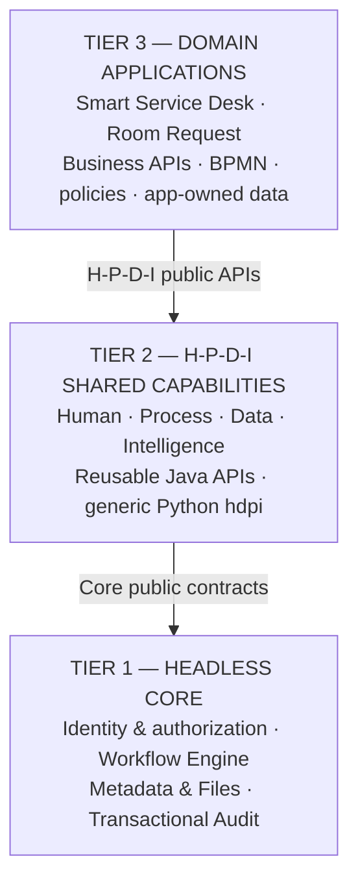

# Smart Service Desk

**Quản lý yêu cầu hỗ trợ, điều phối công việc và hỗ trợ ra quyết định bằng AI.**

Smart Service Desk theo dõi hành trình ticket từ lúc tiếp nhận đến khi người gửi xác nhận kết quả. Sản phẩm được xây dựng trên **kiến trúc DX-OS ba tầng**, tách nền tảng kỹ thuật dùng chung, các capability H-P-D-I và ứng dụng nghiệp vụ để dễ phát triển, bảo trì và tái sử dụng.

[](https://github.com/HaUI-DangSuyNghi/Smart-Service-Desk/releases/tag/v0.1.0)
[](LICENSE)
[](backend/pom.xml)

**Đi tới:** [Tổng quan](#tổng-quan) · [Kiến trúc](#kiến-trúc-dx-os-ba-tầng) · [Quick Start](#bắt-đầu-nhanh) · [AI](#ai-và-phạm-vi-hoạt-động) · [Tài liệu](#tài-liệu-và-bằng-chứng) · [Releases](https://github.com/HaUI-DangSuyNghi/Smart-Service-Desk/releases) · [Contributing](CONTRIBUTING.md)

> **Bản phát hành và nhánh phát triển:** [v0.1.0](https://github.com/HaUI-DangSuyNghi/Smart-Service-Desk/releases/tag/v0.1.0) được công bố ngày **31/10/2026**, từ source commit `ba82b2fc5eb36ea309563d2d7442db95b96a7608`. Tag và source archive đã phát hành không bị sửa. `develop` tiếp tục có thay đổi sau release; không coi tính năng mới là một phần của v0.1.0. **No-AI/manual workflow** là mốc demo được hỗ trợ; các chế độ GPU, Qwen và provider bên ngoài là tích hợp tùy chọn, không được mặc định coi là đã nghiệm thu.

**Quyền sử dụng:** mã gốc nhóm có quyền cấp phép theo [Apache-2.0](LICENSE). Phần dữ liệu, model, ảnh và tài sản bên thứ ba được xét riêng trong [LICENSING.md](LICENSING.md); hai quyền tài sản HaUI mới có xác nhận do trưởng nhóm thuật lại, bằng chứng trực tiếp từ trường vẫn cần lưu trữ. Công bố release không đồng nghĩa có chứng nhận production/security. Xem [PoF evidence](docs/publication/POF_EVIDENCE.md).

## Tổng quan

Ở phòng máy, khoa hoặc đơn vị vận hành CNTT, một yêu cầu hỗ trợ thường đi qua nhiều người: người gửi mô tả sự cố, điều phối viên đánh giá và phân công, kỹ thuật viên tiếp nhận xử lý, người gửi xác nhận kết quả. Khi thông tin thiếu, nhiều yêu cầu trùng hoặc thiếu dấu vết xử lý, công việc dễ bị chuyển nhầm, xử lý lặp và khó theo dõi tiến độ.

**Smart Service Desk** tổ chức quy trình đó thành ticket có định danh, phân quyền theo workspace, lịch sử trạng thái và các điểm phê duyệt rõ ràng. AI hỗ trợ nhận diện ngữ nghĩa, sàng lọc thông tin thiếu, phát hiện tín hiệu trùng và gợi ý phân loại; **quyết định nghiệp vụ quan trọng vẫn được kiểm soát bởi quy tắc, quyền hệ thống và con người**.

Dự án đồng thời là một hiện thực kiến trúc **DX-OS 3 tầng**: Core không biết nghiệp vụ, tầng H-P-D-I cung cấp năng lực tái sử dụng và ứng dụng chuyên ngành sở hữu chính sách riêng. `Room Request` là ứng dụng thứ hai dùng để kiểm chứng khả năng tái sử dụng, không phải một lời khẳng định rằng mọi luồng của nó đã được nghiệm thu E2E.

## Năng lực nổi bật

| Năng lực | Giá trị và giới hạn |
| --- | --- |
| **Quản lý ticket theo vòng đời** | Tiếp nhận, review, phân công, xử lý, hoàn thành, xác nhận hoặc yêu cầu làm lại; các đường đi và guard cụ thể phụ thuộc cấu hình triển khai |
| **Multi-workspace & RBAC** | Keycloak/SSO; phân biệt requester, agent, coordinator, platform-admin; kiểm tra quyền tại server, không chỉ ẩn nút trên UI |
| **Điều phối & tác vụ** | Flowable/BPMN, inbox, đề xuất tổ/người đang trực, ghi nhận START/PAUSE/RESUME và trạng thái công việc |
| **AI có kiểm soát** | Phân loại, tín hiệu thiếu thông tin, gợi ý trùng lặp, hỗ trợ hỏi đáp; rule engine và cơ chế chuyển xử lý thủ công khi kết quả không đủ tin cậy |
| **Tái sử dụng nền tảng** | Core identity, workflow, metadata, tệp và audit; H-P-D-I công bố hợp đồng để ứng dụng không phụ thuộc trực tiếp chi tiết nội bộ |
| **Có thể kiểm thử và truy vết** | OpenAPI, source boundary checks, test và tài liệu evidence; phân biệt unit/synthetic, local integration với chứng nhận release |

## Hành trình một ticket

**Requester tiếp nhận/tạo yêu cầu → Coordinator review và điều phối → Support Agent xử lý → Requester xác nhận hoặc yêu cầu làm lại.**

AI (nếu bật) có thể gợi ý phân loại, bổ sung ngữ cảnh hoặc nhận diện tín hiệu trùng lặp; quyết định review, phân công, hoàn thành và xác nhận vẫn chịu ràng buộc quyền, trạng thái và quy trình. Không tự đóng/gộp ticket chỉ vì model dự đoán trùng.

[Sơ đồ luồng ticket — minh họa khái niệm, không phải screenshot runtime](docs/assets/ticket-flow-engineering.svg) · [Đặc tả E2E](docs/LUONG_E2E_CHINH.md) · [AI D2 admission](docs/implementation/AI_D2_DELIVERY.md)

**Product preview:** chưa có bộ ảnh screenshot dashboard/ticket/workflow chụp từ runtime đã xác minh và được phân phối trong repository. README không dùng ảnh UI tạo giả làm ảnh sản phẩm.

## Kiến trúc DX-OS ba tầng

Một sơ đồ logic duy nhất, theo đúng **chiều phụ thuộc Tier 3 → Tier 2 → Tier 1**. Đây không phải sơ đồ Frontend–Backend–Database; runtime hạ tầng không phải tầng thứ tư.



- **Tier 3 — Applications:** Smart Service Desk và Room Request sở hữu entity, rule, priority, BPMN, application API, giao diện và persistence của từng nghiệp vụ. Room Request chứng minh khả năng tái sử dụng, không đồng nghĩa mọi luồng đã được xác nhận E2E.
- **Tier 2 — H-P-D-I:** Human, Process, Data, Intelligence cung cấp capability tái sử dụng. `intelligence/src/hdpi` là Python runtime generic T2; policy và AI profile cụ thể do app T3 sở hữu.
- **Tier 1 — Headless Core:** định danh/authorization primitives, Flowable workflow engine, metadata, lưu tệp và kiểm toán giao dịch. Core không chứa ticket, phòng máy hay danh mục AI Service Desk.

`backend/.../assembly` chỉ lắp ráp module, không phải kênh đi tắt qua strict boundary. APISIX đảm nhiệm định tuyến; Keycloak đảm nhiệm xác thực/định danh; PostgreSQL và Docker Compose là hạ tầng, không phải tầng kiến trúc mới.

**Quy tắc:** T1 không phụ thuộc T2/T3; public API T2 không phụ thuộc Core; T3 chỉ dùng hợp đồng được phép, không import private adapter hay transport dưới tầng. Xem [ADR-005](docs/architecture/ADR-005-dxos-three-tier-boundary.md), [boundary map](docs/architecture/tier-boundary-map.md), [strict boundary operations](docs/architecture/STRICT_BOUNDARY_OPERATIONS.md).

## Công nghệ chính

| Thành phần | Công nghệ | Trách nhiệm |
| --- | --- | --- |
| Frontend | React 19, TypeScript, Vite 8, Tailwind CSS 4 | Giao diện theo ứng dụng và quyền |
| Backend | Java 17, Spring Boot 3.3.13 | Core, H-P-D-I và application services |
| Workflow | Flowable 7.1, BPMN | Tiến trình, tác vụ và lịch sử xử lý |
| Identity & Gateway | Keycloak 26.0.8, OIDC/JWT; Apache APISIX | Xác thực, phân quyền và định tuyến |
| Persistence | PostgreSQL, Flyway | Dữ liệu và migrations |
| Intelligence | Python 3.12, rule engine, retrieval, model/API adapters | Gợi ý và hỗ trợ AI theo chế độ |
| Deployment | Docker Compose v2, overlays | Build, khởi chạy và cấu hình |

Version/digest chính xác phụ thuộc commit và manifest: [backend/pom.xml](backend/pom.xml), [frontend/package.json](frontend/package.json), [intelligence/pyproject.toml](intelligence/pyproject.toml), [compose.yaml](compose.yaml).

## Bắt đầu nhanh

**Ưu tiên workflow thủ công (No-AI) trước.** Lệnh được kiểm tra trong `scripts/setup.ps1`, `scripts/start.ps1` và `scripts/dx.ps1`; hướng dẫn bên dưới dành cho **Windows 10/11, PowerShell 5.1+, Docker Desktop ở chế độ Linux containers, Compose v2 và Git**. `./dx` trong Git Bash cũng gọi PowerShell, không phải công cụ POSIX độc lập.

### A. Tải và chạy release v0.1.0

Chỉ thực hiện trên **thư mục cài mới**, không reset realm hoặc đụng đến Docker volumes/database của demo đang dùng chung:

```powershell
git clone https://github.com/HaUI-DangSuyNghi/Smart-Service-Desk.git
cd Smart-Service-Desk
git switch --detach v0.1.0
powershell -NoProfile -ExecutionPolicy Bypass -File scripts/setup.ps1
powershell -NoProfile -ExecutionPolicy Bypass -File scripts/start.ps1 -NoAi
```

Setup tạo cấu hình `.env` và credential cục bộ, không cần cấp GPU hay API key. **Giới hạn đã công bố:** xác minh ngày 31/10 ghi nhận build FE/BE và smoke/restart-persistence trực tiếp với backend **PASS trong stack cô lập có PostgreSQL 16.6 override**. Image PostgreSQL pinned 16.15 của release thất bại trong harness đó; full Compose mặc định, APISIX và browser login **chưa được kiểm thử trong cùng lần chạy**. Xem [Final verification](docs/publication/pof/FINAL_VERIFICATION.md) trước khi coi bản cài mới là đã nghiệm thu.

### B. Chạy nhánh phát triển

Trong checkout thử nghiệm **riêng** của `develop` (không chuyển nhánh trên bản đang vận hành hoặc có thay đổi chưa commit):

```powershell
git switch develop
.\dx env
.\dx doctor
.\dx up no-ai
.\dx ps
```

`.\dx up no-ai` lưu `AI_MODE=disabled` cho đường nghiệp vụ thủ công. `.\dx start` mở menu tương tác, `.\dx help` liệt kê các lệnh. Dừng bằng `.\dx down`; xem log bằng `.\dx logs`. Không dùng `.\dx realm` trên dữ liệu cần bảo toàn: reset Keycloak có thể thay đổi user ID (`sub`).

### C. Đăng nhập và thử quy trình

- Web: [http://localhost:5173](http://localhost:5173) · API Gateway: [http://localhost:9080](http://localhost:9080) · Keycloak: [http://localhost:8081](http://localhost:8081).
- Tài khoản thực trong `infra/keycloak/realm-template.json`: `requester1`, `coordinator1`, `agent1` ở workspace `lab-a`; `requester2`, `coordinator2`, `agent6` ở `lab-b`. Mật khẩu riêng của mỗi lần setup nằm trong biến `DEMO_PASSWORD` ở `.env`, không được đưa lên Git.
- Thử: Requester tạo ticket → Coordinator review/assign → Agent START và hoàn thành → Requester confirm/rework. Mỗi bước phải có actor và quyền tương ứng.

Container `healthy` không phải xác nhận toàn bộ luồng E2E, provider, model hay API quota. Khi lỗi image/runtime, kiểm log và [Demo runbook](docs/DEMO_RUNBOOK.md), **không xóa dữ liệu để “thử lại”**.

### D. AI là tùy chọn, không phải prerequisite

| Chế độ | Lệnh Windows | Phụ thuộc |
| --- | --- | --- |
| No-AI | `.\dx up no-ai` | Không cần GPU, model hay API key |
| Provider API | `.\dx up api` | Model/provider/key riêng hợp lệ |
| Qwen local | `.\dx up model` | GPU và image/model bundle có quyền sử dụng, nạp sẵn |
| Qwen + Ask API | `.\dx up model ask` | Cả Qwen local và API |
| Remote GPU | `.\dx up remote` | Worker, Cloudflare Access và digest hợp lệ |

Chọn model/API bằng `.env`; tuyệt đối không commit token hoặc đặt secret trong `VITE_*`. Clone source không tự kéo LoRA weights. Chi tiết: [Local model](docs/local-model.md) · [Remote GPU](docs/remote-model.md) · [D2 portable Docker](docs/implementation/AI_D2_PORTABLE_DOCKER_VI.md) · [Model rights](licenses/models/README.md).

## AI và phạm vi hoạt động

AI của Smart Service Desk gồm nhiều năng lực **khác nhau**, không đồng nhất việc classifier trả nhãn với việc hệ thống đã có trợ lý tự động hoàn chỉnh:

- **Ticket intelligence:** đề xuất nhóm vấn đề, mức độ, tín hiệu rủi ro và tuyến xử lý theo profile của ứng dụng; kết quả chịu rule guard và có thể yêu cầu con người review.
- **Context enrichment:** phát hiện ticket cần bổ sung ngữ cảnh; các cơ chế intake/review-admission bảo đảm không đẩy quyết định quá sớm khi feature flag được bật.
- **Deduplication:** phát hiện ứng viên ticket giống nhau/cùng sự cố; tự động hợp nhất không phải hành vi mặc định. Quyết định liên kết canonical có điều kiện và do actor được phép thực hiện.
- **Retrieval/Assistance:** hạ tầng retrieval, generation và hỏi đáp là các đường tích hợp riêng; **câu trả lời API chỉ dựa trên title/description không được gọi là RAG grounded** nếu chưa truy hồi, kiểm nguồn và cấp quyền tương ứng.

**Độ chính xác AI cần gold set được con người review và tập holdout độc lập.** Kết quả silver/synthetic hoặc PASS trên test double chỉ chứng minh đúng phạm vi thử nghiệm, không thay thế đánh giá thực địa. Chi tiết: [Intelligence README](intelligence/README.md), [AI06 status](intelligence/docs/task/AI06/AI06_COMPLETION_STATUS.md), [ADR-011](docs/architecture/ADR-011-ai07-model-primary-rule-guarded.md) và [AI D2](docs/implementation/AI_D2_DELIVERY.md).

## API và hợp đồng

| Phạm vi | Base path | Hợp đồng |
| --- | --- | --- |
| Core | `/api/core/v1` | [core.yaml](contracts/openapi/core.yaml) |
| H-P-D-I | `/api/hpdi/v1` | [HPDI OpenAPI](contracts/hpdi/openapi.yaml) |
| Service Desk | `/api/apps/servicedesk/v1` | [servicedesk.yaml](contracts/openapi/servicedesk.yaml) |
| Intelligence | Adapter/schema theo contract, không phải API công khai cho client tùy ý | [contracts/intelligence/v1](contracts/intelligence/v1/) |

Hợp đồng và quyền kiểm tra theo workspace là nguồn tham chiếu tốt hơn một ví dụ endpoint rời rạc. Không gọi trực tiếp private AI transport từ trình duyệt.

## Kiểm thử, vận hành và bằng chứng

Lệnh kiểm tra sẵn có trên **checkout và môi trường thử nghiệm riêng**:

```powershell
.\dx check
.\dx smoke
python scripts/check-tier-boundaries.py
mvn -f backend/pom.xml verify
npm ci --prefix frontend
npm run typecheck --prefix frontend
npm run lint --prefix frontend
npm run test --prefix frontend
npm run build --prefix frontend
```

Playwright: tại `frontend/`, chạy `npx playwright install chromium` rồi `npm run test:e2e`. Test browser này dựa trên stub API contract, không thay thế nghiệm thu qua Keycloak/APISIX thật. Backend integration cần Docker/database phù hợp; không hướng các lệnh reset/test vào môi trường dùng chung.

**Phân biệt bằng chứng và giới hạn:** [v0.1.0 PoF index](docs/publication/POF_EVIDENCE.md) và [Final verification](docs/publication/pof/FINAL_VERIFICATION.md) ghi cụ thể bản nguồn, phạm vi PASS và những hạng mục chưa xác minh. [GitHub Actions](https://github.com/HaUI-DangSuyNghi/Smart-Service-Desk/actions) cung cấp trạng thái hosted theo commit; local PASS **không tự động là hosted approval**. Không khẳng định “production-ready”, E2E sạch hay quyền phân phối đầy đủ từ mã nguồn tồn tại.

Troubleshooting: `401` → token/issuer/audience; `403` → role/workspace; AI `503/504` → provider/key/quota/model digest và log không chứa secret. Không reset realm chỉ để xử lý lỗi đăng nhập; hãy xem [runbook](docs/DEMO_RUNBOOK.md).

## Cấu trúc repository

```text
Smart-Service-Desk/
├── backend/          Java: core/, hpdi/, apps/ và assembly/
├── frontend/         React platform/ và domain apps/
├── intelligence/     Generic Python hdpi và app-owned profiles
├── contracts/        OpenAPI, realtime, capability và AI schemas
├── infra/            Keycloak, APISIX, PostgreSQL, Compose overlays
├── scripts/          CLI, setup, acceptance và boundary checks
├── docs/             Architecture, runbook, PoF và release evidence
├── fixtures/         Test/evaluation data có provenance riêng
├── licenses/         Thành phần và quyền bên thứ ba
└── compose.yaml      Compose cơ sở
```

## Tài liệu và bằng chứng

| Chủ đề | Điểm bắt đầu |
| --- | --- |
| Kiến trúc và strict boundary | [ADR-005](docs/architecture/ADR-005-dxos-three-tier-boundary.md) · [Boundary map](docs/architecture/tier-boundary-map.md) |
| APIs & hợp đồng | [Core OpenAPI](contracts/openapi/core.yaml) · [HPDI OpenAPI](contracts/hpdi/openapi.yaml) · [Service Desk](contracts/openapi/servicedesk.yaml) |
| Development / Quick Start | [Demo runbook](docs/DEMO_RUNBOOK.md) · [Core integration](docs/core-integration.md) |
| AI runtime & triage | [Intelligence README](intelligence/README.md) · [AI D2](docs/implementation/AI_D2_DELIVERY.md) |
| Testing & CI | [GitHub Actions](https://github.com/HaUI-DangSuyNghi/Smart-Service-Desk/actions) · [Core acceptance](docs/core-acceptance.md) |
| Deploy / operations | [Compose overlays](infra/compose/README.md) · [Demo recovery](docs/DEMO_RECOVERY_20261028.md) |
| Contribution & releases | [CONTRIBUTING](CONTRIBUTING.md) · [CHANGELOG](CHANGELOG.md) · [Release notes](RELEASE_NOTES_v0.1.0.md) |
| License & provenance | [LICENSE](LICENSE) · [LICENSING](LICENSING.md) · [Dependency/SBOM evidence](docs/publication/pof/README.md) |

## Đóng góp và giấy phép

Nhánh `develop` là mốc tích hợp; thay đổi đi qua Pull Request và review theo [CONTRIBUTING.md](CONTRIBUTING.md). Các phiên bản đã phê duyệt được quản lý riêng trên [Releases](https://github.com/HaUI-DangSuyNghi/Smart-Service-Desk/releases); cập nhật tài liệu sau release không thay đổi tag `v0.1.0`.

**Apache-2.0 áp dụng cho mã gốc mà nhóm có quyền cấp phép**, theo [LICENSE](LICENSE) và [LICENSING.md](LICENSING.md). Tài liệu từ đơn vị khác, ảnh, model weights, dataset và dependency không tự được cấp lại giấy phép. [Manifest 82 tài sản](docs/publication/release-distribution-status.csv) phân biệt quyền được nhóm xác nhận, quyền tác giả trực tiếp và các quyền HaUI do trưởng nhóm báo cáo nhưng còn cần lưu chứng cứ trực tiếp. Không đưa secrets, dữ liệu cá nhân hoặc tài sản chưa rõ quyền lên PR.
