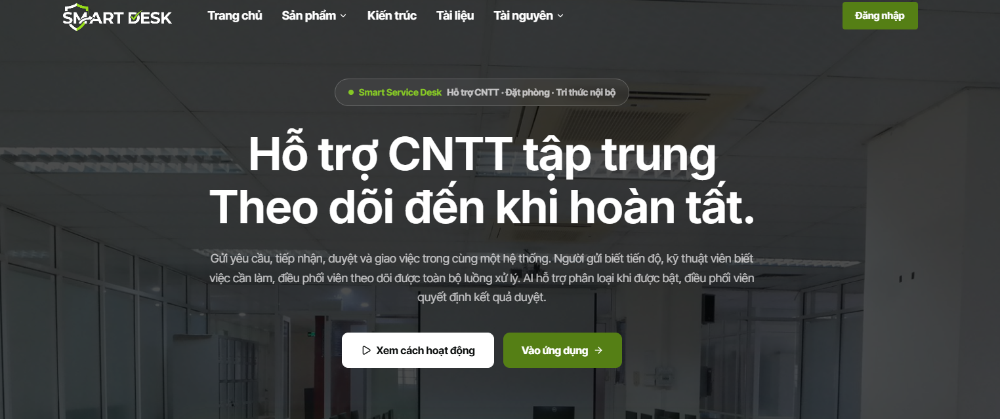
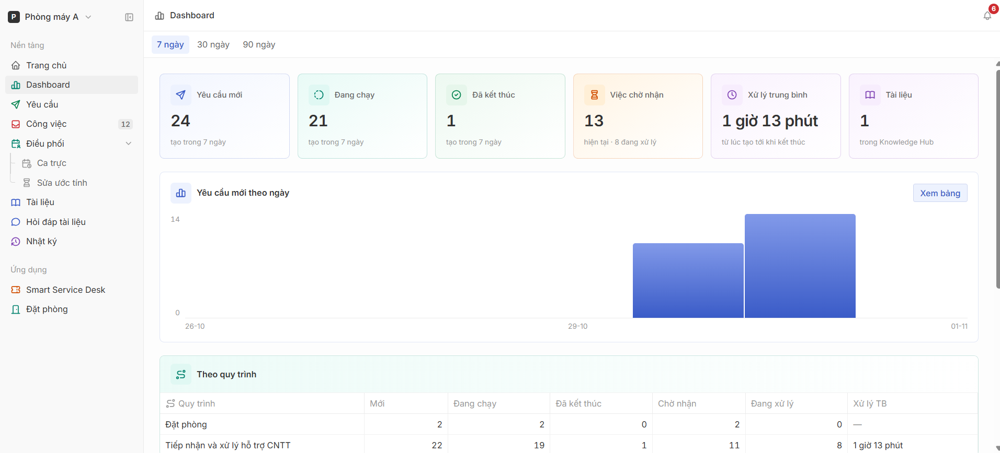
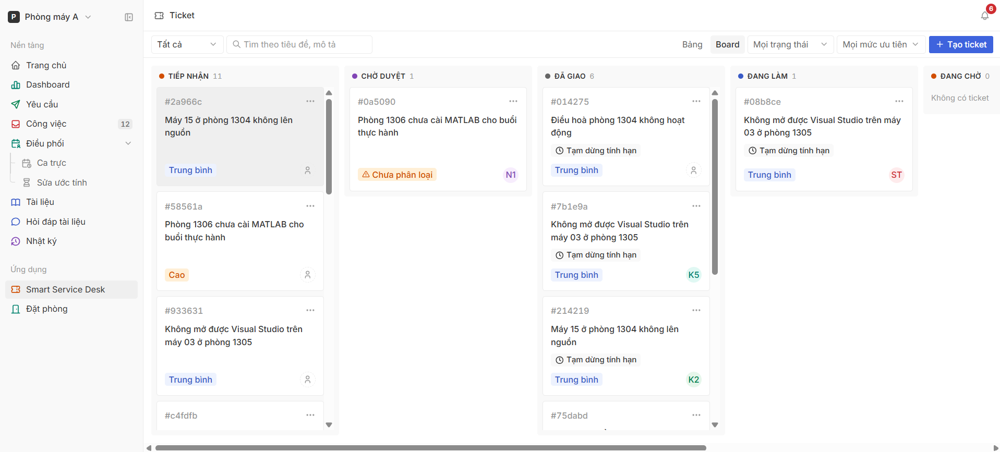
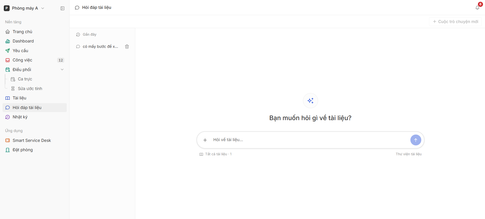
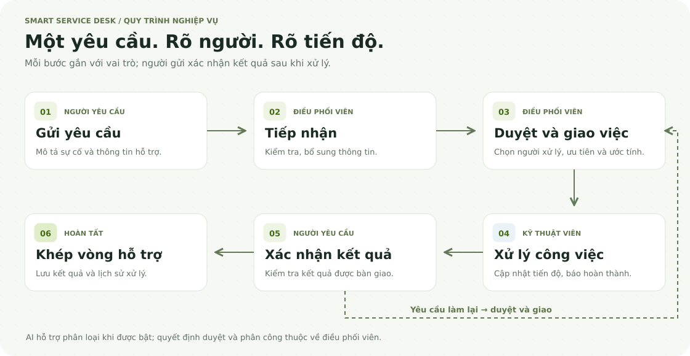
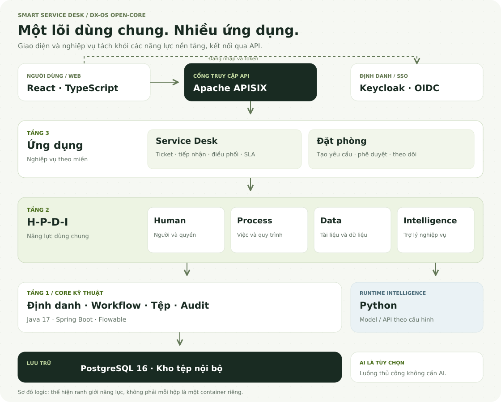

<div align="center">

### Sản phẩm dự thi **Olympic Tin học Sinh viên Việt Nam 2026 — nội dung Phần mềm Nguồn mở (OLP PMNM 2026)**, chủ đề DX-OS Open-Core.

# Smart Service Desk

**Từ yêu cầu hỗ trợ đến kết quả xử lý, trên một nền tảng chung.**

Nền tảng nguồn mở cho vận hành CNTT trong khoa, phòng máy và đơn vị đào tạo.
Tiếp nhận sự cố, điều phối kỹ thuật viên, quản lý đặt phòng và tra cứu tài liệu theo từng không gian làm việc.

[](https://github.com/HaUI-DangSuyNghi/Smart-Service-Desk/releases)
[](LICENSE)


[Dùng thử trực tuyến](https://haui.smartdeskapp.me/) · [Giao diện](#giao-diện) · [Tính năng](#tính-năng) · [Kiến trúc](#kiến-trúc) · [Cài đặt](#cài-đặt) · [Tài liệu](#tài-liệu)

</div>



## Giới thiệu

Một máy tính không lên nguồn, đường truyền gặp sự cố hay một yêu cầu đặt phòng đều cần được tiếp nhận đúng nơi và theo dõi đến khi có kết quả. Khi thông tin nằm rải rác trong tin nhắn và bảng tính, người gửi khó biết yêu cầu đang ở đâu, còn người điều phối khó nắm được ai đang xử lý việc gì.

**Smart Service Desk** tập trung các công việc đó vào một hệ thống: người dùng gửi yêu cầu, điều phối viên tiếp nhận và phân công, kỹ thuật viên cập nhật tiến độ, người gửi xác nhận kết quả. Mỗi vai trò có giao diện và thao tác phù hợp trong workspace của mình.

Dự án tổ chức theo kiến trúc **Core → Human / Process / Data / Intelligence → Ứng dụng**. Service Desk và Đặt phòng cùng sử dụng các năng lực nền tảng, thay vì xây riêng phần định danh, quy trình và dữ liệu cho từng ứng dụng.

## Điểm nổi bật

- **Theo dõi trọn vòng đời yêu cầu:** từ tiếp nhận, duyệt và giao việc đến xử lý, xác nhận kết quả hoặc yêu cầu làm lại.
- **Điều phối theo vai trò:** phân công người xử lý, xem lịch công việc, ca trực, mức ưu tiên và hạn xử lý.
- **Một nền tảng, nhiều ứng dụng:** Service Desk và Đặt phòng dùng chung lớp năng lực H-P-D-I và lõi kỹ thuật.
- **Tài liệu gắn với công việc:** thư viện tài liệu, xem trước, tải xuống và giao diện hỏi đáp có lịch sử hội thoại.
- **AI là trợ lý, con người quyết định:** hỗ trợ phân loại và hỏi đáp khi được cấu hình; vẫn có chế độ vận hành thủ công không cần GPU hoặc API key.
- **Thông tin cập nhật trong ứng dụng:** thông báo, bình luận và cập nhật thời gian thực giúp theo dõi thay đổi khi đang làm việc.
- **Tự triển khai bằng Docker Compose:** mã nguồn, cấu hình hạ tầng, hợp đồng API và hướng dẫn vận hành nằm trong cùng repository.

## Giao diện

Các ảnh dưới đây minh họa giao diện và dữ liệu mẫu. Bố cục có thể khác giữa các phiên bản.

### Tổng quan hoạt động

Dashboard tập hợp số liệu yêu cầu, công việc và tài liệu để theo dõi tình hình trong workspace.



### Quản lý ticket theo bảng công việc

Theo dõi yêu cầu từ tiếp nhận và chờ duyệt đến đã giao, đang làm và đang chờ.



### Hỏi đáp tài liệu

Không gian hội thoại để tra cứu tài liệu, với lịch sử hội thoại và lựa chọn phạm vi tài liệu. Chức năng AI được bật theo cấu hình triển khai.



## Tính năng

| Phân hệ | Khả năng chính |
| --- | --- |
| **Service Desk** | Tạo ticket, tìm kiếm và lọc yêu cầu, xem dạng bảng hoặc board, theo dõi trạng thái và lịch sử xử lý. |
| **Điều phối** | Tiếp nhận, duyệt, phân công và giao lại công việc; theo dõi lịch, ca trực và tải công việc. |
| **Xử lý công việc** | Bắt đầu, tạm dừng, tiếp tục, báo hoàn thành, trả việc và đề nghị điều chỉnh ước tính. |
| **Đặt phòng** | Tạo yêu cầu, xem danh sách và chi tiết, theo dõi tiến độ duyệt; sửa hoặc hủy khi điều kiện cho phép. |
| **Knowledge Hub** | Quản lý tài liệu theo workspace, xem trước và tải xuống; hỏi đáp khi bật dịch vụ AI tương ứng. |
| **Dashboard** | Thống kê yêu cầu, công việc, thời gian xử lý và số liệu theo quy trình. |
| **Định danh và phân quyền** | Đăng nhập qua Keycloak, phân quyền theo workspace và vai trò; quản trị nền tảng. |
| **Thông báo và nhật ký** | Thông báo trong ứng dụng, cập nhật thời gian thực và nhật ký phục vụ truy vết; email khi cấu hình SMTP. |

### Luồng trải nghiệm



Người yêu cầu, điều phối viên và kỹ thuật viên phối hợp trong một vòng xử lý có xác nhận. Khi kết quả chưa đáp ứng, yêu cầu được chuyển lại để tiếp tục xử lý.

| Vai trò | Công việc thường dùng |
| --- | --- |
| **Người yêu cầu** | Gửi ticket, đặt phòng, theo dõi tiến độ và xác nhận kết quả. |
| **Kỹ thuật viên** | Xem việc được giao, nhận việc theo quyền, cập nhật trạng thái và báo hoàn thành. |
| **Điều phối viên** | Tiếp nhận, duyệt và giao việc; theo dõi hàng đợi, ca trực và hạn xử lý. |
| **Quản trị viên** | Quản lý định danh, quyền và cấu hình nền tảng theo phạm vi được cấp. |

## Kiến trúc




Smart Service Desk tổ chức theo ba tầng, phân biệt **cơ chế kỹ thuật**, **năng lực dùng chung** và **nghiệp vụ ứng dụng**. Người dùng đăng nhập qua Keycloak; giao diện web gọi API qua APISIX.

| Tầng | Trách nhiệm | Thành phần của dự án |
| --- | --- | --- |
| **Tầng 3 — Ứng dụng** | Thể hiện bài toán, giao diện và quy tắc nghiệp vụ theo miền. | Service Desk, Đặt phòng; các module ứng dụng React và backend. |
| **Tầng 2 — H-P-D-I** | Cung cấp năng lực Human, Process, Data, Intelligence để các ứng dụng sử dụng lại. | Con người và quyền theo workspace, công việc và quy trình, tài liệu, tích hợp Intelligence. |
| **Tầng 1 — Core** | Cung cấp cơ chế kỹ thuật và API nền tảng. | Định danh, workflow, lưu tệp và nhật ký; tích hợp Keycloak, Flowable và PostgreSQL. |

**AI là một lựa chọn triển khai:** Python Intelligence kết nối qua năng lực Intelligence; luồng tiếp nhận, duyệt và phân công thủ công không yêu cầu GPU hoặc API key. Sơ đồ thể hiện ranh giới logic, không đồng nghĩa mỗi khối là một dịch vụ triển khai độc lập.

Xem [bản đồ ranh giới kiến trúc](docs/architecture/tier-boundary-map.md) và [kiến trúc Core](docs/core-architecture.md) để đối chiếu với mã nguồn và hợp đồng API.

### Công nghệ

| Thành phần | Công nghệ |
| --- | --- |
| Giao diện | React 19, TypeScript, Vite, Tailwind CSS, shadcn/ui |
| Backend | Java 17, Spring Boot 3.3, Flowable 7.1 |
| Định danh | Keycloak, OpenID Connect |
| API Gateway | Apache APISIX |
| Cơ sở dữ liệu | PostgreSQL 16 |
| Intelligence | Python 3.12; tích hợp model hoặc API theo chế độ triển khai |
| Triển khai | Docker, Docker Compose v2 |

## Cài đặt

### Chuẩn bị

- Git và Docker Desktop chạy Linux containers, hoặc Docker Engine với Compose v2.
- PowerShell để sử dụng các lệnh khởi động bên dưới.
- Các cổng `5173`, `9080` và `8081` còn trống.
- Kết nối mạng để tải image và thư viện trong lần build đầu tiên.

### Khởi chạy từ mã nguồn

Thực hiện trong **thư mục cài đặt mới**:

```powershell
git clone https://github.com/HaUI-DangSuyNghi/Smart-Service-Desk.git
cd Smart-Service-Desk
git switch main
powershell -NoProfile -ExecutionPolicy Bypass -File scripts/setup.ps1
powershell -NoProfile -ExecutionPolicy Bypass -File scripts/start.ps1 -NoAi
```

Để chạy một bản phát hành cụ thể, chọn tag tương ứng trong [Releases](https://github.com/HaUI-DangSuyNghi/Smart-Service-Desk/releases) trước bước setup. Lần khởi động đầu tiên cần thời gian build các dịch vụ.

Setup tạo `.env` và cấu hình realm riêng cho máy. **Không commit hoặc chia sẻ `.env`, API key, mật khẩu và thư mục `.local`.** Với hệ thống đã có dữ liệu, không reset realm hay xóa volume để cài lại.

> Cấu hình image và môi trường Docker ảnh hưởng đến khả năng khởi động. Xem [hồ sơ xác minh cài đặt](docs/publication/pof/FINAL_VERIFICATION.md) để biết cấu hình và phạm vi đã được kiểm chứng; không mặc định mọi chế độ AI hoặc mọi môi trường đều có cùng kết quả.

| Dịch vụ | Địa chỉ mặc định |
| --- | --- |
| Giao diện web | <http://localhost:5173> |
| API Gateway | <http://localhost:9080> |
| Gateway health | <http://localhost:9080/health> |
| Keycloak | <http://localhost:8081> |

### Tài khoản trải nghiệm

Mật khẩu tài khoản demo là giá trị **`DEMO_PASSWORD` trong `.env` trên máy cài đặt**, không phải mật khẩu công khai dùng chung.

| Tài khoản | Vai trò | Phạm vi |
| --- | --- | --- |
| `requester1` | Người yêu cầu | `lab-a` |
| `agent1` | Kỹ thuật viên | `lab-a` |
| `coordinator1` | Điều phối viên | `lab-a` |
| `requester2` | Người yêu cầu | `lab-b` |
| `agent6` | Kỹ thuật viên | `lab-b` |
| `coordinator2` | Điều phối viên | `lab-b` |
| `admin1` | Quản trị nền tảng | Toàn cục theo quyền quản trị |
| `superadmin` | Tài khoản thử nghiệm nhiều vai trò | `lab-a`, `lab-b` và quản trị nền tảng |

**Thử một vòng xử lý:** đăng nhập `requester1` để tạo ticket → dùng `coordinator1` để tiếp nhận, duyệt và giao cho `agent1` → dùng `agent1` để xử lý → quay lại `requester1` để xác nhận. Dùng các tài khoản riêng giúp thể hiện đúng trách nhiệm từng vai trò.

### Lệnh vận hành

```powershell
.\dx start          # Menu khởi động và chọn chế độ AI
.\dx up             # Khởi động theo chế độ đã lưu
.\dx up no-ai       # Chạy nghiệp vụ thủ công, không cần GPU/API key
.\dx doctor         # Kiểm tra môi trường
.\dx ps             # Xem trạng thái container
.\dx logs           # Xem log dịch vụ
.\dx down           # Dừng container, giữ dữ liệu
```

### Các lựa chọn AI

| Lệnh | Chế độ |
| --- | --- |
| `.\dx up no-ai` | Tiếp nhận, duyệt và phân công thủ công. |
| `.\dx up api` | Phân loại và hỏi đáp qua API đã cấu hình. |
| `.\dx up model` | Phân loại bằng Qwen local; cần GPU và image model phù hợp. |
| `.\dx up model ask` | Qwen local kết hợp hỏi đáp qua API. |
| `.\dx up remote` | Kết nối Qwen trên máy GPU riêng. |

AI là tùy chọn tích hợp, không phải điều kiện để chạy luồng hỗ trợ thủ công. Điền provider, model và key trong `.env` nếu dùng API; không đưa key vào các biến `VITE_*`. Xem [hỏi đáp tài liệu](docs/KNOWLEDGE_CHAT.md) và [hướng dẫn GPU từ xa](docs/remote-model.md) trước khi cấu hình.

## Dành cho nhà phát triển

```text
frontend/src/
  platform/       Giao diện và năng lực dùng chung
  apps/           Service Desk, Đặt phòng
backend/src/main/java/vn/haui/dx/
  core/           Lõi kỹ thuật
  hpdi/           Human, Process, Data, Intelligence
  apps/           Nghiệp vụ ứng dụng
intelligence/src/ Python runtime và profile ứng dụng
contracts/        Hợp đồng API và schema
infra/            Keycloak, APISIX, PostgreSQL và cấu hình triển khai
scripts/          Khởi động, kiểm tra và vận hành
docs/             Hướng dẫn, kiến trúc và hồ sơ kiểm chứng
```

Frontend dùng Node.js từ 22.12 trở lên; backend dùng Java 17/Maven 3.9.9; Intelligence dùng Python 3.12. Chạy các kiểm tra frontend bằng:

```powershell
cd frontend
npm ci
npm run typecheck
npm run lint
npm test
npm run build
```

Browser test: cài Chromium bằng `npx playwright install chromium`, sau đó chạy `npm run test:e2e`. Các browser contract test sử dụng API giả lập; kiểm chứng tích hợp hệ thống thật được ghi riêng trong tài liệu nghiệm thu.

## Tài liệu

| Nội dung | Tài liệu |
| --- | --- |
| Kiến trúc và ranh giới | [Core Architecture](docs/core-architecture.md) · [Tier Boundary Map](docs/architecture/tier-boundary-map.md) |
| Tích hợp và vận hành | [Core Integration](docs/core-integration.md) · [Core Acceptance](docs/core-acceptance.md) |
| Yêu cầu và thiết kế | [Requirements Mapping](docs/requirements-mapping.md) |
| Hợp đồng API | [Core](contracts/openapi/core.yaml) · [Service Desk](contracts/openapi/servicedesk.yaml) · [H-P-D-I](contracts/hpdi/openapi.yaml) |
| Hỏi đáp và model từ xa | [Knowledge Chat](docs/KNOWLEDGE_CHAT.md) · [Remote Model](docs/remote-model.md) |
| Nguồn mở và kiểm chứng | [PoF Evidence](docs/publication/POF_EVIDENCE.md) · [Final Verification](docs/publication/pof/FINAL_VERIFICATION.md) · [Dependency Licenses](docs/legal/dependency-inventory.md) |
| Phát hành | [Releases](https://github.com/HaUI-DangSuyNghi/Smart-Service-Desk/releases) · [Changelog](CHANGELOG.md) |

## Nhóm phát triển

**Đội: HaUI** · **Trường: Đại học Công nghiệp Hà Nội**

| Thành viên | Vai trò | Liên hệ |
| --- | --- | --- |
| Nguyễn Minh Hiểu | Người phát triển | [minhhieu28405@gmail.com](mailto:minhhieu28405@gmail.com) |
| Nguyễn Mạnh Thi | Người phát triển | [thikudo2809@gmail.com](mailto:thikudo2809@gmail.com) |
| Bùi Huy Hoàng | Người phát triển | [buihoang3425@gmail.com](mailto:buihoang3425@gmail.com) |

**Trải nghiệm sản phẩm:** [haui.smartdeskapp.me](https://haui.smartdeskapp.me/). Tài khoản trong mục cài đặt dành cho môi trường demo tự triển khai; không mặc định áp dụng cho bản trực tuyến. Liên hệ nhóm phát triển để được hướng dẫn truy cập.

## Đóng góp và liên hệ

Phát triển tính năng từ nhánh `develop`, tạo Pull Request để review trước khi tích hợp. Nhánh `main` dành cho các bản phát hành của dự án. Quy trình chi tiết nằm trong [CONTRIBUTING.md](CONTRIBUTING.md).

Góp ý, báo lỗi hoặc đề xuất tính năng tại [GitHub Issues](https://github.com/HaUI-DangSuyNghi/Smart-Service-Desk/issues). Khi báo lỗi, cung cấp phiên bản, bước tái hiện và log đã loại bỏ thông tin nhạy cảm.

Người tham gia tuân thủ [quy tắc ứng xử](CODE_OF_CONDUCT.md). Nếu phát hiện lỗ hổng bảo mật, báo riêng theo [chính sách bảo mật](SECURITY.md), không đăng chi tiết khai thác hoặc thông tin xác thực lên Issues công khai.

## Giấy phép

Mã nguồn và tài liệu gốc do nhóm sở hữu, có quyền cấp phép, được phát hành theo **Apache License 2.0**. Xem [LICENSE](LICENSE) và [phạm vi cấp phép](LICENSING.md).

Thư viện bên thứ ba, hình ảnh và tài liệu của chủ sở hữu khác giữ nguyên giấy phép, thông báo và điều kiện áp dụng. Thông tin nguồn gốc, quyền phân phối và bằng chứng được lưu tại [danh mục thành phần](docs/legal/dependency-inventory.md) và [manifest phát hành](docs/publication/release-distribution-status.csv).
