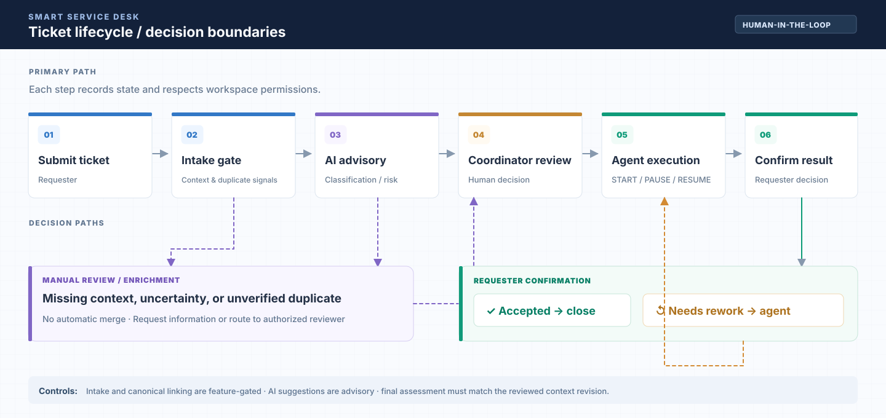
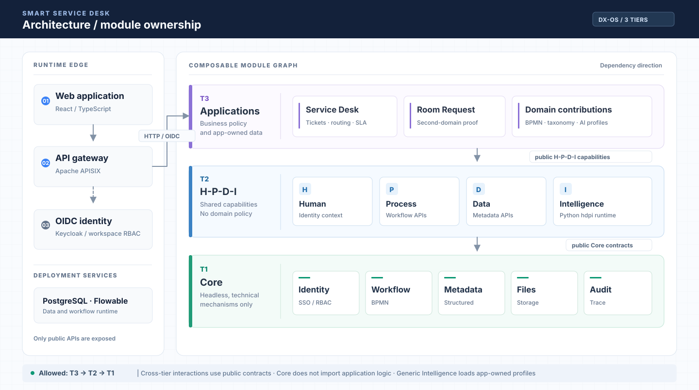

<div align="center">

# Smart Service Desk

### DX-Lab · Nền tảng tiếp nhận và điều phối yêu cầu hỗ trợ thông minh

**Một lõi dùng chung · Nhiều ứng dụng nghiệp vụ · AI hỗ trợ con người ra quyết định**

[](backend/)
[](frontend/)
[](intelligence/)
[](docs/architecture/ADR-005-dxos-three-tier-boundary.md)
[](LICENSING.md)
[](docs/publication/EVALUATION_READINESS.md)

**[Tổng quan](#-tổng-quan)** · **[Luồng nghiệp vụ](#-luồng-xử-lý-ticket)** · **[Kiến trúc](#-kiến-trúc-dx-os)** · **[Bắt đầu](#-chạy-thử-trên-máy-cá-nhân)** · **[AI](#-intelligence--ai)** · **[Tài liệu](#-tài-liệu-và-bằng-chứng)**

</div>

> [!IMPORTANT]
> **Trạng thái phát hành — chưa được phê duyệt (theo hồ sơ dự án ngày 28/10/2026).** Nhóm thống nhất **định hướng** Apache-2.0 nhưng chưa có giấy phép được cấp chính thức hoặc tệp `LICENSE` ở gốc. Quyền đối với tài liệu tham chiếu, một phần dữ liệu AI và model/adapter còn phải rà soát; production security gate G9 vẫn được ghi nhận **FAIL**. Repository có thể xem trên GitHub **không đồng nghĩa** với việc mọi nội dung đã được cấp quyền tái sử dụng hoặc phát hành. Không coi mô tả và báo cáo test lịch sử trong README là chứng nhận production hay bản demo đang hoạt động. Xem [LICENSING.md](LICENSING.md), [đánh giá công bố](docs/publication/EVALUATION_READINESS.md) và [kiểm tra phát hành](docs/PUBLIC_RELEASE_CHECKLIST.md).

## 💡 Tổng quan

Ở phòng máy, khoa hoặc đơn vị vận hành CNTT, một yêu cầu hỗ trợ thường đi qua nhiều người: người gửi mô tả sự cố, điều phối viên đánh giá và phân công, kỹ thuật viên tiếp nhận xử lý, người gửi xác nhận kết quả. Khi thông tin thiếu, nhiều yêu cầu trùng hoặc thiếu dấu vết xử lý, công việc dễ bị chuyển nhầm, xử lý lặp và khó theo dõi tiến độ.

**Smart Service Desk** tổ chức quy trình đó thành ticket có định danh, phân quyền theo workspace, lịch sử trạng thái và các điểm phê duyệt rõ ràng. AI hỗ trợ nhận diện ngữ nghĩa, sàng lọc thông tin thiếu, phát hiện tín hiệu trùng và gợi ý phân loại; **quyết định nghiệp vụ quan trọng vẫn được kiểm soát bởi quy tắc, quyền hệ thống và con người**.

Dự án đồng thời là một hiện thực kiến trúc **DX-OS 3 tầng**: Core không biết nghiệp vụ, tầng H-P-D-I cung cấp năng lực tái sử dụng và ứng dụng chuyên ngành sở hữu chính sách riêng. `Room Request` là ứng dụng thứ hai dùng để kiểm chứng khả năng tái sử dụng, không phải một lời khẳng định rằng mọi luồng của nó đã được nghiệm thu E2E.

## ✨ Điểm nổi bật

| Năng lực | Giá trị và giới hạn |
| --- | --- |
| **Quản lý ticket theo vòng đời** | Tiếp nhận, review, phân công, xử lý, hoàn thành, xác nhận hoặc yêu cầu làm lại; các đường đi và guard cụ thể phụ thuộc cấu hình triển khai |
| **Multi-workspace & RBAC** | Keycloak/SSO; phân biệt requester, agent, coordinator, platform-admin; kiểm tra quyền tại server, không chỉ ẩn nút trên UI |
| **Điều phối & tác vụ** | Flowable/BPMN, inbox, đề xuất tổ/người đang trực, ghi nhận START/PAUSE/RESUME và trạng thái công việc |
| **AI có kiểm soát** | Phân loại, tín hiệu thiếu thông tin, gợi ý trùng lặp, hỗ trợ hỏi đáp; rule engine và cơ chế chuyển xử lý thủ công khi kết quả không đủ tin cậy |
| **Tái sử dụng nền tảng** | Core identity, workflow, metadata, tệp và audit; H-P-D-I công bố hợp đồng để ứng dụng không phụ thuộc trực tiếp chi tiết nội bộ |
| **Có thể kiểm thử và truy vết** | OpenAPI, source boundary checks, test và tài liệu evidence; phân biệt unit/synthetic, local integration với chứng nhận release |

## 🔄 Luồng xử lý ticket

[](docs/assets/ticket-flow-engineering.svg)

*Click vào sơ đồ để xem ảnh vector kích thước đầy đủ; xem [đặc tả luồng E2E](docs/LUONG_E2E_CHINH.md) để hiểu các điều kiện thực thi.*

Đây là **sơ đồ nghiệp vụ mục tiêu** để đọc luồng, không khẳng định mọi tùy chọn đang bật trong cấu hình mặc định. Ví dụ, intake trước review và xử lý canonical liên kết trùng có feature flag và điều kiện cho phép riêng. **Không tự gộp/đóng ticket chỉ vì model dự đoán trùng**; đánh giá cuối phải gắn với context/revision hợp lệ, còn quyết định review và phân công phải thỏa quyền, phiên bản và trạng thái quy trình.

Đọc chi tiết: [luồng E2E](docs/LUONG_E2E_CHINH.md) · [đặc tả ticket](docs/ticket.md) · [AI D2 intake](docs/implementation/AI_D2_DELIVERY.md) · [ADR-013 về enrichment/dedup](docs/architecture/ADR-013-ai08-enrichment-dedup-advisory.md).

## 🏗️ Kiến trúc DX-OS

[](docs/assets/dxos-system-map.svg)

*Click vào sơ đồ để xem đầy đủ kiến trúc; quy tắc phụ thuộc chuẩn nằm trong [ADR-005](docs/architecture/ADR-005-dxos-three-tier-boundary.md).*

| Tầng | Trách nhiệm | Ví dụ trong mã nguồn |
| --- | --- | --- |
| **T1 — Core headless** | Năng lực kỹ thuật dùng chung; **không chứa khái niệm ticket, phòng máy hoặc chính sách AI của ứng dụng** | `backend/.../core` |
| **T2 — H-P-D-I** | **H**uman: ngữ cảnh người dùng và workspace; **P**rocess: năng lực quy trình; **D**ata: khả năng dữ liệu; **I**ntelligence: adapter/runtime tái sử dụng | `backend/.../hpdi`, `intelligence/src/hdpi`, `frontend/src/platform` |
| **T3 — Applications** | Service Desk, Room Request; entity, BPMN, profile, phân loại, priority, policy và giao diện nghiệp vụ | `backend/.../apps`, `intelligence/src/apps`, `frontend/src/apps` |
| **Assembly** | Lắp ráp các module khi chạy; không phải đường tắt cho ứng dụng gọi nội bộ Core | `backend/.../assembly`, `frontend/src/main.ts` |

**Quy tắc bất biến:** T1 không phụ thuộc T2/T3; API công khai của T2 độc lập với Core; T3 không import adapter/private implementation của tầng dưới. Kiểm tra bằng [ADR-005](docs/architecture/ADR-005-dxos-three-tier-boundary.md), [boundary map](docs/architecture/tier-boundary-map.md), [quy tắc vận hành](docs/architecture/STRICT_BOUNDARY_OPERATIONS.md) và workflow [Tier boundaries](.github/workflows/tier-boundaries.yml).

## 🧩 Các thành phần chính

| Thành phần | Công nghệ / nhiệm vụ |
| --- | --- |
| Frontend | React, TypeScript, Vite; giao diện theo vai trò và ranh giới `platform/apps` |
| Backend | Java 17, Spring Boot, Maven; Core, H-P-D-I và các ứng dụng |
| Identity & gateway | Keycloak (OIDC), Apache APISIX; JWT, workspace và định tuyến |
| Workflow & persistence | Flowable BPMN, PostgreSQL; lịch sử xử lý và dữ liệu nghiệp vụ |
| Intelligence | Python `hdpi`, retrieval / đánh giá / generation và adapter triage; app sở hữu policy & profile |
| AI execution | Rule engine + Qwen local/LoRA tùy gói bàn giao, hoặc API qua provider được cấu hình |
| Deployment & contracts | Docker Compose và overlays; OpenAPI/JSON schema theo ranh giới sở hữu |

Phiên bản thư viện/container cụ thể phụ thuộc lockfile, Maven và image pin của commit đang chạy; không suy ra tính tương thích chỉ từ bảng tổng quan. Xem [danh mục phụ thuộc và giấy phép](docs/dependency-licenses.md).

## 🚀 Chạy thử trên máy cá nhân

> [!CAUTION]
> **Chỉ dùng các bước này trên máy/Compose project thử nghiệm được phép thao tác.** Không chạy reset realm, xóa volume hoặc thay đổi cấu hình trên bản demo đang dùng chung. Trạng thái `healthy` chỉ xác nhận tiến trình khởi động, **không bảo đảm** login, provider AI, toàn luồng nghiệp vụ hay E2E đã PASS.

### Yêu cầu

- Windows 10/11, PowerShell 5.1+; Docker Desktop ở chế độ Linux containers, Compose v2.
- Internet khi dựng lần đầu để tải image và dependencies; đủ cổng trống trên host (`5173`, `9080`, `8081`).
- **Không cần GPU** nếu dùng API; Qwen local cần Docker truy cập GPU NVIDIA và **image/model hợp lệ được bàn giao riêng**. Clone repo không tự tải trọng số.

### Bốn bước bắt đầu

```powershell
# 1. Lấy mã nguồn làm việc (develop là nhánh tích hợp, main là nhánh phát hành)
git clone https://github.com/HaUI-DangSuyNghi/Smart-Service-Desk.git
cd Smart-Service-Desk
git switch develop

# 2. Tạo cấu hình cá nhân (không commit .env hay .local)
.\dx env
notepad .env

# 3. Kiểm tra môi trường, chọn chế độ AI phù hợp
.\dx doctor
.\dx up api

# 4. Xem trạng thái
.\dx ps
```

Với chế độ `api`, điền provider, model và API key **của chính bạn** vào `.env` trước khi chạy. Ví dụ tên biến (không đưa secret thật vào README):

```dotenv
AI_API_PROVIDER=gemini
AI_API_MODEL=<model-id-phù-hợp>
AI_API_KEY=<secret-cá-nhân>
```

Mở **Web: [http://localhost:5173](http://localhost:5173)** · **Gateway: [http://localhost:9080](http://localhost:9080)** · **Keycloak: [http://localhost:8081](http://localhost:8081)**.

Có thể dùng `.\dx start` để vào menu tương tác, `.\dx up` để dùng cấu hình AI đã lưu. Nếu chỉ muốn kiểm tra bản cài thử nghiệm mới và **không có API key/GPU**, đọc [hướng dẫn khởi động và điều kiện AI](docs/local-model.md) trước khi chọn chế độ — không giả định mọi chế độ đều sẵn sàng.

### Các chế độ AI

| Lệnh | Phân loại / đánh giá | Hỏi AI | Điều kiện |
| --- | --- | --- | --- |
| `.\dx up api` | API + guard bằng rule | API | Provider/model/key hợp lệ; không cần GPU |
| `.\dx up model` | Qwen local + rule | Theo cấu hình đã lưu | GPU và image Qwen đã nạp |
| `.\dx up model ask` | Qwen local + rule | API | Điều kiện cả local và provider |

Để nạp model local: `docker load -i <đường-dẫn-image-từ-nhóm>.tar` sau khi được nhóm cho phép sử dụng. Xem [Local Model Guide](docs/local-model.md), [AI portable delivery](docs/implementation/AI_D2_PORTABLE_DOCKER_VI.md) và [model licenses](licenses/models/README.md). **Không commit trọng số, LoRA, secrets, datasets chưa được duyệt hoặc tuyên bố model đã được cấp phép phân phối.**

### Tài khoản mẫu

| Người dùng | Vai trò | Workspace |
| --- | --- | --- |
| `user1` / `user4` | Requester — gửi và xác nhận yêu cầu | `lab-a` / `lab-b` |
| `user2` / `user5` | Agent — tiếp nhận và xử lý | `lab-a` / `lab-b` |
| `user3` / `user6` | Coordinator — review và điều phối | `lab-a` / `lab-b` |
| `user7` | Platform admin | Toàn nền tảng (không thuộc một workspace mặc định) |

Mật khẩu demo **không hard-code**: được sinh cho từng máy và lấy từ `DEMO_PASSWORD` trong `.env` cục bộ. Chỉ dùng các tài khoản này với dữ liệu mẫu được phép; không đăng mật khẩu lên issue hay ảnh chụp.

## 🧠 Intelligence & AI

AI của Smart Service Desk gồm nhiều năng lực **khác nhau**, không đồng nhất việc classifier trả nhãn với việc hệ thống đã có trợ lý tự động hoàn chỉnh:

- **Ticket intelligence:** đề xuất nhóm vấn đề, mức độ, tín hiệu rủi ro và tuyến xử lý theo profile của ứng dụng; kết quả chịu rule guard và có thể yêu cầu con người review.
- **Context enrichment:** phát hiện ticket cần bổ sung ngữ cảnh; các cơ chế intake/review-admission bảo đảm không đẩy quyết định quá sớm khi feature flag được bật.
- **Deduplication:** phát hiện ứng viên ticket giống nhau/cùng sự cố; tự động hợp nhất không phải hành vi mặc định. Quyết định liên kết canonical có điều kiện và do actor được phép thực hiện.
- **Retrieval/Assistance:** hạ tầng retrieval, generation và hỏi đáp là các đường tích hợp riêng; **câu trả lời API chỉ dựa trên title/description không được gọi là RAG grounded** nếu chưa truy hồi, kiểm nguồn và cấp quyền tương ứng.

**Độ chính xác AI cần gold set được con người review và tập holdout độc lập.** Kết quả silver/synthetic hoặc PASS trên test double chỉ chứng minh đúng phạm vi thử nghiệm, không thay thế đánh giá thực địa. Chi tiết: [Intelligence README](intelligence/README.md), [AI06 status](intelligence/docs/task/AI06/AI06_COMPLETION_STATUS.md), [ADR-011](docs/architecture/ADR-011-ai07-model-primary-rule-guarded.md) và [AI D2](docs/implementation/AI_D2_DELIVERY.md).

## 🔌 API và hợp đồng

| Phạm vi | Base path | Hợp đồng |
| --- | --- | --- |
| Core | `/api/core/v1` | [core.yaml](contracts/openapi/core.yaml) |
| H-P-D-I | `/api/hpdi/v1` | [HPDI OpenAPI](contracts/hpdi/openapi.yaml) |
| Service Desk | `/api/apps/servicedesk/v1` | [servicedesk.yaml](contracts/openapi/servicedesk.yaml) |
| Intelligence | Adapter/schema theo contract, không phải API công khai cho client tùy ý | [contracts/intelligence/v1](contracts/intelligence/v1/) |

Hợp đồng và quyền kiểm tra theo workspace là nguồn tham chiếu tốt hơn một ví dụ endpoint rời rạc. Không gọi trực tiếp private AI transport từ trình duyệt.

## 🧪 Kiểm thử, vận hành và bằng chứng

```powershell
.\dx check            # cấu hình Compose / một số kiểm tra môi trường
.\dx smoke            # smoke trên stack được chuẩn bị riêng
.\dx ps               # trạng thái container
.\dx logs             # log các dịch vụ
.\dx down             # dừng stack, giữ volumes theo chế độ script
```

Các kiểm tra ở mức mã nguồn (chạy trong môi trường có toolchain tương ứng):

```powershell
mvn -f backend/pom.xml verify
npm ci --prefix frontend
npm run build --prefix frontend
npm run test --prefix frontend
python scripts/check-tier-boundaries.py
```

> [!WARNING]
> **Không có tuyên bố “CI xanh / E2E hoàn chỉnh / production ready” ở đây.** Báo cáo [submission readiness](docs/SUBMISSION_READINESS.md) ghi blocker tại thời điểm kiểm tra; [demo recovery 28/10](docs/DEMO_RECOVERY_20261028.md) ghi nhận đường demo API local được khôi phục nhưng browser E2E còn blocker. CI bị chặn bởi hạ tầng/billing không đồng nghĩa PASS. Khi nghiệm thu phải lưu **commit SHA, cấu hình, lệnh và kết quả thực tế** của lần chạy mới.

**Một số tình huống thường gặp:** `401` → kiểm tra issuer/token/audience; `403` → kiểm role và workspace; không tìm thấy image model → kiểm gói model đã bàn giao; AI `503/504` → kiểm provider, key, quota và log **mà không lộ secret**. Nếu realm Keycloak đã tồn tại, template mới **không tự thay đổi realm cũ**. `.\dx realm` là thao tác reset có thể thay đổi user `sub` và làm mất liên kết với dữ liệu cũ; **chỉ dùng trên môi trường demo cô lập sau khi hiểu tác động**, tuyệt đối không dùng để sửa vội hệ thống đang chạy chung. Xem [runbook](docs/DEMO_RUNBOOK.md) và [hướng dẫn mô hình](docs/local-model.md).

## 📁 Cấu trúc repository

```text
Smart-Service-Desk/
├── backend/             # Java: Core T1, HPDI T2, applications T3, assembly
├── frontend/            # React: reusable platform và domain applications
├── intelligence/        # Python hdpi runtime; app-owned profiles và tests
├── contracts/           # Core / HPDI / applications / Intelligence wire contracts
├── infra/               # APISIX, Keycloak, PostgreSQL, Compose overlays
├── scripts/             # Setup, acceptance, boundary guards, vận hành
├── fixtures/            # Test/reference assets: xem quyền và provenance trước khi chia sẻ
├── docs/                # ADR, hướng dẫn, evidence, publication gates
├── licenses/            # Provenance/license cho một số model và runtime supplements
├── compose.yaml         # Base deployment
├── LICENSING.md         # Định hướng license, CHƯA PHẢI license grant
└── CONTRIBUTING.md      # Git Flow và quy tắc đóng góp
```

## 📚 Tài liệu và bằng chứng

| Chủ đề | Đọc tiếp |
| --- | --- |
| **Bắt đầu và vận hành** | [DEMO_RUNBOOK](docs/DEMO_RUNBOOK.md), [local-model](docs/local-model.md), [Compose overlays](infra/compose/README.md) |
| **Kiến trúc & ranh giới** | [ADR-005](docs/architecture/ADR-005-dxos-three-tier-boundary.md), [tier-boundary map](docs/architecture/tier-boundary-map.md), [boundary operations](docs/architecture/STRICT_BOUNDARY_OPERATIONS.md) |
| **Service Desk** | [ticket specification](docs/ticket.md), [E2E flow](docs/LUONG_E2E_CHINH.md), [Backend API integration](docs/BACKEND_API_INTEGRATION_CONTRACT.md) |
| **AI & bàn giao** | [Intelligence](intelligence/README.md), [AI D2 delivery](docs/implementation/AI_D2_DELIVERY.md), [portable Docker](docs/implementation/AI_D2_PORTABLE_DOCKER_VI.md) |
| **Trạng thái nghiệm thu** | [demo recovery](docs/DEMO_RECOVERY_20261028.md), [submission readiness](docs/SUBMISSION_READINESS.md), [publication evaluation](docs/publication/EVALUATION_READINESS.md) |
| **Quyền và giấy phép** | [LICENSING](LICENSING.md), [dependency licenses](docs/dependency-licenses.md), [public release checklist](docs/PUBLIC_RELEASE_CHECKLIST.md) |

## 🤝 Đóng góp và giấy phép

Dự án phát triển theo [Git Flow](CONTRIBUTING.md): tạo nhánh `feature/*` hoặc `docs/*` từ `develop`, gửi Pull Request vào `develop`, review trước khi merge; `main` dành cho bản phát hành được chấp thuận. Không đưa mật khẩu, API key, dữ liệu cá nhân, ảnh/tài liệu không rõ quyền hoặc model weights lên commit.

**Giấy phép:** Apache-2.0 mới là **định hướng** cho mã do nhóm sở hữu, **chưa phải quyền sử dụng đã cấp**; hiện không có root `LICENSE` được phê duyệt. Quyền của nguồn tham chiếu, dependency, dataset, model và adapter phải xét độc lập. Xem [LICENSING.md](LICENSING.md) trước khi fork/phân phối, tạo bản release hoặc tái sử dụng mã.

---

<div align="center">
  <sub>Smart Service Desk · DX-Lab / DX-OS three-tier architecture · Documentation for the integration branch (`develop`)</sub>
</div>
