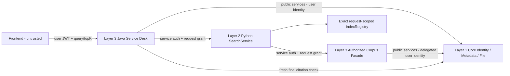

# BE-02 - Authorized Knowledge Retrieval Technical Design

Ngay lap: 2026-10-18 (Asia/Saigon). **DESIGN ONLY - CHO PHE DUYET**.
Tieng Viet khong dau de giu ASCII. Khong trien khai HTTP, khong sua Core/AI-03.

## 1. Baseline va pham vi

- Da fetch origin: `origin/develop = da955d24eddf9004fea12aa45d51cdc58d5a537d`, merge PR #22.
- Local develop HEAD `f348beb200b84bb31f2550879d38e744fa695230`, cham 48 commit. Fast-forward bi Git chan do tai lieu untracked trung ten; khong ghi de/stash/di chuyen/xoa chung.
- Doc source trong worktree detached moi rieng `D:/Smart-Service-Desk-be02-design`, HEAD bang origin/develop. Tai lieu giao workspace goc; khong tuyen bo local develop da update.
- GitHub API co xac thuc ngay 2026-10-18: PR #23 open, merged=false, updated_at=2026-10-18T11:11:59Z. Anonymous 404 khong co nghia PR khong ton tai.
- PR #23 cham: `.github/workflows/intelligence-triage-e2e.yml`, `.github/workflows/servicedesk-triage.yml`, `backend/Dockerfile`, `backend/pom.xml`, `compose.yaml`, `docs/SEC01_SECURITY_REMEDIATION.md`, `docs/security/sec01/evidence.json`, `docs/security/sec01/inventory.csv`, `infra/apisix/Dockerfile`, `intelligence/Dockerfile`, `scripts/acceptance/integration-compose.yaml`, `scripts/scan-core.ps1`, `scripts/security/export-inventory.py`, `scripts/test-core-acceptance.ps1`, `scripts/test-file.ps1`, `scripts/test-workflow.ps1`.
- Chi them tai lieu nay; khong sua security/deployment, file PR #23, DB hay worktree nguoi khac. Coding phai recheck PR #23 va phoi hop owner. Khong Architecture Audit toan repo.

## 2. Bang chung source tai baseline

Duong dan tinh tu repo root.

| Source/class | Hanh vi va he qua |
| --- | --- |
| `intelligence/src/smart_service_intelligence/services/search.py` - SearchService | TrustedContext explicit; so workspace; resolve/authorize partition truoc registry/scoring; profile/config exact; chi verified citation ra response. Degraded mac dinh tat, khong bat authorization/integrity. |
| `intelligence/src/smart_service_intelligence/integrations/core.py` - CoreAuthorizedCorpusAdapter | Catalog application-owned; /me xac nhan subject/membership; metadata/descriptor/bytes deu doc va so checksum/workspace. _selection tinh lai scope truoc scoring; resolve doc lai cho citation. |
| Cung file - CoreHttpClient | token_provider tra bearer Core chap nhan; URL gan /api/core/v1. HTTPS ngoai loopback test; no redirects/proxies; bounded reads. Socket timeout 10s khong phai total deadline. |
| `intelligence/src/smart_service_intelligence/retrieval/registry.py` - IndexRegistry | register rebuild/self-check, immutable partition; get exact authorized key. Khong tu build/persist/evict/cap quyen. |
| `intelligence/src/smart_service_intelligence/citations/verifier.py` - CoreCitationVerifier | Current resolver; so version/checksum, rechunk va exact chunk/excerpt. Missing/changed -> stale; deny -> hard error. UUID shape khong chung minh provenance. |
| `intelligence/src/smart_service_intelligence/retrieval/models.py`, `chunking.py`, `index.py` | Versioned scope/key/manifest, SHA-256; markdown-paragraph@0.1.0; chunk digest theo metadata ID, workspace/version/checksum/policy/ordinal. |
| `intelligence/docs/architecture/access-scope-contract.md` | Core HTTP model con CHO BE PHE DUYET; JWT groups khong introspect membership; fingerprint khong chung minh chua revoke. |
| `backend/src/main/java/vn/haui/dx/core/identity/internal/SecurityConfig.java`, `JwtCurrentUser.java`, `WorkspaceAccessImpl.java` | Resource server JWT; CurrentUser tu signed groups; requireMember/requireRole theo token. Chua corpus callback service auth. |
| `backend/src/main/java/vn/haui/dx/core/data/api/MetadataService.java`, `internal/JdbcMetadataService.java` | Member doc metadata; agent/coordinator create. Metadata immutable, version moi la UUID moi. usageRights la text, khong AI policy. |
| `backend/src/main/java/vn/haui/dx/core/data/api/FileService.java`, `internal/LocalFileService.java`, `internal/MetadataFileAccessPolicy.java` | describe/open kiem membership/linked policy. Metadata-linked file doc duoc boi member co metadata. Read khong phai AI rights. Core file cap 5 MiB, rong hon AI-03. |
| `contracts/openapi/core.yaml`, `contracts/openapi/servicedesk.yaml` | Core co /me, metadata list/get, files describe/content; Service Desk co ticket/statistics/progress/triage. Chua knowledge search/corpus delegation/AI rights API. |
| `docs/BE01_TRIAGE_HANDOFF.md`, `docs/AI04_TRIAGE_HANDOFF.md` | Auth truoc HTTP; transaction ket thuc truoc I/O; service bearer rieng, khong user JWT; strict schema/caps/deadlines va 502/503/504. Chua corpus delegation. |

## 3. Kien truc de xuat

**Backend-owned authorized corpus facade, read-only delegation theo request.** Khong user JWT sang Python, khong Core service account doc rong, khong doi Core authorization model.

Java Service Desk so huu rights-cleared catalog, lay user tu Core Identity, doc Core Metadata/File public Java services duoi identity do. Opaque grant chi cho corpus duoc phep cua mot search. Python chi doc facade bang service credential rieng + grant. Generic Intelligence chi biet corpus protocol; khong hard-code Service Desk role/catalog/business route.



| Owner | Trach nhiem |
| --- | --- |
| Java / Layer 3 | Public authz, rights catalog, grant/facade, transport validation, final citation gate/errors; khong doc Core DB/storage truc tiep. |
| Python / Layer 2 | Trusted adapter context, exact authorized index, AI-03 ranking, CoreCitationVerifier qua facade; khong suy quyen tu FE/service token. |
| Core / Layer 1 | Identity, metadata/file read authorization, authoritative records/bytes/provenance. |
| Frontend | Query/topK, hien ranking/excerpt an toan, manual fallback; khong tao scope/citations. |

```mermaid
sequenceDiagram
    participant FE as Frontend
    participant J as Java Service Desk
    participant C as Core public services
    participant P as Python retrieval worker
    participant F as Java corpus facade
    FE->>J: POST knowledge/search (JWT, query, topK)
    J->>C: identity/role + rights-cleared source reads
    C-->>J: authorized metadata, descriptor, bytes
    J->>J: scope snapshot + bounded request grant
    J->>P: logical search 0.1.0 + service auth + grant header
    P->>F: authenticated manifest/source reads
    F->>C: fresh user validity, rights, read checks
    C-->>F: current authorized records/bytes
    F-->>P: trusted manifest/sources
    P->>P: TrustedContext; exact build/register
    P->>F: resolve_partition reauthorization before scoring
    F->>C: fresh scope check
    F-->>P: same scope or reject
    P->>P: existing SearchService / TF-IDF
    loop Candidate at most topK
        P->>F: resolve current source in grant
        F->>C: fresh metadata/file auth + bytes
        F-->>P: current source, missing, or hard deny
        P->>P: CoreCitationVerifier exact rechunk
    end
    P-->>J: logical response
    J->>C: final identity/rights + citation source checks
    J->>J: exact chunk/excerpt check; close grant
    J-->>FE: verified response / sanitized ProblemDetail
    Note over J,P: Finally/timeout/disconnect closes grant and cancels worker; discard late results
```

Khong transaction qua HTTP. Callback dung pool/permits rieng, khong doi public thread dang cho Python; tranh deadlock Java -> Python -> Java. Core transactions ngan tung call.

## 4. Trust boundary va token delegation

### Identity va scope

1. JWT chi den Java resource server. Workspace path la untrusted: validate va WorkspaceAccess.requireRole tren workspace do; body khong override scope.
2. MVP de xuat AGENT/COORDINATOR; requester/platform-admin khong tu dong bypass workspace/AI rights. Can phe duyet business policy.
3. Corpus = giao cua trusted rights catalog, app role policy, metadata read va file read duoi user; khong lay allowlist/subject/roles/scope tu FE/Python.
4. Grant khong cap Core permission moi. JWT/grant het han, rights/catalog doi hay permission deny -> abort; khong tra ket qua cu.

### Credentials va request grant

- Java -> Python: retrieval service bearer rieng, khong triage token; chi invoke, khong Core data permission.
- Python -> Java: credential rieng chi corpus callback, can X-Corpus-Grant; khong chap nhan tai public Core/Service Desk API. Verified TLS ngoai loopback; private network khong thay TLS cross-host.
- Grant random opaque 256-bit, server lookup, bind requestId/audience service identity/subject/workspace/pinned profile/catalog-rights revisions/exact metadata-file-version-checksum set/scope digest/expiry/quota. Khong URL/allowlist tu request.
- TTL min(12s, JWT exp - now); token khong du operation budget thi reject truoc invoke. Khong extend/retry/reuse cho request khac. Cho repeated reads trong cung request cho pre-score/citation. Close finally; callback muon denied, zero bytes.
- Process-local store TTL, max 4 grants/Java instance; MVP mot instance, khong persistence. Nhieu replica can owner routing/shared secure store, scope sau.
- User Authentication/token chi giu Java memory suot request. Callback revalidate JWT bang configured decoder, tao dung user SecurityContext de goi public Core services, restore/clear finally. Khong dung Python service principal thay user; khong leak thread context; khong gui JWT Python.
- SecurityConfig hien tai chua chap nhan service bearer: can narrow chain cho callback prefix, service auth + grant truoc read. Khong permitAll, khong service token tren /api/core/v1/**. Can security approval, khong implement trong task/PR #23.
- Khong log query/content/JWT/service token/grant/raw fingerprint/allowlist, ke ca tracing/access log. Chi safe correlation/counts/duration/versions/error type. Facade khong nhan URL/path/file ID tuy y.

### Doi chieu CoreAuthorizedCorpusAdapter/token_provider

Khong gan service token vao CoreHttpClient.token_provider: Core thay principal cua token, khong phai user. Khong tao service account doc rong, khong forward user JWT Python (chua phe duyet).

Khong repoint CoreHttpClient sang facade va gia lap /api/core/v1/me: client hard-code prefix, adapter can bearer identity Core; de gia mao authority/nham service auth voi user auth.

Them mot facade transport adapter trung lap implement AuthorizedCorpusSource (retrieval/base.py) va CoreSourceResolver (citations/base.py). Trusted manifest tao TrustedContext/PartitionKey/AuthorizedDocument, fresh scope check moi lan. CoreCitationVerifier dung resolver nay vi provenance cuoi cung tu Core qua Java. Origin/prefix la pinned config, khong Service Desk domain trong Python. Khong deserialize search body thanh trusted context. Giu nguyen CoreAuthorizedCorpusAdapter/CoreHttpClient/SearchService/scoring/chunking/logical schemas.

## 5. Corpus authorization va data rights

- Catalog MVP la read-only server config duoc review theo workspace. Entry gom Core metadata/file UUID, expected version/checksum, rights approval reference, approved usage (retrieval/index/excerpt), audience, revision. Khong catalog tu FE/public metadata list/Python.
- MetadataRecord.usageRights chi la evidence, khong tu dong cho phep AI khi text ghi public. Chi ingest khi owner duyet manifest quyen; read != AI rights. Khong ingest Ticket attachment mac dinh.
- So metadata workspace/ID/fileId; descriptor workspace/ID/media type/size; metadata checksum = file checksum = SHA-256 bytes. Chi text/plain va text/markdown UTF-8. Khong PDF/OCR/HTML/external fetching.
- Entry foreign workspace, denied read, sai rights/checksum -> fail closed toan request, khong silently omit denied source. Catalog rong chi khi approved ro; exact empty index va SUCCESS rong/needsReview.
- Version moi la UUID moi, can catalog revision moi thay v1. Khong latest; v1 con ton tai khong co nghia van approved. Check rights/catalog revision truoc scoring va final response; doi revision -> huy grant/reject.

## 6. Public/private API contract de xuat

Chua co routes sau trong server/OpenAPI; task nay khong sua OpenAPI.

### 6.1 Public Java

`POST /api/apps/servicedesk/v1/workspaces/{workspace}/knowledge/search`

Theo Service Desk prefix hien co, khong ghi de Core metadata search, khong gan ticket triage vi khong can Ticket. JWT + workspace AGENT/COORDINATOR + corpus policy. Content-Type/Accept JSON; Cache-Control no-store.

```json
{"query":"Khong ket noi duoc Wi-Fi","topK":5}
```

Chi hai property bat buoc. Reject unknown/duplicate keys, trailing JSON, nonfinite numbers, topK boolean/fraction, query blank. Query max 8192 Unicode code points, body UTF-8 32 KiB, topK integer 1..10. Workspace pattern [a-z0-9-]{1,50}. Khong nhan requestId/profile/context/subject/roles/metadataIds/catalog/scope/token trong body. Java tao invocation requestId UUID va inject profile/workspace. Public trace ID va logical invocation ID tach nhu BE-01.

Body toi Python giu logical search contract **0.1.0**:

```json
{
  "contractVersion":"0.1.0",
  "requestId":"<Java-generated invocation UUID>",
  "profile":"service-desk",
  "context":{"workspaceId":"<authorized workspace>"},
  "query":"Khong ket noi duoc Wi-Fi",
  "topK":5
}
```

Response 200 la nguyen search-result.schema.json, khong FE wrapper:

| Field | Rang buoc |
| --- | --- |
| contractVersion, requestId, profile, workspaceId | Exact correlation; version 0.1.0. |
| status, results | SUCCESS hoac DEGRADED; <= topK <= 10. Moi hit bat buoc workspaceId, metadataId, sourceVersion, sourceChecksum, chunkId, score, excerpt. |
| score | Finite positive engine-specific ranking, **khong confidence/probability**, khong phan tram/so voi triage confidence. |
| runtime | SUCCESS bat buoc engine, engineVersion, profileVersion, corpusVersion, indexVersion tu actual manifest. Pin service-desk@0.2.0 (0.1.0 non-executable trong profiles/registry.yaml); TF-IDF engine 0.1.0. Khong bia runtime/version. |
| needsReview, error | SUCCESS error null; no-match SUCCESS rong/needsReview=true. DEGRADED bat buoc results rong, runtime null, needsReview true, error code INTELLIGENCE_UNAVAILABLE. |

Schemas goc contracts/intelligence/v1/search-request.schema.json va search-result.schema.json: additionalProperties false. Them correlation/finite score/provenance runtime checks; UUID shape khong chung minh Core issuance. MVP allow_operational_degraded=false; outage tra ProblemDetail, khong nham no-match voi unavailable. FE hien excerpt nhu text, khong HTML. metadataId khong la download capability; mo source van authorized Core API. Khong auto action/persist Ticket/Workflow.

### 6.2 Private Intelligence

`POST /internal/intelligence/v1/search`

- Body/response y het logical schemas 0.1.0. Headers Authorization Bearer Java-to-Python retrieval credential va X-Corpus-Grant opaque grant; khong auth field moi trong body.
- Auth service truoc, lay manifest tu configured facade origin, so requestId/profile/workspace voi grant. TrustedContext chi tu trusted facade, khong search input. Service token khong tu tao grant/allowlist.
- Profile pinned startup va grant. Khong expose APISIX/public port/CORS cho FE. Giu triage endpoint nguyen, khong retrieval trong triage.

### 6.3 Private Java corpus facade

Prefix `/internal/apps/servicedesk/v1/knowledge-corpus`; khong public Core API.

| Operation | Request | Response |
| --- | --- | --- |
| GET /manifest | Python-to-Java bearer + X-Corpus-Grant; no query/body | 200 trusted manifest sau fresh full scope check. |
| GET /sources/{metadataId} | Cung auth; UUID trong grant | 200 source sau fresh Core checks; 404 chi source trong grant khong resolve; 403 grant/rights/permission denied, khong tiet lo ID ngoai grant. |

Manifest version authorized-corpus-facade@0.1.0: requestId, expiresAt, subject, workspaceId, profileId/profileVersion, authorityId, catalogRevision, rightsRevision, scopeFingerprint, corpusVersion, sources (metadataId, fileId, sourceVersion, sourceChecksum, title, mediaType, byteSize). Subject/list chi tu trusted facade. Digest canonical/versioned gom authority/workspace/subject/exact state/rights revisions; khong requestId/grant/token trong key. Subject isolation conservative, khong cross-user partition MVP.

Source envelope version authorized-corpus-source@0.1.0: workspaceId, metadataId, sourceVersion, sourceChecksum, title, mediaType, byteSize, contentBase64. File ID tu Core/manifest, khong worker input. Strict JSON/keys, bound base64 truoc decode, checksum/UTF-8 sau decode. Envelope cap 128 KiB cho source demo 64 KiB.

Grant set/revision immutable, khong update snapshot giua request. Source doi -> stale/missing theo resolver, khong tu thay citation version moi. Callback check service auth/grant audience/lifetime/JWT validity/rights/Core read va quotas truoc tra bytes. Manifest resolve lai full corpus truoc scoring; resolver chi trong grant. Khong cache quyen/proxy URL tuy y.

## 7. Citation validation va index lifecycle

1. Java preflight doc approved catalog duoi user, chot scope. Python lay lai manifest/sources, so authority/scope/checksum, tao TrustedContext, build_index exact PartitionKey.
2. IndexRegistry rieng moi request, build/register trong cancellable worker. Khong shared/persistent index/warm-up bang user rong; registry hien tai khong tu co thread-safe cache lifecycle.
3. SearchService resolve_partition fresh auth truoc scoring; scope doi -> reject, khong fallback/rebuild trong grant. Vocabulary/IDF chi fit authorized corpus, khong global roi filter hits.
4. CoreCitationVerifier dung facade resolver: current Core read, checksum/version, exact rechunk. Stale/missing hit bi loai/needsReview=true; auth/integrity abort. Khong bia hit cho du topK.
5. Java schema/correlation/profile/workspace/runtime/count/unique chunkId/finite positive score checks; hit IDs trong grant. Final gate reauthorize **toan bo corpus trong grant**, khong chi hits, vi nguon khong xuat hien trong hits van anh huong IDF. Doc lai Core metadata/descriptor/bytes duoi user, fresh rights/current scope, roi kiem moi citation. Source/scope doi sau Python response -> reject toan response, khong tu sua runtime/results. Day la conservative final gate, khac stale filtering noi bo AI-03.
6. Java check **exact chunkId va excerpt**, khong chi SHA/UUID/substring. Focused validator tai hien deterministic boundary/chunk-ID policy markdown-paragraph@0.1.0 tu chunking.py; khong port ranking/normalizer. Golden Python/Java vectors cho Unicode code points, whitespace, CRLF, heading, long words, ordinal, canonical JSON digest. Chua parity thi blocker, khong ship contains(excerpt).
7. Finally/timeout/deny huy grant, bo registry/docs, cancel worker; khong persist bytes/token/index. Source/catalog moi -> key moi request sau. Khong stale fallback/pickle/joblib.

Request-time revalidation khong la atomic ACL snapshot xuyen he thong. Final gate thu hep TOCTOU, khong instant revocation. Production can linearizable permission thi can Core revision/lease/revocation-aware check.

## 8. Error handling

Public errors dung Backend ProblemDetail voi code/public correlation, khong raw exception/claims/source list/URL/token. Chi HTTP 200 dung logical envelope. Codes BE-02 moi duoi day la de xuat, chua implement; giu y nghia BE-01.

| Tinh huong | Public HTTP / code | Xu ly |
| --- | --- | --- |
| Invalid body/query/topK/workspace | 400 / VALIDATION_FAILED | Truoc Intelligence/corpus access. |
| Invalid/expired user JWT, ke ca final gate | 401 / UNAUTHENTICATED | Khong nham service credential failure. |
| User khong membership/role/AI rights | 403 / FORBIDDEN | Deny preflight hoac abort giua request. |
| Core metadata/file missing/hidden | 404 / NOT_FOUND | Khong tiet lo source; preflight/final gate fail closed. Python resolver co the filter stale source trong grant. |
| Catalog/effective scope doi | 403 / KNOWLEDGE_SCOPE_CHANGED | Huy grant, khong automatic retry/DEGRADED. |
| Body qua lon/media type sai | 413 / PAYLOAD_TOO_LARGE; 415 / UNSUPPORTED_MEDIA_TYPE | Chan truoc decode. |
| Public concurrency/rate quota | 429 / KNOWLEDGE_RATE_LIMITED | Retry-After, khong tao vuot grant/worker cap. |
| Internal service auth 401/403, missing/expired grant do integration | 502 / INTELLIGENCE_INTEGRATION_FAILED | Khong tra 401 de FE refresh user JWT. Java doi chieu local grant state; actual user expiry/deny moi 401/403 public. |
| Invalid response/correlation/runtime/foreign citation/checksum/chunk/excerpt | 502 / INTELLIGENCE_CONTRACT_FAILED | Fail closed, zero partial hits, khong DEGRADED. |
| Disabled/refused/upstream 429/5xx/worker unavailable | 503 / INTELLIGENCE_UNAVAILABLE | Khong SUCCESS rong nhu no-match. |
| Whole operation deadline/slow body/hung worker | 504 / INTELLIGENCE_TIMEOUT | Cancel HTTP/worker, close grant, discard late results. |

Private Python auth sai -> 401/403, invalid request -> 400, size -> 413, quota -> 429, unavailable -> 503, timeout -> 504. Authorization/integrity khong bat chung thanh degraded. Facade errors can safe machine reason de Java phan biet user-state voi service/grant integration failure, khong forward raw upstream error. Core outage o preflight/final gate cung fail closed 503/504.

## 9. Resource limits va timeouts

| Layer | MVP de xuat |
| --- | --- |
| Logical request/response | 32 KiB/256 KiB, bounded streaming truoc parse; query 8192 code points, topK 1..10. |
| Corpus demo | Max 5 docs, 64 KiB/source, 256 KiB tong decoded UTF-8; plain/markdown. Source envelope 128 KiB, manifest 32 KiB. |
| Callback | No body; aggregate header cap 8 KiB, request line 2 KiB; fixed-size credential/grant validation. |
| AI-03 absolute ceilings, khong tang | 2 MiB/source, 16 MiB/partition, 1000 docs, 4096 chunks/source, query 8192 chars. Khong phai SLA. |
| Java admission | 4 active searches/grants/instance; 1 active/subject/workspace; 10 starts/phut/subject/workspace; khong queue vo han. |
| Python admission | 2 active killable worker processes, no queue, excess 429. Budget 256 MiB/worker can benchmark NumPy/SciPy truoc deploy, chua claim da dat. |
| Per-grant callback quota | Max 64 calls va 4 MiB cumulative decoded source bytes; check truoc tra bytes. 2 manifest checks (bootstrap va pre-score); 25 Core source reads ben facade cho 5-doc/topK=10 (5 bootstrap + 5 load + 5 pre-score + 10 citations), chua tinh Java preflight/final gate. |
| Network/operation | Connect <=1s; Java whole-operation 12s gom preflight/final check; Java->Python HTTP <=8s gom body; moi callback <=1s gom body va khong vuot remaining deadline. |
| Compute | Python processing <=7s, killable worker stdlib multiprocessing/subprocess; cancel khi het han. Socket Timer AI-04 khong ngat TF-IDF CPU. |

Day la design budget, chua benchmark/SLA. Java Core JDBC/storage reads phai bound theo remaining deadline bang bounded executor/cancellation/query timeout phu hop; synchronous Core call khong duoc giu grant/thread vo han. Neu chua bao dam bounded Core I/O thi timeout acceptance chua dat. Khong transaction qua network.

Monotonic local clock, UTC delegation expiry; timer khong reset slow-drip. No redirects/environment proxy/automatic retry. Khong dung CoreHttpClient timeout=10s thay total deadline. Vuot quota/deadline thi fail closed, khong partial results. Worker khong giu source sau request, khong cho arbitrary code/path/model input.

## 10. Blockers va phe duyet truoc coding

| Gate | Quyet dinh/thay doi toi thieu |
| --- | --- |
| A - Delegation/security | Duyet opaque request grant + hai service credentials + narrow callback chain + Java-only user auth context. Chua co middleware/facade nay; khong can Core framework, khong user JWT sang Python. |
| B - Business/data rights | Duyet AGENT/COORDINATOR-only MVP, rights-cleared catalog va owner duyet/rut AI usage. Core chua co AI policy; MVP enforce Service Desk catalog, khong sua Core read rules. |
| C - Revocation | Core chi biet groups trong JWT con han. Re-decode khong phat hien Keycloak revoke/group removal truoc exp. 300s realm local theo access-scope contract khong phai cam ket production. Can chap nhan bounded revocation theo actual token TTL cho synthetic MVP. **Production hard-block neu can instant revoke.** Toi thieu Core-owned revocation-aware identity/authorization check (hoac approved IdP introspection + current memberships) tai preflight/callback/final, khong auth framework moi/ACL revision gia. |
| D - Citation parity | Duyet focused Java chunk validator + golden cross-language tests, khong doi AI-03. Khong expose retrieval chi voi UUID/schema check. |
| E - Bounds | Duyet corpus nho/per-request index/killable worker; benchmark CPU/memory/callback. Khong tu tang timeout/tao shared index rong quyen khi khong dat. |
| F - PR #23 coordination | Recheck PR/security owner truoc security/deployment/Maven changes. backend/pom.xml hien chi include triage-*.schema.json; package search schemas can phoi hop file ownership. |
| G - Workspace baseline | Owner can quyet dinh bao ton/integrate tai lieu untracked truoc local fast-forward. Coding dung worktree rieng tai develop moi nhat, khong clean worktree nguoi khac. |

Public Core Identity/Metadata/File services du cho **synthetic bounded-revocation MVP** sau phe duyet tren. Thieu revocation-aware authorization va AI rights san co neu muon production manh hon; khong claim grant/fingerprint giai quyet instant revoke. JWT het han thuc su phai deny moi gate; revoke khi token chua het han la gioi han rieng.

## 11. Test matrix va acceptance

Day la ke hoach, **chua chay/chua PASS** trong task design. Khong dien giai BE-01/AI-04 evidence thanh BE-02 acceptance.

| Nhom | Case toi thieu | Expected |
| --- | --- | --- |
| Input | Blank/missing query; topK 0/11/fraction/boolean; fake context/roles/metadataIds; duplicate/trailing JSON; >32 KiB | 400/413 truoc corpus/Intelligence, zero grants. |
| Identity | Missing/invalid/expired JWT; requester; other workspace; admin khong membership; fake input groups | 401/403, zero source bytes/AI calls khi preflight deny. |
| AI rights | Member doc file nhung khong approval; free-text usageRights; rights withdrawn | Deny, khong ingest/index/score. |
| Delegation | Wrong/triage token, missing/forged/expired/closed grant, replay requestId, audience/workspace/profile mismatch | Deny truoc Core read; internal failure khong thanh FE auth failure. |
| Isolation | Concurrent users/workspaces, callback thread reuse, exception cleanup | Dung user Core auth, restore/clear context, zero cross-request bytes/index/grant. |
| Provenance | Foreign metadata/file, wrong fileId/checksum/size/version, tampered bytes, invalid UTF-8/media, redirect | Hard failure, zero citation/DEGRADED. |
| Index | Global/sibling-workspace index, old rights/catalog, new source UUID, IDF co denied doc | Exact authorized partition; reject truoc scoring. |
| Citation | Fake UUID/chunk/excerpt, substring khong exact chunk, NaN/Infinity/zero, duplicate, >topK, wrong runtime/correlation | 502, zero leaked hits; golden Unicode/CRLF/whitespace/digest parity. |
| Stale/revoke | Missing/changed after scoring; deny during callback; JWT/grant expiry before final; rights doi after Python response | Python stale filter/needsReview; auth abort; Java final change fail closed; zero late/stale fallback. |
| JWT revocation limit | Remove membership while old JWT valid; get new JWT | Ghi ro token cu co the valid den exp; token moi denied. Instant revoke chi PASS khi Core capability bo sung. |
| Transport | Wrong media/schema, slow headers/body, oversized stream, Core/Python down, internal 401/403/429/5xx | Sanitized 502/503/504, worker/grant cleanup, no retry/deadlock. |
| Resources | 5/6 docs, 64 KiB boundary, 256 KiB sum, callback quota, admission/rate, hung CPU, memory | Bounded reads/workers, kill at deadline, no OOM/thread leaks. |
| Functional | Known synthetic query, no-match, approved empty corpus | Verified Core citations only; no-match SUCCESS rong/needsReview; ranking score, exact runtime. |
| Non-regression | Triage enabled/disabled/down; Ticket/Workflow/manual operations | Retrieval read-only, no business mutation; manual/triage independent. Legitimate Core read audit khong phai Ticket mutation. |
| Privacy | Logs/traces/errors/worker crash | No query/content/credential/grant/allowlist in artifacts. |

Sau coding: focused Java unit/HTTP stub tests, full AI-03/AI-04 Python regression, real Java-Python-Core tren disposable DB, real Keycloak role/JWT checks. MockMvc JWT khong real login; HTTP stub khong Python E2E; healthcheck khong delegation acceptance. Chi claim gateway/browser E2E khi chay that; evidence chi safe IDs/counts/versions/codes.

## 12. Source tai su dung va ke hoach toi thieu

| Source | Cach dung/gioi han |
| --- | --- |
| backend/src/main/java/vn/haui/dx/apps/servicedesk/triage/HttpIntelligenceTriageClient.java | JDK HttpClient no redirect, capped subscriber, whole-body async deadline/cancel, strict Jackson. Search adapter nho, khong refactor triage thanh framework. |
| Cung package: TriageValidator.java, TriageConfiguration.java, TriageErrors.java, TriageFailure.java, TicketTriageService.java | networknt Draft 2020-12 schemas, correlation/pin, sanitized errors, optional/disabled config, auth truoc I/O; search co citation checks rieng. |
| backend/src/main/java/vn/haui/dx/core/identity/api/WorkspaceAccess.java, CurrentUser.java, WorkspaceRole.java; core/data/api/MetadataService.java, FileService.java, MetadataRecord.java, StoredFile.java | Public services Java->Core, khong import internal repository/storage/bypass policy. |
| intelligence/src/smart_service_intelligence/http_service.py | AI-04 strict parse/service auth/byte caps/admission/no logging; socket timer khong du CPU retrieval, can worker boundary. |
| intelligence/src/smart_service_intelligence/services/search.py, retrieval/base.py, index.py, registry.py, models.py | Existing SearchService/protocols/exact build/versioned key; chi them facade adapter/wrapper. |
| intelligence/src/smart_service_intelligence/citations/base.py, verifier.py, contracts/search.py | Resolver protocol, CoreCitationVerifier, SearchContractValidator; khong mock citation runtime. |
| contracts/intelligence/v1/search-request.schema.json, search-result.schema.json | Giu logical 0.1.0, package Java resources sau coordination PR #23; khong subset validator. |
| intelligence/tests/integrations/test_core_adapter.py; intelligence/tests/retrieval/test_security.py, test_citations.py, test_search_service.py, test_index.py | Reuse scope/provenance/stale/foreign-index patterns. |
| scripts/acceptance/intelligence-retrieval.py; scripts/intelligence/AI04TicketTriagePythonE2E.java | Acceptance/E2E patterns, DB/principal rieng; khong sua scripts/workflows PR #23. |

Implementation sau khi gates A-F duoc duyet:

1. Re-fetch baseline/recheck PR #23; worktree rieng, chot callback auth/secrets/rights/revocation. Chua duyet thi khong code HTTP.
2. Nhom tu viet 3-5 tai lieu synthetic moi, khong PII/Ticket that. Manifest ghi author/date/checksum/explicit retrieval-index-excerpt permission va license (de xuat CC0-1.0, can owner duyet). Workspace/principals/DB disposable rieng. Upload file/create metadata qua Core APIs, nhan UUID/version/checksum that vao trusted catalog; khong kb-* hay tu tao UUID citation.
3. Java input validation/rights catalog/grant/facade/narrow callback auth/search port-client/final citation validator, tests truoc public endpoint. Khong Core refactor/persist recommendations.
4. Generic Python facade adapter/private wrapper/per-request index/killable worker, existing SearchService/CoreCitationVerifier. Golden parity + auth negatives truoc happy path FE.
5. Search synthetic qua public Java; verify source Core, rehearse cross-workspace/deny/expiry/revocation/outage/slow CPU. Bao exact commits/tests/revocation limits roi FE consume. Khong auto-ingest production workspace.

Ngoai scope: shared/persistent index, background indexing, PDF/OCR/crawlers, LLM answers, semantic confidence, Core framework, global audit/refactor, PR #23 remediation. Chi them khi co yeu cau/review, khong scaffolding truoc.
