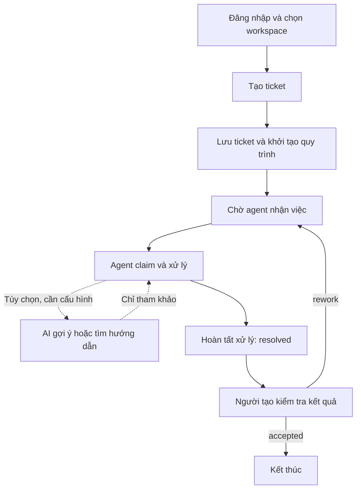

# Luồng E2E chính của Smart Service Desk

> Đối chiếu với mã nguồn ngày 26/10/2026. Tài liệu tập trung vào bài toán và hành trình nghiệp vụ; phân biệt chức năng backend với mức độ hoàn thiện giao diện. Không xem đây là xác nhận sẵn sàng production.

## 1. Project giải quyết bài toán gì?

Smart Service Desk quản lý yêu cầu hỗ trợ theo một vòng khép kín: **người dùng gửi yêu cầu → nhân viên nhận và xử lý → người gửi xác nhận → kết thúc hoặc xử lý lại**.

Ví dụ minh họa: một người dùng báo “Không kết nối được Wi-Fi tại phòng học”. Thay vì chỉ nhắn tin cho kỹ thuật viên và khó theo dõi kết quả, người dùng tạo một ticket. Hệ thống ghi nhận yêu cầu, quản lý nhiệm vụ của nhân viên và yêu cầu người gửi kiểm tra kết quả trước khi kết thúc.

Các nhu cầu chính:

- **Tiếp nhận tập trung:** lưu nội dung, người tạo và thời điểm tạo yêu cầu.
- **Phân quyền:** tách phạm vi làm việc theo workspace và vai trò.
- **Điều phối:** quản lý bước xử lý, người nhận việc và bước xác nhận kết quả.
- **Theo dõi:** tra cứu ticket, tiến độ, lịch sử và thống kê.
- **AI hỗ trợ:** gợi ý phân loại, ưu tiên, nhóm xử lý; có nhánh tìm hướng dẫn dựa trên nguồn tri thức được kiểm soát.
- **Truy vết:** ghi nhận lịch sử quy trình và audit, không chỉ lưu một trạng thái cuối cùng.

Repository còn xây dựng nền tảng DX-OS dùng chung. Service Desk là ứng dụng nghiệp vụ chính được mô tả ở đây, không phải toàn bộ nền tảng.

## 2. Các bên tham gia

| Vai trò | Công việc chính | Giới hạn |
| --- | --- | --- |
| `requester` — người yêu cầu | Tạo ticket, xem ticket của mình, xác nhận hoặc yêu cầu làm lại | Không mặc nhiên xem mọi ticket trong workspace |
| `agent` — nhân viên hỗ trợ | Xem ticket trong workspace, nhận và hoàn tất nhiệm vụ xử lý | Không được xử lý ticket do chính mình tạo |
| `coordinator` — điều phối viên | Theo dõi ticket và tình hình workspace | Muốn nhận bước xử lý phải đồng thời có quyền `agent` |
| Quản trị nền tảng | Thực hiện quyền quản trị được cấp | `platform-admin` không tự động có quyền xem ticket của mọi workspace |

Cả requester, agent và coordinator đều có thể tạo ticket theo quyền workspace. Một tài khoản có thể có nhiều vai trò, nhưng vẫn chịu các ràng buộc nghiệp vụ như không tự xử lý yêu cầu của mình.

## 3. Sơ đồ luồng chính



Danh sách, tiến độ và thống kê phục vụ theo dõi xuyên suốt. AI là nhánh hỗ trợ, không phải điều kiện bắt buộc để hoàn tất ticket.

## 4. Luồng E2E từng bước

### Bước 1 — Đăng nhập và xác định workspace

Người dùng đăng nhập qua Keycloak; frontend sử dụng OIDC/PKCE. Các lời gọi API gửi kèm token để backend xác thực và kiểm tra quyền.

Workspace là phạm vi làm việc được cấp quyền. Có quyền ở workspace A không đồng nghĩa được truy cập workspace B. Backend xác định người thao tác từ ngữ cảnh xác thực, không tin một trường người tạo tùy ý do trình duyệt gửi lên.

**Đầu ra:** biết người dùng là ai, đang làm việc ở đâu và được phép thực hiện hành động gì.

### Bước 2 — Người dùng tạo yêu cầu

Thông tin đầu vào:

- `title`: tiêu đề, từ 1 đến 200 ký tự.
- `description`: mô tả, từ 1 đến 4.000 ký tự.
- `clientRequestId`: UUID định danh lần gửi để phát hiện gửi trùng.

```text
POST /api/apps/servicedesk/v1/workspaces/{workspace}/tickets
```

Backend kiểm tra dữ liệu và quyền, lưu ticket, khởi tạo quy trình `service-desk` và ghi audit trong cùng giao dịch. Nếu một phần thất bại, giao dịch rollback để tránh ticket hoặc quy trình được tạo dở.

Ticket có tham chiếu tới quy trình; `businessKey` của quy trình là UUID ticket. Gửi lại cùng `clientRequestId` với cùng người tạo và workspace trả `409`, không tạo thêm ticket. Đây không phải cơ chế tự trả lại kết quả thành công của lần gửi trước.

**Đầu ra:** một ticket và quy trình đang ở bước `handle`. Gọi API khởi tạo quy trình chung của Core không tự tạo bản ghi ticket; luồng này phải đi qua API ứng dụng.

### Bước 3 — Nhân viên tìm và nhận việc

Agent dùng inbox quy trình để tìm nhiệm vụ dành cho nhóm agent của workspace, rồi thực hiện **claim**, tức nhận trách nhiệm xử lý.

Danh sách ticket và inbox khác nhau: danh sách thể hiện yêu cầu nhìn thấy được; inbox thể hiện nhiệm vụ có thể nhận hoặc đang được giao. Quyền đọc ticket không tự cấp quyền đọc mọi lịch sử quy trình.

Ví dụ, agent chưa liên quan có thể đọc ticket nhưng progress trả `404`; cần tìm nhiệm vụ qua inbox và nhận việc đúng quyền. Agent không được nhận xử lý ticket của chính mình; coordinator muốn nhận việc cần thêm quyền agent.

**Đầu ra:** có nhân viên phụ trách nhiệm vụ `handle`. Ticket vẫn được tính là chờ xử lý, dù đã claim.

### Bước 4 — Xử lý và tùy chọn dùng AI

Nhân viên đọc yêu cầu, xác minh và xử lý sự cố thực tế. Với ví dụ Wi-Fi, việc sửa thiết bị diễn ra ngoài phần mềm; hệ thống quản lý nhiệm vụ và tiến độ, không tự sửa thiết bị.

#### 4.1. Triage: gợi ý phân loại yêu cầu

```text
POST /api/apps/servicedesk/v1/workspaces/{workspace}/tickets/{id}/triage
```

Endpoint không nhận request body. Backend kiểm tra quyền đọc ticket, lấy tiêu đề và mô tả đã lưu rồi gọi Intelligence qua HPDI, với profile phía server `service-desk`, phiên bản `0.3.0`.

Kết quả gợi ý gồm `category`, `priority`, `suggestedGroup`: loại yêu cầu, mức ưu tiên và nhóm nên xử lý. Đây là thông tin tham khảo. Lời gọi triage không tự claim, chuyển nhiệm vụ hay hoàn tất quy trình; nhóm được đề xuất không đồng nghĩa đã được phân công.

Triage hiện là lời gọi riêng, không nên mô tả rằng tạo ticket luôn tự động chạy AI.

#### 4.2. Assistance: tìm hướng dẫn có nguồn

Trang chi tiết ticket có panel nhập câu hỏi để tìm hướng dẫn. Backend kiểm tra quyền xem ticket trước khi truy cập AI/tri thức, sử dụng các nguồn được cấu hình và ghim theo workspace, rồi kiểm tra lại quyền sau lời gọi AI trước khi trả kết quả.

- Có đủ bằng chứng: trả hướng dẫn cùng nguồn trích dẫn và phiên bản nguồn để người dùng kiểm tra.
- Không đủ bằng chứng: trả `INSUFFICIENT_EVIDENCE`, người dùng có thể bổ sung câu hỏi hoặc tiếp tục xử lý thủ công.
- Chưa bật hoặc không khả dụng: không coi AI là bước bắt buộc của quy trình ticket.

**Giới hạn quan trọng:** assistance mặc định tắt. Cấu hình hiện có chỉ chấp nhận các chế độ thử nghiệm synthetic rõ ràng (`synthetic-reference`, `synthetic-cloud-dev`). Không nên mô tả đây là chatbot production mặc định hoặc công cụ tự do tra cứu mọi tài liệu nội bộ.

### Bước 5 — Nhân viên báo đã xử lý

Nhân viên hoàn tất nhiệm vụ `handle` qua API nhiệm vụ của Core, với kết quả `resolved`. Quy trình chuyển sang `confirm`, giao cho người đã tạo yêu cầu.

**Đầu ra:** ticket chờ xác nhận, chưa kết thúc. Nhân viên báo xong không thay thế quyết định kiểm tra kết quả của người gửi.

### Bước 6 — Người tạo xác nhận hoặc yêu cầu làm lại

| Quyết định | Kết quả của bước `confirm` | Hệ thống thực hiện |
| --- | --- | --- |
| Đã giải quyết đúng | `accepted` | Đi tới sự kiện kết thúc quy trình |
| Vẫn còn vấn đề | `rework` | Quay về bước `handle` để xử lý tiếp |

Nhánh làm lại tiếp tục trên quy trình của ticket hiện có, không tạo ticket mới. Quy trình quay về nhiệm vụ dành cho nhóm agent, không nên mặc định luôn tự giao lại cho đúng nhân viên cũ.

**Đầu ra cuối:** yêu cầu được tính hoàn thành theo luồng chuẩn khi người tạo chấp nhận và quy trình kết thúc bình thường.

### Bước 7 — Theo dõi và thống kê

```text
GET /api/apps/servicedesk/v1/workspaces/{workspace}/tickets
GET /api/apps/servicedesk/v1/workspaces/{workspace}/tickets/{id}
GET /api/apps/servicedesk/v1/workspaces/{workspace}/tickets/{id}/progress
GET /api/apps/servicedesk/v1/workspaces/{workspace}/tickets/statistics
```

Danh sách hỗ trợ tìm theo tiêu đề/nội dung, phân trang và lọc thời gian tạo. Progress dựa trên quy trình; Flowable là nguồn sự thật về tiến độ, không có một trạng thái ticket độc lập dùng thay thế.

| Chỉ số | Ý nghĩa |
| --- | --- |
| `total` | Tổng ticket nhìn thấy được và khớp bộ lọc |
| `awaitingHandling` | Đang ở bước `handle`, đã hoặc chưa claim |
| `awaitingConfirmation` | Đang ở bước `confirm` |
| `completed` | Quy trình kết thúc bình thường, không còn nhiệm vụ đang chạy |
| `unclassified` | Trạng thái/dữ liệu không khớp các trường hợp chuẩn, cần kiểm tra |

`from` bao gồm mốc đầu, `to` không bao gồm mốc cuối. Các mốc lọc theo **thời điểm tạo ticket**, không phải thời điểm xử lý xong. Thống kê ticket tạo trong tháng không có nghĩa là mọi ticket hoàn tất trong tháng.

Thống kê theo cùng phạm vi quyền: requester xem phần của mình; agent/coordinator xem trong workspace. Frontend đã có widget thống kê gọi API.

## 5. Các thành phần phối hợp

```text
Người dùng / Frontend
    |
    | Đăng nhập qua Keycloak; gọi API qua APISIX
    v
Backend ứng dụng Service Desk
    |
    | Dùng các hợp đồng/capability HPDI
    +--> Human: danh tính, workspace, quyền
    +--> Process: quy trình, nhiệm vụ, lịch sử
    +--> Data: năng lực dữ liệu dùng chung
    +--> Intelligence: triage / assistance khi được cấu hình
              |
              v
       Runtime Intelligence Python

Core cung cấp năng lực nền; Flowable thực thi quy trình;
PostgreSQL lưu dữ liệu ticket và dữ liệu phục vụ vận hành.
```

H-P-D-I là Human, Process, Data, Intelligence. Đây là các nhóm năng lực nền tảng, không phải bốn bước người dùng phải thao tác tuần tự.

Ứng dụng Service Desk sở hữu nghiệp vụ ticket và định nghĩa quy trình. Core cung cấp cơ chế dùng chung. Các năng lực metadata/tệp của nền tảng không đồng nghĩa ticket đã có đầy đủ nghiệp vụ đính kèm riêng tư.

## 6. Ví dụ đi hết một vòng

1. Lan đăng nhập với quyền requester trong workspace được cấp.
2. Lan tạo ticket “Không vào được Wi-Fi phòng học”, kèm mô tả và UUID lần gửi.
3. Backend lưu ticket và khởi động quy trình, tạo nhiệm vụ `handle` cho nhóm agent.
4. Minh là agent khác người tạo, tìm nhiệm vụ trong inbox và claim.
5. Minh có thể gọi triage để tham khảo; nếu assistance được bật đúng cấu hình thử nghiệm, Minh có thể hỏi hướng dẫn có nguồn.
6. Minh xử lý thực tế và hoàn tất `handle` với `resolved`.
7. Lan nhận bước `confirm`. Nếu còn lỗi, Lan chọn `rework`, quy trình quay về `handle`.
8. Sau khi xử lý đạt yêu cầu, Lan chọn `accepted`; quy trình kết thúc.
9. Khi đọc lại thống kê với bộ lọc phù hợp, ticket thuộc nhóm `completed`. Lịch sử cho phép theo dõi các bước theo quyền truy cập.

Đây là kịch bản nghiệp vụ qua các API tương ứng, không phải cam kết mọi bước đã có nút thao tác trên giao diện hiện tại.

## 7. Đã có gì và còn giới hạn gì?

| Phạm vi | Tình trạng thể hiện trong repository |
| --- | --- |
| Tạo, danh sách, chi tiết, progress ticket | Có API backend và hợp đồng OpenAPI |
| Xử lý → xác nhận → chấp nhận/làm lại | Có BPMN thực thi bằng Flowable và cơ chế nhiệm vụ Core |
| AI triage | Có endpoint và adapter riêng, không tự động nằm trong tạo ticket |
| Dashboard ticket | Có API thống kê và widget frontend gọi API |
| Danh sách ticket trên UI | `TicketListPage.tsx` hiện là placeholder |
| Chi tiết ticket trên UI | Có định danh ticket và panel assistance; chưa phải màn hình đầy đủ của vòng đời ticket |
| Assistance có nguồn | Có backend và panel; mặc định tắt, giới hạn cấu hình synthetic |
| Đính kèm riêng cho ticket, SLA, hủy ticket, tự phân công theo AI | Không coi là các phần đã hoàn chỉnh của luồng này |
| Production | README ghi Security G9 FAIL, release BLOCKED; chức năng chạy được không có nghĩa đủ điều kiện phát hành |

Repository còn có quy trình `room-request` với một bước duyệt của coordinator và các quy trình mẫu. Đây là ví dụ mở rộng nền tảng, không phải bước bắt buộc trong vòng đời ticket Service Desk.

## 8. Nguồn đối chiếu trong repository

- `backend/src/main/java/vn/haui/dx/apps/servicedesk/TicketController.java`: API ticket và thống kê.
- `backend/src/main/java/vn/haui/dx/apps/servicedesk/TicketService.java`: nghiệp vụ, quyền và liên kết quy trình.
- `backend/src/main/resources/apps/servicedesk/process/service-desk.bpmn20.xml`: bước xử lý, xác nhận và vòng làm lại.
- `backend/src/main/java/vn/haui/dx/apps/servicedesk/triage/TicketTriageService.java`: lời gọi triage từ dữ liệu ticket.
- `backend/src/main/java/vn/haui/dx/apps/servicedesk/assistance/TicketAssistanceService.java`: kiểm tra quyền và gọi assistance.
- `backend/src/main/java/vn/haui/dx/apps/servicedesk/assistance/ServiceDeskAssistanceConfiguration.java`: giới hạn cấu hình assistance.
- `frontend/src/apps/servicedesk/pages/TicketListPage.tsx`: placeholder danh sách.
- `frontend/src/apps/servicedesk/pages/TicketDetailPage.tsx`: trang hỗ trợ theo ticket/workspace.
- `frontend/src/apps/servicedesk/dashboard/TicketStatsWidget.tsx`: widget thống kê.
- `contracts/openapi/servicedesk.yaml`: hợp đồng API ứng dụng.
- `docs/servicedesk-ticket-foundation.md`, `docs/servicedesk-statistics.md`: quy tắc ticket, quyền và thống kê.

**Tóm lại:** project quản lý yêu cầu hỗ trợ theo vòng khép kín có phân quyền và truy vết; AI hỗ trợ quyết định nhưng không thay người xử lý hoặc người xác nhận kết quả.
