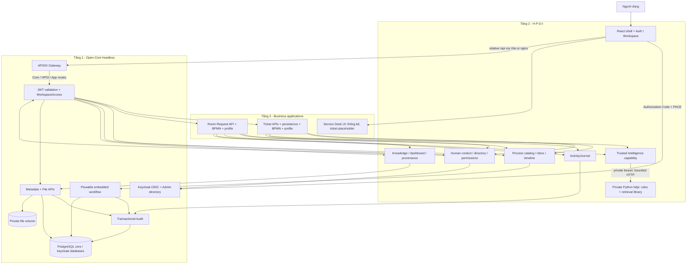

# Kiểm toán kỹ thuật Smart Service Desk - PMNM HaUI 2026

Ngày đánh giá: **25/10/2026, Asia/Saigon**. Baseline: branch `develop`, commit `24ba2820c2cfa56b24f68fe026312becaf530b40` (PR #41). Đây là mô phỏng độc lập, không phải điểm hoặc quyết định của Hội đồng.

## 1. Executive Summary

**Kết luận: tiếp tục kiến trúc hiện tại, nhưng CHƯA thông qua nghiệm thu demo/nộp bài.** Không cần viết lại Core hoặc chuyển sang microservices. Cần đóng khoảng trống UI nghiệp vụ, thống nhất authorization và hoàn tất điều kiện nguồn mở trước khi mở rộng AI.

Phát hiện quan trọng, theo thứ tự ảnh hưởng:

1. **P0 - Chưa có LICENSE chính thức.** `LICENSING.md:21` xác nhận chưa cấp license; ý định Apache-2.0 không thay thế yêu cầu mục 5/10/12 của đề. Quyền phát hành original code, fixtures và PDF tham chiếu chưa được hoàn tất.
2. **P0 - Chưa chứng minh điều kiện công khai/release.** GitHub web và API ẩn danh đều HTTP 404; `git tag` không có kết quả. Không suy ra chắc chắn repo private hoặc remote release không tồn tại, nhưng không thể xác nhận đạt PoF. Nếu không public tại thời điểm chấm, mục 12 quy định không chấm PoF và có thể loại.
3. **P1 - Service Desk UI chưa khép kín.** `frontend/src/apps/servicedesk/pages/TicketListPage.tsx:9` là placeholder; client Service Desk mới có thống kê. Chưa có màn hình tạo/chi tiết ticket hoặc triage. H/P/D có UI và API thực, không được đánh đồng toàn bộ frontend với scaffold.
4. **P1 - Có đường API bỏ qua permission mới ở H-P-D-I.** Knowledge/Process controller kiểm quyền chi tiết, nhưng Core API cho cùng tài nguyên chỉ kiểm membership/role cũ; gateway mở cả hai nhóm route. Phát hiện từ luồng code, chưa tái hiện bằng token thật trong phiên này; không phải anonymous access hoặc cross-workspace leak đã xác nhận.
5. **P1/P2 - Release security chưa thông qua; scan chưa bao phủ frontend mới.** Evidence ngày 18/10/2026 ghi G9 FAIL; không có scan mới trong phiên này. Không gán số CVE lịch sử cho image hiện tại. `scripts/scan-core.ps1:3` và workflow tích hợp chưa liệt kê image frontend.

**Điểm mạnh có bằng chứng:** ba tầng có ranh giới được kiểm tra bằng source guards, ArchUnit, build frontend platform độc lập; workflow là Flowable thực với BPMN, transaction, lịch sử và khóa đồng thời; Intelligence rule-based có giải thích và kiểm thử; Room Request đã có code để chứng minh hướng tái sử dụng, không chỉ nhiều container.

| Chỉ số | Kết quả | Cách hiểu |
|---|---:|---|
| Implementation Progress | **55/72 = 76,4%** | Độ phủ 72 mốc bàn giao triển khai; không phải 76,4% sản phẩm đã chạy ổn định |
| Verified Completion | **19/72 = 26,4%** | Cận dưới những mốc xác nhận trong phiên audit; DB/Compose/browser còn UNVERIFIED |
| Requirement Coverage | **8/36 = 22,2% Pass** | 21 Partial, 2 Fail, 5 Unverified; partial-credit tham khảo 51,4%, không phải tỷ lệ MUST đã đạt |
| Verified evidence score | **43/100** | PoF 19/50 + Product 24/50, trước quyết định không chấm/loại theo mục 12 |
| Estimated score có điều kiện | **50-58/100** | Khi repo truy cập được và runtime hiện tại tái xác nhận kết quả tích hợp lịch sử; tin cậy thấp-trung bình |
| Mục tiêu cải thiện | **75-85/100** | Sau đóng task ưu tiên, demo và clearance nguồn mở; không bảo đảm điểm |

### Phạm vi, phương pháp và giới hạn

- Đã đọc đủ 7 trang PDF chính thức, gồm rubric/chế tài/lộ trình; xem trực quan sơ đồ trang 2. SHA-256: `EBB7578A2B0CD3DC4A1DAB0E146BD04CF1C0A461074B0E2B9F668AF10928F016`.
- Khảo sát backend/frontend/intelligence/contracts/infra/scripts/fixtures/docs, Git/CI; đọc sâu các luồng Identity, Data/File, Workflow, H-P-D-I, Service Desk, Room Request, triage và tests. Đây là audit theo luồng/rủi ro, không tuyên bố review từng dòng của mọi file.
- Tham khảo các mốc kế hoạch 13 trang `docs/references/Ke_hoach_DX_Lab_14_ngay_3_nguoi.pdf`, architecture/boundary recovery/handoff/security. Kế hoạch không thay đề và không chứng minh implementation.
- Ba file untracked có trước audit được giữ nguyên: `docs/BE02_KNOWLEDGE_RETRIEVAL_DESIGN.md`, `docs/MERGE_READY_01_REVIEW.md`, `docs/PROJECT_FROM_ZERO_TO_CONTRIBUTOR.md`. Không coi chúng là artifact tái lập từ HEAD. BE-02 tự ghi DESIGN ONLY, không phải endpoint đã triển khai.
- Chỉ thêm báo cáo này trong repository; không sửa code/config, commit/merge/tag/publication. Build/test chạy trên `git archive HEAD` trong TEMP; không dùng DB/volume người dùng, không đưa secret vào báo cáo.
- Docker daemon không sẵn sàng: named pipe `dockerDesktopLinuxEngine` không tồn tại. Không tự mở Docker Desktop hoặc chạy stack/reset/restore. Full clean-install, live SSO, browser E2E hiện tại đều UNVERIFIED.
- HTTP 404 ẩn danh không chứng minh repository không tồn tại. Issue tracker, remote tags/releases, CI và branch protection hiện tại không xác minh được. Không tái sử dụng thông tin ngày 18/10 như trạng thái online hôm nay.

## 2. Architecture Map

### 2.1. Kiến trúc thực tế

**Modular monolith Java + Identity/Gateway/DB và private Python runtime**, không phải cụm microservices nghiệp vụ độc lập. Phù hợp đề: headless là không phụ thuộc UI người dùng cuối, không đồng nghĩa mỗi capability có container riêng.

| Tầng/thành phần | Implementation/evidence | Trạng thái |
|---|---|---|
| T1 Identity | Keycloak realm; `backend/src/main/java/vn/haui/dx/core/identity/internal/SecurityConfig.java:25`; issuer/audience trong application.yml | JWT/group roles/PKCE/directory có thật; live SSO chưa rerun |
| T1 Gateway | `infra/apisix/apisix.yaml:1`, standalone routes Core/HPDI/apps, limits; `compose.yaml:1` không publish backend/DB | APISIX routing; JWT thực thi tại Java, không phải gateway JWT plugin |
| T1 Data/File/Audit | JDBC metadata, private files, PostgreSQL, AuditService | API headless, SQL/transaction; DB tests skip trong audit |
| T1 Workflow | `backend/src/main/java/vn/haui/dx/core/workflow/internal/FlowableWorkflowService.java:90` | Flowable embedded; không thiếu một container engine riêng |
| T2 H | HumanContext/MemberDirectory/PermissionGuard; FE auth/workspace/members/profile | UI/API có; directory dùng Keycloak Admin API read-only |
| T2 P | `backend/src/main/java/vn/haui/dx/hpdi/process/internal/CoreProcessCapabilities.java:18`; FE inbox/requests/timeline | Catalog, DTO riêng, task actions, lịch sử |
| T2 D | `backend/src/main/java/vn/haui/dx/hpdi/data/internal/CoreKnowledgeCatalog.java:27`; FE knowledge/dashboard/audit | Metadata/content/checksum/search; dashboard gọi API, không chỉ mock |
| T2 I | TrustedIntelligenceCapability/HttpIntelligenceTransport → `intelligence/src/hdpi` | Private triage HTTP; UI Intelligence chưa cài |
| T3 Service Desk | TicketService/Repository/Controller, ServiceDeskProcess, TicketTriageService | Backend có; UI mới widget thống kê và placeholder |
| T3 Room Request | `backend/src/main/java/vn/haui/dx/apps/roomrequest/RoomRequests.java:15`, BPMN/profile riêng | Có code/tests tái sử dụng; live integration hiện tại chưa chứng minh |
| Assembly | `backend/src/main/java/vn/haui/dx/assembly/DxOsApplication.java:7`, FE registry | Ghép module; không phải Core import ngược app |



Đây là dependency logic; cùng JVM gọi interface, không nhất thiết HTTP. **Các đường xuyên browser→Keycloak→Gateway→DB/Python còn UNVERIFIED tại HEAD hiện tại**. Sơ đồ không phải kết quả runtime; retrieval library không được vẽ như HTTP search endpoint đã có.

### 2.2. Bản chất Open-Core và khả năng tái sử dụng

- **Core có thật ở cấp code/contract.** Identity/Data/File/Workflow/Audit không cần React; không phải chỉ web CRUD. Admin console Keycloak không biến Core thành UI nghiệp vụ.
- **Tái sử dụng vượt mức sơ đồ:** RoomRequests dùng HumanContext, ProcessCapability, KnowledgeCatalog, IntelligenceCapability, ActivityJournal; BPMN/profile riêng tại app. Source guards, ArchUnit, core-only và second-domain compile/test đều PASS; DB lifecycle tests trong các profile vẫn skip.
- **Chưa chứng minh live reuse hiện tại:** build profile không thay thế boot Core/app mới, dùng cùng SSO/Data/Workflow trên DB thật. Evidence lịch sử phải gắn SHA, không gán cho PR #41.
- Bỏ Service Desk giữ được membership/security, metadata/file/audit, Flowable mechanism, HPDI capabilities, Python hdpi và FE platform. Thêm app chủ yếu đổi assembly/resource/profile/migration packaging, không đưa nghiệp vụ ticket vào Core.
- Một JVM, một DB core, Flowable cùng transaction manager là lựa chọn hợp lý cho 3 người/14 ngày. JDBC observations phụ thuộc schema Flowable bên trong Core: cần retest khi đổi engine, không gọi implementation hoàn toàn engine-neutral.
- Điểm cần sửa là **policy enforcement xuyên Core/HPDI**, không phải thay toàn bộ kiến trúc. Không phát hiện dependency ngược bị guards bỏ lọt trong các kiểm tra đã chạy; không suy ra guards chứng minh mọi đặc tính runtime.

## 3. Requirement Compliance Matrix

Nguồn chuẩn: PDF người dùng cung cấp, số trang vật lý. `Pass`: đủ bằng chứng cho phạm vi hẹp của hàng; `Partial`: thiếu thành phần/runtime/clearance; `Fail`: artifact xác định thiếu; `Unverified`: chưa đủ dữ liệu, không đồng nghĩa thất bại. Các hàng được tách thành 36 nghĩa vụ audit, không phải 36 tiêu chí điểm độc lập của đề.

| ID | Mức | Yêu cầu / mục, trang PDF | Trạng thái | Evidence / gap |
|---|---|---|---|---|
| R01 | MUST | Ba tầng, 3 tr.3 | Pass | Assembly/Core/HPDI/apps; source guards, ArchUnit, independent FE platform build |
| R02 | MUST | Headless/shared Core, 4.1 tr.3 | Pass | APIs không cần UI, core-only compile; live reuse ở R16 |
| R03 | MUST | Identity/auth/authorization, 4.1 | Partial | JWT/groups/PKCE/directory; chưa live SSO hiện tại; F04 |
| R04 | MUST | Gateway/API trung gian kiểm soát, 4.1 | Partial | Routes/limits/isolation có config; gateway chưa boot |
| R05 | MUST | Storage cấu trúc và/hoặc phi cấu trúc, 4.1 | Partial | PostgreSQL/migrations/files; DB tests skip |
| R06 | MUST | Workflow/state/history, 4.1 | Partial | BPMN/Flowable/locks; chưa current lifecycle runtime |
| R07 | MUST | Sơ đồ và service flow, 4.1 | Pass | Docs architecture và đối chiếu code ở mục 2 |
| R08 | MUST | H: login/quyền/workspace/knowledge, 4.2 tr.3-4 | Partial | BE/FE có chức năng; chưa browser permission matrix |
| R09 | MUST | P: actor/time/history/pending, 4.2 | Partial | ProcessController/inbox/timeline/UI; DB chưa rerun |
| R10 | MUST | D: unified source/provenance, 4.2 | Partial | Source/version/rights/checksum; current DB chưa xác nhận |
| R11 | MUST | D: search/filter/stats/dashboard, 4.2 | Partial | APIs/widgets có thật; chưa browser-verify số với lifecycle |
| R12 | MUST | REST/GraphQL cho dữ liệu, 4.2/7 | Pass | REST controllers/contracts metadata/knowledge/ticket |
| R13 | MUST | Ít nhất một Intelligence, 4.2/7 | Partial | Local rules/service tests PASS; I UI và current full-stack demo thiếu |
| R14 | MUST | Tool/version/input/limits/explanation I, 4.2 | Pass | Rules 0.2.0/profile 0.3.0/evidence/needsReview; license ở R19-20 |
| R15 | MUST | Ít nhất một app thực tế, 4.3 | Partial | IT support backend có; ticket UI placeholder |
| R16 | MUST | App dùng Core/HPDI, 4.3 | Partial | TicketService/RoomRequests; chưa rerun live liên thông |
| R17 | MUST | Public repository, 5/10 tr.4-5 | Unverified | Anonymous GitHub web/API 404 |
| R18 | MUST | Lịch sử commit thực tế, 5 | Pass | 233 reachable commits, nhiều PR/nhánh, từ 06/10/2026 |
| R19 | MUST | LICENSE rõ ràng, 5/10 | Fail | Không root LICENSE; formal grant pending |
| R20 | MUST | Dependency/license compatibility, 5 | Partial | Có inventory/locks; closure/frontend/version chưa đủ |
| R21 | MUST | Versioned release/tag, 5/10 | Unverified | Local không tag; remote không truy cập được |
| R22 | MUST | Source build/install/run, 5/7 | Partial | Java/FE/Python source checks PASS; chưa clean full-stack run |
| R23 | MUST | README architecture/install/API/accounts, 5/10 | Partial | Có hướng dẫn/account; frontend/dashboard/version mô tả cũ |
| R24 | MUST | CHANGELOG, 5/10 | Pass | Có tracked CHANGELOG/unreleased entries |
| R25 | MUST | Issue/bug tracker, 5/10 | Unverified | Remote 404; PR template không thay issue tracker |
| R26 | MUST | Không commit secret/nhạy cảm, 5/7 | Unverified | .env/realm ignored; scan lịch sử chưa bao phủ lại HEAD/233 commits |
| R27 | MUST | Không dùng closed/unclear core components, 5 | Partial | Stack khai báo OSS; chưa full closure approval |
| R28 | MUST | Origin/version/license/role dependency, 5 | Partial | Inventory/provenance có nhưng toàn stack chưa cập nhật |
| R29 | MUST | Core tests tối thiểu, 7 tr.5 | Pass | 93 Java tests thực thi PASS và guards; không phải DB suite toàn phần |
| R30 | MUST | RBAC/hash/secrets/.env.example, 7 | Partial | Delegated Keycloak password handling, JWT tests; chưa live hash/policy; F04 |
| R31 | MUST | Sample/fallback nguồn ngoài, 7/8 | Partial | Fixtures/seed scripts/manual workflow có; chưa full-stack fallback hiện tại |
| R32 | MUST | Nguồn/quyền dữ liệu/provenance hợp lệ, 8 | Partial | Manifests có nguồn nhưng quyền pending; không khẳng định đã dùng trái phép |
| R33 | MUST | UI/dashboard/sample thử, 9 | Partial | H/P/D tiếng Việt có; Service Desk chưa hoàn chỉnh |
| R34 | MUST | Demo user→core→process→data→I→result, 9 | Partial | API scripts/evidence lịch sử; browser chain chưa khép kín |
| R35 | MUST | Chỉ rõ tầng, 10 phút demo + tối đa 5 phút hỏi, 9 | Unverified | Chưa rehearsal/slide/time evidence |
| R36 | MUST | Báo cáo kỹ thuật và slide tối đa 12, 10 | Fail | Chưa thấy bộ hồ sơ nộp bài/slide; audit không tự thay product report |

**Không phải MUST:** đúng Keycloak/APISIX/Flowable; tự viết lại nền tảng; đúng hai nguồn dữ liệu mở; LLM/GPU; app thứ hai; GraphQL khi đã REST; Docker nếu có source procedure khác tái lập được; Prometheus/Grafana; rate limiting; CONTRIBUTING; video 3-5 phút. Báo cáo 8-10 trang là khuyến nghị về độ dài. Các lợi thế có sẵn không bù việc thiếu LICENSE/public evidence.

## 4. Implementation Inventory

Tại HEAD có 136 Java source production, 33 Java test/support source, 165 file frontend/src, 99 Python source trong intelligence/src và 62 Python test source. Số file chỉ để xác định phạm vi, **không dùng làm phần trăm hoàn thành**.

| Mức trưởng thành | Những thành phần thuộc mức này | Điều chưa được phép suy ra |
|---|---|---|
| Code + cấu hình + test cục bộ đã chạy | JWT mapping, directory adapter, HPDI adapters, Java-Python transport/schema validation, frontend type/lint/unit/build, rules/retrieval/evaluation Python, boundary guards | Không đồng nghĩa live SSO, DB integration hay browser E2E |
| Code tích hợp + scripts + evidence lịch sử | Metadata/file/audit, Flowable lifecycle/locks, ticket persistence/statistics, Room Request, gateway/private Python | Runtime trên current HEAD chưa tái chứng minh |
| UI/API có triển khai nhưng chưa browser nghiệm thu | Workspace, members/profile, Knowledge Hub, inbox/assignment/completion, timeline, dashboard/audit | Không nói mọi màn hình là mock, cũng không chấm UX/ổn định từ build |
| Scaffold/chưa khép kín | TicketListPage placeholder, Service Desk chỉ có statistics client/widget; platform Intelligence README ghi chưa cài | Chưa có create/list/detail/triage UX cho chuỗi demo chính |
| Library chưa thành public product API | Search/assist/retrieval/citation libraries, dense/hybrid optional | Không gọi là Knowledge Search HTTP/RAG sản phẩm đã chạy |
| Chỉ có dự định/đang chờ | Source license approval, data rights approval, release; BE-02 design untracked | Không coi license intention, PROPOSED profile hoặc design là nghiệm thu |
| Không tìm thấy trong nguồn khảo sát | Bộ slide nộp bài, product technical report đã chốt, local version tag | Không khẳng định những file này không tồn tại ở máy khác hoặc remote không truy cập được |

## 5. Detailed Technical Audit

### 5.1. Identity, SSO, RBAC

**Requirement → Implementation → Evidence → Gap → Impact → Action:** mục 4.1/7 yêu cầu identity và authorization → Keycloak + resource server + workspace group roles và permission directory → `backend/src/main/java/vn/haui/dx/core/identity/internal/SecurityConfig.java:25`, `backend/src/main/java/vn/haui/dx/core/identity/internal/JwtCurrentUser.java:22`, application.yml → chưa live login/refresh/logout; Core policy không đồng nhất permission H-P-D-I → có thể vượt qua quyền bị thu hồi tại lớp capability → đóng F04 và chạy matrix bằng token thật.

- Security chain chỉ mở `/actuator/health`; các request khác cần authentication. JWT issuer, JWKS và audience `dx-core` được cấu hình. Group claim chỉ nhận workspace/role đúng regex; platform-admin không được mặc nhiên coi là member mọi workspace.
- FE dùng Authorization Code/PKCE S256, token trong memory, PKCE state trong sessionStorage; `frontend/src/platform/human/auth/userManager.ts:10`, `frontend/src/platform/human/auth/config.ts:31`. Đây là code/config, chưa chứng minh iframe silent renew hoặc logout trên trình duyệt thực.
- Backend có authorization thực, không chỉ ẩn menu: TicketService giới hạn requester đọc ticket của mình; workflow kiểm candidate/assignee/independence; metadata tạo cần agent/coordinator. Tuy nhiên quyền chi tiết mới không được enforce trên mọi đường API tương đương.
- Password handling được giao Keycloak; realm template không chứa credentials demo thật. `scripts/setup.ps1:5` sinh random secrets vào file ignored. Không kiểm database credential hash trong phiên này, không tự chứng nhận thuật toán hash đang chạy.
- Directory cache 60 giây; danh sách role groups tối đa 100 và members tối đa 1.000 mỗi group, chưa paginate (`backend/src/main/java/vn/haui/dx/core/identity/internal/KeycloakWorkspaceDirectory.java:124`). Hợp lý demo nhỏ; không đủ để tuyên bố hỗ trợ 100.000 người. Độ trễ revoke còn phụ thuộc JWT lifespan và cache, cần mô tả rõ thay vì hứa revoke tức thời.

### 5.2. API Gateway và exposure

- APISIX route Core, HPDI, Service Desk, Room Request vào platform; có limit-count và giới hạn body 6 MiB (`infra/apisix/apisix.yaml:3`). JWT authorization thực thi downstream tại Java; gateway không cần tự có OIDC plugin mới đáp ứng đề.
- Compose publish loopback Keycloak 8081, Gateway 9080 và FE 5173; không publish PostgreSQL/platform/private Python. Đây là kiểm tra configuration; chưa kiểm port thực vì daemon tắt. Không được nói backend/DB đang public chỉ vì có EXPOSE trong Dockerfile.
- FE gọi relative `/api`; Vite proxy hoặc nginx proxy sang APISIX (`frontend/vite.config.ts:17`, `frontend/nginx.conf:7`). Thiếu gateway CORS không phải blocker ở same-origin path này; direct cross-origin API là chế độ chưa hỗ trợ.
- `keycloak start-dev`, HTTP và `sslRequired=none` là cấu hình local demo, không là production deployment. Giữ loopback; nếu expose internet phải thiết kế TLS/hostname/proxy trust riêng, không chỉ mở port.

### 5.3. Data, file storage, transaction và provenance

**Requirement → Implementation → Evidence → Gap → Impact → Action:** D phải có dữ liệu/provenance/API → PostgreSQL metadata/file/audit + Knowledge capability → `backend/src/main/java/vn/haui/dx/hpdi/data/internal/CoreKnowledgeCatalog.java:42` kiểm workspace/checksum/media type/bytes → DB hiện tại chưa xác nhận; quyền dữ liệu fixture còn pending → không đủ cơ sở quảng bá dữ liệu sẵn sàng public/AI corpus → duyệt dữ liệu và chạy DB/content tests trên release SHA.

- Flyway V1-V6 và app Room Request V7 tồn tại; `EngineAfterMigrations` xử lý thứ tự Flowable sau Flyway. V6 bỏ cross-owner FK từ servicedesk_ticket sang process_scope, không sửa migration lịch sử (`backend/src/main/resources/db/migration/V6__decouple_servicedesk_workflow_reference.sql:2`).
- Ticket create dùng transaction bao workflow start + ticket insert + activity/audit (`backend/src/main/java/vn/haui/dx/apps/servicedesk/TicketService.java:38`). Unique `(workspace, creator, client_request_id)` chống insert lặp ở DB; không đánh đồng với HTTP retry luôn trả cùng resource.
- SQL search dùng parameter binding; tìm literal bằng position/lower, không nối raw query vào SQL. List/count dùng repeatable-read để nhất quán trong một request. Không phát hiện bằng chứng SQL injection ở đường đã đọc.
- File service giới hạn 5 MiB, kiểm extension/signature/UTF-8, random storage key, kiểm symlink/checksum; rollback hook xử lý blob khi DB transaction thất bại (`backend/src/main/java/vn/haui/dx/core/data/internal/LocalFileService.java:178`). DB/file atomicity đã có thiết kế nghiêm túc, nhưng không được chứng nhận lại chỉ từ compile; 23 file integration tests đang skip.
- `JdbcAuditService.record` dùng propagation MANDATORY: audit phải commit/rollback cùng nghiệp vụ, không ghi rời. Có requestId/ProblemDetail để truy vết; không có bằng chứng đã triển khai metrics/tracing stack tập trung.
- Backup/recovery có script dừng/quiesce và restore sang volume mới trong `scripts/test-core-acceptance.ps1:75`. Không chạy vì tác động runtime/daemon thiếu; không khẳng định backup/restore HEAD hiện tại PASS.
- Upload mặc định Compose bật `DX_ALLOW_UNSCANNED_UPLOAD=true` (`compose.yaml:46`); FileApi default fail-closed nếu không bật. Đây là ngoại lệ demo đã chủ ý, không phải có malware scanner. Chỉ dùng dữ liệu synthetic đã duyệt; không biến upload công khai thành production-ready.

### 5.4. Workflow và Process

- Process không phải cột status tự update: Flowable BPMN Service Desk có handle → confirm → accepted/end hoặc rework/handle; initiator được gán bước xác nhận. Actor, timestamps, comments và history được engine/API lưu.
- `backend/src/main/java/vn/haui/dx/core/workflow/internal/FlowableWorkflowService.java:148` có claim/independent approver; complete kiểm assignee, expectedTaskKey và allowed outcome; `lockedTask` dùng `process_scope ... for update` tại dòng 368. Có nguyên nhân kỹ thuật để chống race/double-complete, không chỉ có nút UI.
- HPDI ProcessController có catalog/start/inbox/claim/assign/complete/timeline/statistics, frontend có inbox và timeline. Task assignment kiểm coordinator/candidate/independence tại Core. Không cần thêm engine mới.
- ServiceDeskProcess không self-service (`backend/src/main/java/vn/haui/dx/apps/servicedesk/ServiceDeskProcess.java:13`): phải tạo ticket qua app để process đi cùng record. Vì ticket UI chưa có, form chung HPDI không phải cách thay thế tạo ticket. Core process API vẫn là API nền tảng; cần nêu rõ contract/trust boundary và xem xét ngăn app-only process bị tạo mồ côi qua entry point khác.
- Không ép chuỗi trạng thái 6 nhãn của kế hoạch lên đề chính thức. Đề yêu cầu quy trình có trạng thái/actor/history; handle/confirm/rework có thể đáp ứng nếu demo rõ và chạy thật.

### 5.5. Intelligence: có thật nhưng chưa phải toàn bộ trải nghiệm sản phẩm

- RulesEngine `name=rules`, build `0.2.0`; Service Desk profile `0.3.0`; Python package `0.3.0`. Input title/description, output category/priority/suggestedGroup, literal input evidence, matchedRules, impact/urgency/reason, needsReview. Nguồn: `intelligence/src/hdpi/engines/rules/engine.py:29`, `intelligence/src/hdpi/services/triage.py:28`. Profile vẫn ghi PROPOSED; không thay business approval bằng test PASS.
- App lấy ticket đã authorize rồi mới gọi I, không nhận arbitrary trusted context từ browser (`backend/src/main/java/vn/haui/dx/apps/servicedesk/triage/TicketTriageService.java:19`). Private Python endpoint dùng service bearer constant-time comparison, body caps và request deadline (`intelligence/src/hdpi/http_service.py:64`).
- Java transport không follow redirects, connect timeout 1s/request khoảng 4s, request 32 KiB/response 256 KiB, kiểm content type/status/duplicate JSON (`backend/src/main/java/vn/haui/dx/hpdi/intelligence/integration/HttpIntelligenceTransport.java:30`). Tests transport/schema có thực thi, không chỉ HTTP happy path.
- EngineUnavailable có DEGRADED/needsReview; transport timeout/unavailable là lỗi 503/504 tùy mapping, **không phải mọi lỗi HTTP được đổi thành DEGRADED response**. Manual workflow độc lập I về thiết kế; current outage E2E chưa chạy. UI chưa có trạng thái gợi ý/lỗi/fallback nên trải nghiệm này chưa hoàn thành.
- TF-IDF là lexical retrieval, không tự gọi là semantic search/RAG. BM25/dense/hybrid/citation/assist có library/tests nhưng không có public Knowledge Search API hay UI Intelligence. Đề không bắt buộc các phần này, không trừ điểm vì thiếu LLM.
- Đã chạy evaluator hiện tại: 12 authored cases, Hit@1 **7/12 = 0,5833**, Hit@3 **11/12 = 0,9167**, MRR **0,7389**, macro Recall@3 **0,875**; conformance **12/12**. Security/provenance/contract report có 9 checks và zero recorded violation metrics. Đây là engineering regression nhỏ, `benchmarkClaim=false`, không chứng minh accuracy ngoài thực tế hoặc đã đạt G9 image security.
- Quyền source/data/model tách biệt. Fixture manifests đang PENDING_OWNER_APPROVAL; không dùng local kb ID như Core metadata ID, không lấy test corpus để khẳng định dữ liệu production đã có quyền. Năm real dense-model tests được skip vì chưa provision model; OPTIONAL, không làm rule-based I thất bại.

### 5.6. Business application và frontend

- Backend Service Desk có create/list/detail/search/time filters/statistics/progress/triage, workspace/creator visibility, sample workflows và tests. Người dùng chính: requester, agent, coordinator; bài toán hỗ trợ CNTT trong đơn vị đào tạo phù hợp mục 4.3.
- FE có H/P/D tương đối rộng: auth/workspace, knowledge upload/list/detail/provenance, requests/inbox/timeline, assign/complete, dashboard/audit; service calls dùng API client có token/401 handling, không hard-code toàn bộ dashboard.
- Nhưng `frontend/src/apps/servicedesk/services/ticketService.ts:17` mới có getTicketStatistics; `frontend/src/apps/servicedesk/index.ts:12` đăng ký một ticket route placeholder, chưa processLinks chi tiết. Không thể kể rằng người dùng tạo ticket và xem AI hoàn toàn qua UI hiện tại.
- UI I chưa triển khai được ghi thẳng trong `frontend/src/platform/intelligence/README.md:3`. Thu hẹp target: tạo/list/detail ticket + triage evidence/read-only suggestion + đi sang Process timeline/inbox có sẵn; không xây thêm portal song song.
- Chưa chạy trình duyệt desktop/mobile, keyboard/reader, refresh/logout thực. Source có responsive styles và UI primitives không đủ để chứng nhận accessibility/UX. FE build warning bundle chính khoảng 867 kB minified là P3 tối ưu, không blocker chức năng.

### 5.7. Kết quả kiểm tra thực thi trong phiên audit

Build/test chạy trên bản sao tracked HEAD, không bao gồm ba tài liệu untracked. Log nằm ngoài repository tại `C:\Users\admin\AppData\Local\Temp\haui-audit-b8c7db729f274ce48151dc9a25c17b54`. Đây là evidence cục bộ có thể bị dọn TEMP, chưa phải artifact release bền vững.

| Lệnh/kiểm tra | Kết quả thực tế | Giới hạn |
|---|---|---|
| `python scripts/check-tier-boundaries.py` | PASS strict source debt/expiry/metadata | Không thay compiled Java hoặc runtime |
| `python scripts/test-tier-boundaries.py` | 39 tests PASS | Mutation guards, không phải 39 product E2E |
| `py -3.11 scripts/test-core-contract.py` | PASS route specificity/detail/missing-field rejection | Không phải gateway HTTP acceptance |
| Maven 3.9.12, Java 17, `mvn -B -f backend/pom.xml test` | BUILD SUCCESS, 176 discovered, **93 executed PASS / 83 skipped**, 0 failure/error | DB env không set; không báo 176 PASS |
| `mvn -B -f backend/pom.xml -Pcore-only clean test` | SUCCESS, 78 discovered, **18 PASS / 60 skipped** | Proves compile isolation, chưa Core DB runtime |
| `mvn -B -f backend/pom.xml -Psecond-domain clean test` | SUCCESS, 153 discovered, **90 PASS / 63 skipped** | Không cộng chồng với 93; Room Request integration chưa chạy |
| Node 24.14.0/npm 11.9.0, `npm ci --ignore-scripts --no-audit --no-fund` | Cài 551 packages thành công theo lock | Không phải dependency security scan |
| `npm run typecheck`, `npm run lint` | Cả hai exit 0 | Static checks |
| `npm test` | **15 files / 56 tests PASS** | Vitest unit/service/helper tests, không browser E2E |
| `npm run build`, `npm run build:platform` | Cả hai exit 0; Vite bundle warning >500 kB | Browser render/OIDC env runtime chưa test |
| Python 3.12.10/Unicode 15.0.0 + exact requirements.lock, source pytest | **708 PASS, 5 skipped**, 0 failure/error | Windows source suite; chưa Linux/wheel equivalence/full stack |
| `scripts/intelligence/run-evaluation.py` với config-v0.3/current JUnit | Exit 0, retrieval/conformance/security PASS | 12 authored cases, không production benchmark |
| `docker ps` | Không kết nối daemon | Environment blocker, không chứng minh code Compose lỗi |
| `docker compose config --quiet`, base và base+triage/profile | Cả hai exit 0, dùng placeholder env trên bản sao TEMP | Chỉ kiểm syntax/interpolation, không pull/build/start hoặc validate credentials/mount content |
| Anonymous GitHub web/API/tags/releases | 404/inaccessible | Public/release/issues/remote CI UNVERIFIED |

Các lần thăm dò không thành công được giữ nguyên trong log, không giấu thành PASS: Python MSYS thiếu PyYAML; chạy check-core-contract không truyền response artifact báo lỗi tham số (audit invocation, không phải product defect); Python 3.11 suite không hợp lệ với pin 3.12/Unicode 15 và bị loại khỏi kết luận; portable 3.12 ban đầu cô lập PYTHONPATH làm hai subprocess tests fail. Sau chỉnh **runtime tạm ngoài repo** để dùng normal import/PYTHONHASHSEED, hai test được rerun PASS và toàn suite 708 PASS/5 skip. Không sửa source/tests để làm chúng xanh.

83 Java skips bao gồm DB-backed CoreRuntimeIntegration, Metadata, LocalFileService, WorkflowApproval, Ticket/RoomRequest và TicketTriageIntegration. Không đặt DB env trỏ tới database người dùng để tránh side effects. Năm Python skips đều real dense-model checks yêu cầu HDPI_DENSE_MODEL_ROOT, không phải lỗi pipeline chính.

### 5.8. Minh chứng lịch sử và Proof of FOSS

`docs/BE_POSTMERGE01.md:137` ghi acceptance ngày 18/10 tại SHA `53eb992e12d3b08611a155aae6b911e0a253ba52`: 96 API assertions, PKCE protocol checks, 11 triage cases qua Keycloak/APISIX/Java/Python và outage/manual completion. Đây là **reported historical evidence**, không thực thi lại tại HEAD. Tài liệu cũng ghi browser E2E NOT RUN.

`docs/security/sec01/evidence.json:1` là evidence ngày 18/10; final source `207b9ace6daf24e678e9fa35b49966997353571d`, historical totals 369 HIGH/15 CRITICAL occurrences, không phải unique CVEs hoặc kết quả scan 25/10. Chỉ dùng để kết luận gate đã được ghi FAIL và chưa có clearance mới, không tuyên bố từng vulnerability vẫn tồn tại ở mọi image hiện tại.

| PoF artifact | Đã quan sát | Thiếu / không được khẳng định |
|---|---|---|
| Public access | origin URL tồn tại trong Git config; anonymous 404 | Public visibility chưa chứng minh |
| History | 233 commits reachable, first commit 06/10, nhiều nhánh/PR | Không tự chứng minh tác quyền hoặc deadline BTC |
| LICENSE | LICENSING.md nêu intended Apache-2.0/pending | Không có license grant chính thức |
| Dependency provenance | Java BOM/locks, image digest pins, Python lock/governance, FE package-lock | Full current transitive/image/frontend/fonts notice/compatibility review chưa đủ |
| Version/release | Java 0.1.0-SNAPSHOT, Python 0.3.0, FE 0.1.0 | Package version không thay public release/tag |
| Source build | Build/test như mục 5.7 | Clean clone toàn stack, cache/offline/restart/restore hiện tại chưa xác nhận |
| Docs/community | README/CHANGELOG/CONTRIBUTING/OpenAPI/PR template | Issue tracker public chưa kiểm; README inventory stale; thiếu slides/report |
| Secret hygiene | .env và generated realm ignored; historical gitleaks reported no leaks | Chưa scan lại toàn current refs; không chứng nhận không có secret chỉ từ rg/ignore |
| Data/references | Manifests mô tả synthetic/LLM draft/provenance | Pending owner approval và reference PDFs không mặc nhiên thuộc quyền phát hành của nhóm |

Không thực hiện kết luận pháp lý về tương thích toàn bộ dependency. Cần clearance/notices của đúng gói phân phối; pin version/digest chỉ chứng minh định danh, không tự chứng minh an toàn hoặc quyền tái phân phối.

## 6. Findings & Risks

P0 = điều kiện tham dự/nộp bài có thể bị chặn; P1 = sai chức năng/policy quan trọng hoặc release blocker; P2 = ảnh hưởng lớn chất lượng/minh chứng; P3 = cải tiến nhỏ. **Rủi ro UNVERIFIED không bị biến thành lỗi runtime đã tái hiện.** Mỗi action sau đây là đề xuất, không được sửa trong phiên audit.

### F01 - P0 - Không có LICENSE chính thức [CONFIRMED]

**Requirement → Implementation → Evidence → Gap → Impact → Recommended Action:** mục 5/10 bắt buộc LICENSE → mới có định hướng Apache-2.0 → `LICENSING.md:3`, `LICENSING.md:21`, không có tracked root LICENSE → formal grant chưa có → mục 12 nêu -5 đến -10, nghiêm trọng có thể loại → chủ sở hữu phê duyệt scope/contributors/rights, sau đó thêm văn bản license và notices phù hợp.

Root cause: governance/release approval chưa đóng, không phải thiếu dependency kỹ thuật. **DoD:** grant được người có quyền xác nhận, root LICENSE và exceptions rõ trong đúng source release; không áp license của nhóm lên reference PDFs/third-party/data một cách mặc định. Không tự publish hoặc cấp license thay nhóm.

### F02 - P0 - Public repository và versioned release chưa chứng minh [UNVERIFIED / local tag absent]

**Requirement → Implementation → Evidence → Gap → Impact → Action:** mục 5/10 yêu cầu public repo + release/tag → origin có URL nhưng local tag trống → anonymous web/API HTTP 404, tags/releases không đọc được → chưa chứng minh Hội đồng có thể clone/source checkout version → nguy cơ không chấm PoF/loại, tag riêng có chế tài -5 → owner xác nhận visibility/quyền public rồi kiểm anonymous clone/download và versioned release.

Root cause chưa xác định: private/renamed/inaccessible không phân biệt được từ 404. **DoD:** từ phiên không đăng nhập mở repo/issues/release, clone đúng tag, commit/hash khớp artifact. Không dùng authenticated API hoặc tên remote làm bằng chứng public.

### F03 - P1 - Không tạo và xem ticket/triage qua UI chính [CONFIRMED]

**Requirement → Implementation → Evidence → Gap → Impact → Action:** mục 4.3/9 yêu cầu app và chuỗi đầu-cuối → backend có ticket/workflow/I, FE chỉ statistics widget → `frontend/src/apps/servicedesk/pages/TicketListPage.tsx:9`, `frontend/src/apps/servicedesk/services/ticketService.ts:17`, `frontend/src/platform/intelligence/README.md:3` → thiếu create/list/detail và I display → không demo đầy đủ user→Core→workflow→data→I qua ứng dụng → hoàn thành một thin vertical slice, tái dùng Process UI có sẵn.

Root cause: FE ưu tiên capability platform trước trải nghiệm nghiệp vụ. **DoD:** requester tạo ticket thật, reload vẫn thấy record, agent mở context/claim/complete, requester rework/accept, thấy gợi ý + literal evidence + needsReview và lỗi I không chặn workflow. Không cần redesign H/P/D hoặc app thứ ba.

### F04 - P1 - Permission H-P-D-I không bao phủ các đường Core tương đương [SOURCE-CONFIRMED; live repro UNVERIFIED]

**Requirement → Implementation → Evidence → Gap → Impact → Action:** mục 4.1/7 RBAC phải thực thi server-side → HPDI kiểm quyền chi tiết nhưng Core chỉ membership/role → `backend/src/main/java/vn/haui/dx/hpdi/data/web/KnowledgeController.java:22` đối chiếu `backend/src/main/java/vn/haui/dx/core/data/MetadataApi.java:51` và `backend/src/main/java/vn/haui/dx/core/data/internal/JdbcMetadataService.java:71`; gateway Core route tại `infra/apisix/apisix.yaml:3` → bỏ document:view không ngăn Core metadata/file read của member → permission revocation/UI policy không phải security boundary hoàn chỉnh → dùng policy dùng chung tại tầng thấp hoặc phân tách end-user/Core service access có enforcement rõ, giữ Core không phụ thuộc ngược HPDI.

Đường khác: HPDI claim cần task:handle (`backend/src/main/java/vn/haui/dx/hpdi/process/web/ProcessController.java:87`), Core claim tại `backend/src/main/java/vn/haui/dx/core/workflow/WorkflowApi.java:59` không hỏi permission này; candidate/role/independent approver vẫn được kiểm. FE upload cũng gọi Core trực tiếp (`frontend/src/platform/services/knowledgeService.ts:129`), trong khi document:upload hiện chủ yếu điều khiển UI; Core metadata create kiểm agent/coordinator chứ không permission mới.

**Repro đề xuất:** user có token member/agent hợp lệ; thu hồi permission document:view hoặc task:handle trên group, chờ cache 60 giây; HPDI endpoint phải 403; gọi Core tương đương bằng cùng token. Dựa vào code, Core còn cho phép nếu các điều kiện membership/ownership/candidate thỏa. **Chưa chạy token thật trong audit**, không tuyên bố HTTP 200 đã quan sát.

Root cause: hai authorization models song song; thêm controller permission mà không thay mọi entry point. **DoD:** negative tests phủ HPDI và Core API cho cùng tài nguyên, có/không permission, own/other workspace, revoked permission, directory outage; policy đã được product owner xác định. Nếu Core cố ý là API riêng cho client khác, phải enforce audience/client/service boundary, không chỉ ghi tài liệu. Không giải quyết bằng ẩn nút hoặc cấm mọi Core API làm mất headless proof.

### F05 - P1 - Release security chưa được clearance [HISTORICAL FAIL; current scan UNVERIFIED]

Mục 7/12 yêu cầu bảo mật phù hợp → có hardening/pins/scanner → `README.md:9`, `docs/security/sec01/evidence.json:1` ghi G9 FAIL/RELEASE BLOCKED → chưa scan/approval đúng current images → không đủ điều kiện gọi production-ready; có nguy cơ an toàn demo nếu public → build và scan đúng release SHA, xử lý findings theo severity/reachability/vendor fix và owner decision, không dùng ReportOnly success làm PASS G9.

Root cause: gate chưa đóng sau patch stack. **DoD:** artifacts có SHA/image IDs/digests/scanner DB/full JSON, release decision rõ; local demo giữ loopback/synthetic data. **Không phải yêu cầu chính thức “zero CVE trên mọi package” được tự thêm vào đề**; G9 là chính sách dự án, khả năng loại thuộc đánh giá mức nghiêm trọng của Hội đồng.

### F06 - P2 - Scan coverage không gồm frontend runtime/build dependency [CONFIRMED]

Requirement: dependency/provenance/an toàn áp dụng toàn sản phẩm → scanner nhận danh sách image cố định → `scripts/scan-core.ps1:3`, `.github/workflows/intelligence-triage-e2e.yml:148`, đối chiếu `compose.yaml:77` → image nginx/frontend và frontend build/JS packages chưa nằm trong danh sách đó → không suy ra whole-stack security từ Core/AI scan → mở rộng inventory/scanning theo dịch vụ thực tế và npm resolved graph, không chỉ thêm một image rỗng vào checklist.

**DoD:** frontend image được nhận diện/scan, npm packages và font assets có license/security inventory; manifest dịch vụ và manifest scan được đối chiếu tự động. `npm ci --no-audit` trong audit chỉ là cài lockfile, không xác minh security.

### F07 - P2 - Build xanh che khuất DB skips; không có current browser E2E [CONFIRMED evidence gap]

Requirement mục 7/9: core tests và demo ổn định → có rất nhiều tests và CI config → full Maven 176/83 skip; profiles cũng skip DB; frontend 56 Vitest không browser → chưa current migrations/transaction/Flowable/PKCE/UX acceptance → demo có thể hỏng dù build xanh → chạy disposable DB/Compose đúng SHA và browser chain, fail acceptance nếu required tests skip.

Root cause môi trường audit không có Docker, cùng với cơ chế tests dùng EnabledIfEnvironmentVariable. Không kết luận tests giả: assertion logic đã đọc là có giá trị và CI có cơ chế DB. **DoD:** required DB suites zero-skip tại exact SHA; seed/reset/restart/workflow/outage/browser recordings có artifact; kiểm remote CI thực thay vì workflow file tồn tại.

### F08 - P2 - Inventory và README không theo kịp source [CONFIRMED]

Mục 5/10 cần phiên bản/nguồn gốc/tài liệu rõ → có README/dependency table nhưng mô tả baseline cũ → `README.md:25` nói rendered UI/dashboard còn là task; `docs/dependency-licenses.md:18` ghi Boot 3.3.4 và image cũ, trong `backend/pom.xml:3` là 3.3.13, Compose đã patch và FE H/P/D đã có → source/doc lệch, thiếu closure/font/JS inventory → giảm PoF và gây setup/demo sai kỳ vọng → regenerate resolved inventories, cập nhật status theo current SHA, tách historical evidence thành mục riêng.

**DoD:** README mô tả đúng H/P/D đã có và Service Desk/I UI còn thiếu; versions khớp lock/effective POM/image manifest; notice/compatibility review không còn chỉ top-level declaration. Không sửa/xóa evidence lịch sử để làm đẹp.

### F09 - P2 - Data/reference redistribution rights còn pending [CONFIRMED pending, not proven infringement]

Mục 8 yêu cầu nguồn/quyền dữ liệu → manifests đã khai provenance → `fixtures/intelligence/service-desk/tickets/manifest.json:8`, `fixtures/intelligence/service-desk/knowledge/manifest.json:11`, `LICENSING.md:14` → pending owner approval/usageRights null, reference PDF không có blanket clearance → không thể tự public gói data theo license source hoặc quảng bá corpus đã approved → chủ sở hữu duyệt hoặc thay bằng dữ liệu synthetic đã xác nhận, loại reference chưa được phép khỏi public distribution.

**DoD:** manifest có người duyệt/quyền sử dụng/scope, demo dùng bản đã duyệt, không dữ liệu cá nhân nhạy cảm; scan source archive xác nhận chỉ approved assets. Không suy ra LLM draft thuộc quyền phát hành chỉ vì nhóm lưu trong Git.

### F10 - P2 - Default start chưa khởi động đủ Intelligence bắt buộc cho demo [CONFIRMED configuration; not an architecture violation]

Mục 7/9 cần ít nhất I và full chain → `scripts/start.ps1:11` dùng base compose; `compose.yaml:47` để triage URL/token rỗng; `compose.triage.yaml:3` yêu cầu profile/shared token; setup không sinh token I → README quick-start cơ bản không tự tạo full demo có I → người chạy mới có thể gặp 503 hoặc Python không start → chốt một documented demo command/profile, prerequisite token/ports/profile mount rõ và smoke I.

Có hướng dẫn full integration tại `docs/BE_POSTMERGE01.md:45`; vì vậy **không kết luận chưa tích hợp I hoặc không có cách chạy**. Base configuration và overlay đang được tách có chủ ý. **DoD:** clean checkout theo một đường hướng dẫn duy nhất chạy được I + manual fallback, không hỏi tác giả, không log credential. Không bắt buộc tự bật I trong mọi deployment.

### F11 - P3 - Markdown MIME normalization không bao phủ đuôi được UI chấp nhận [SOURCE-CONFIRMED]

UI chấp nhận `.txt`, `.md`, `.markdown` (`frontend/src/platform/data/knowledge/UploadKnowledgeDialog.tsx:27`), nhưng `frontend/src/platform/services/knowledgeService.ts:146` chỉ điền text/markdown khi thiếu type và đuôi `.md`. File `.markdown` có MIME rỗng do browser/OS có thể bị Core reject ở media-type allowlist, dù extension được UI cho phép. **Impact:** upload lỗi theo platform; không phải mất dữ liệu/cross-workspace issue. **DoD:** normalizer bao phủ mọi extension advertised, có test empty MIME; backend vẫn giữ content validation.

### F12 - P3 - Chưa có bằng chứng scale ngoài phạm vi demo [CONFIRMED implementation ceilings]

`backend/src/main/java/vn/haui/dx/apps/servicedesk/TicketStatisticsService.java:19` scan cohort theo batch 1.000 trong repeatable-read; directory chỉ đọc tối đa 1.000 members/group và cache in-memory 60s; file đọc toàn bộ tối đa 5 MiB; Python service giới hạn concurrency/memory. **Impact:** cost tăng theo cohort, directory thiếu người ở quy mô lớn, local files khó chia replica. Không kết luận hiện tại chậm hoặc cần microservices khi chưa đo. **DoD khi scale thực sự:** load/query-plan evidence, pagination directory, bounded time filters/aggregates, shared/object storage và worker/cache theo bottleneck đo được.

## 7. Progress Assessment

### Phương pháp có thể kiểm tra lại

Chọn **18 hạng mục, mỗi hạng mục 4 mốc**, trọng số ngang nhau: 72 mốc, mỗi mốc 1 điểm. Đây là checklist bàn giao kỹ thuật, không phải ước lượng effort hoặc rubric 100 điểm. Mốc triển khai ghi nhận source/config/test harness/artifact thực sự có; không ghi nhận chỉ vì task được lên kế hoạch. Mốc verified phải có kiểm tra hiện tại phù hợp: test hành vi, static architecture proof, hoặc kiểm tra artifact tĩnh khi bản thân nghĩa vụ là artifact. Unit/mocks không chứng minh mốc live DB/browser.

Trong cột I/V, bốn bit theo đúng thứ tự bốn mốc: `1` = có triển khai/đã verify; `0` ở V = chưa đủ bằng chứng hiện tại (**UNVERIFIED**, không tự coi FAIL). Những mốc verified của cùng nhóm được gộp ở mức năng lực, không đếm từng test case để phóng đại tiến độ.

| Hạng mục / 4 mốc đánh giá | I bits | V bits | Triển khai | Verified | Evidence, thiếu / ưu tiên |
|---|---|---|---:|---:|---|
| Identity: JWT validation; live workspace RBAC; directory adapter; browser SSO lifecycle | 1111 | 1010 | 100% | 50% | Java identity tests; live token/browser chưa có; P1 |
| Gateway: routes; limits; running exposure isolation; full gateway acceptance harness | 1111 | 0000 | 100% | 0% | APISIX/Compose/scripts; daemon tắt; P1 |
| Core Data: metadata DB; file DB/blob; migration lifecycle; persisted ownership/audit | 1111 | 0000 | 100% | 0% | Service/SQL/tests có; DB suites skip; P1 |
| Core Workflow: BPMN start; claim/assign; complete/rework; persisted actor/history | 1111 | 0000 | 100% | 0% | Flowable service/BPMN; DB tests skip; P1 |
| Core integration: protected route wiring; shared contract checks; DB/engine transaction harness; unified ready demo launcher | 1110 | 0100 | 75% | 25% | Contract/guards PASS; full current stack còn thiếu; P1 |
| H: actor/directory capability; permission guard; Knowledge workspace UI; live SSO workspace use | 1111 | 1100 | 100% | 50% | HPDI Human unit tests; browser chưa nghiệm thu; P1 |
| P: catalog/DTO adapters; capability task mapping; live task assignment; browser timeline/lifecycle | 1111 | 1100 | 100% | 50% | Catalog/CoreProcessCapabilities tests; DB/browser còn thiếu; P1 |
| D: authorized knowledge adapter; dashboard UI; persisted provenance; live search/stats consistency | 1111 | 1000 | 100% | 25% | CoreKnowledgeCatalog tests; H/P/D FE build không thay runtime; P1 |
| I: deterministic rules; private HTTP/contract; retrieval/evaluation; app full-stack triage integration harness | 1111 | 1110 | 100% | 75% | 708 Python + Java transport/schema + evaluator; current stack chưa chạy; P1 |
| Business API: transactional create; list/detail filters; live statistics; authorized triage facade | 1111 | 0001 | 100% | 25% | TicketTriageServiceTest PASS; TicketIntegration skip; P1 |
| Business UI: ticket statistics widget; create form; list/detail routes; triage/evidence display | 1000 | 0000 | 25% | 0% | Widget source; page placeholder; P1 |
| E2E: API acceptance scripts; PKCE/outage scripts; browser full chain harness; tagged rehearsal evidence | 1100 | 0000 | 50% | 0% | Historical API proof, không current browser; P1 |
| Testing: Java regression harness; FE/Python suites; CI definitions; current required DB zero-skip proof | 1110 | 1100 | 75% | 50% | Java93/FE56/Python708 executed; remote CI chưa xác minh; P2 |
| Security: JWT/negative-contract controls; secret configuration; scan tooling; current whole-stack clearance | 1110 | 1100 | 75% | 50% | Negative tests/ignored secret config; F04/F05/F06; P1 |
| Deployment: Compose config contract; Dockerfiles/proxy; setup/overlay instructions; fresh full-stack run | 1110 | 1000 | 75% | 25% | Config verification + native builds; image/runtime chưa verify; P1 |
| Documentation: architecture artifacts; API/handoffs; README/CHANGELOG; final product report/slides | 1110 | 1000 | 75% | 25% | Architecture đối chiếu source; docs còn stale; P2 |
| Open-source compliance: real Git history; formal grant; anonymous public access; public version tag | 1000 | 1000 | 25% | 25% | 233 commits; các gate còn thiếu/U; P0 |
| Release/submission: approved source bundle; signed-off rights/notices; release checklist clearance; final delivered demo pack | 0000 | 0000 | 0% | 0% | Không có package đủ clearance; P0 |
| **Tổng mốc** | **55/72** | **19/72** | **76,4%** | **26,4%** | Không được cộng % từng hàng rồi bỏ mẫu số |

**Requirement Coverage:** trên 36 hàng MUST ở mục 3 có 8 Pass, 21 Partial, 2 Fail, 5 Unverified. Tỷ lệ xác nhận đủ = `8/36 = 22,2%`; trên 31 yêu cầu có ít nhất một kết luận đánh giá, tỷ lệ Pass là `8/31 = 25,8%` (không dùng thay chỉ số chính). Nếu cho Partial nửa điểm để định hướng backlog: `(8 + 0,5×21)/36 = 51,4%`. Năm U vẫn nằm trong mẫu số vì chưa chứng minh đủ; **không bị đổi thành Fail**. Hai Fail là artifact thiếu (LICENSE, hồ sơ), không phải suy diễn do Docker tắt.

**Độ tin cậy:** cao cho inventory/build/test counts và lỗi placeholder/absence LICENSE; trung bình cho implementation coverage vì mốc có độ rộng khác nhau; thấp-trung bình cho completion thật vì runtime bị giới hạn. Verified 26,4% là **cận dưới của checklist**, không phải tuyên bố 73,6% code hỏng. Evidence lịch sử cho thấy DB/API từng chạy; muốn nâng confidence phải rerun đúng release SHA, không điều chỉnh phần trăm vì cảm giác đã làm nhiều.

## 8. Scoring Simulation

Theo đúng 6 tiêu chí PoF /50 và 5 tiêu chí Product /50 trong mục 11, tr.5-6. Điểm là nhận định kiểm toán có căn cứ, không phải test-derived official score. Verified evidence score chỉ cho phần có bằng chứng hiện tại; những kỹ năng trình diễn chưa quan sát không được chấm như đã biểu diễn tốt.

| Tiêu chí chính thức | Max | Verified | Evidence / phần trừ / cách nâng |
|---|---:|---:|---|
| PoF: public repository/history/access | 5 | 2 | History233 có; public U. Anonymous clone/issues/release để nâng |
| PoF: license/compatibility/provenance | 10 | 0 | Chưa formal grant/rights closure; intent không thay LICENSE |
| PoF: versioned release/tag | 5 | 0 | Local tag trống, remote U; release source được kiểm chứng |
| PoF: source build/install/reproducibility | 10 | 6 | Java/FE/Python build/test source; chưa full clean system/runtime |
| PoF: dependency origins/versions | 10 | 5 | Locks/pins/governance; frontend/notice/resolved inventory gaps |
| PoF: README/CHANGELOG/tracker/docs | 10 | 6 | Docs/API/contribution thực; stale status/versions, issue tracker U |
| **PoF subtotal** | **50** | **19** | **Không tự cộng điểm public từ origin URL** |
| Product: 3 tầng/headless/H-P-D-I | 10 | 8 | Source/compiled boundaries/RoomRequest; runtime/UI I thiếu |
| Product: completeness/demo stability | 10 | 3 | Local tests xanh nhưng UI chính placeholder, DB/browser U |
| Product: usability/value | 10 | 4 | Bài toán IT support rõ, H/P/D UI có code; chưa real user/browser demo |
| Product: extensibility/technical quality | 10 | 7 | Modular guards, tests, transactions, profiles; authorization/security/scale ceilings |
| Product: presentation/explanation/community | 10 | 2 | Có tài liệu/CONTRIBUTING/API; chưa rehearsal/slides/public community evidence |
| **Product subtotal** | **50** | **24** | **Không chấm phong cách nói như đã quan sát** |
| **Tổng evidence trước gate** | **100** | **43** | **Có thể không được chấm do điều kiện mục 12** |

**Estimated 50-58/100** = PoF 24-27 + Product 26-31, với giả định owner chứng minh repo thực sự public, current clean runtime khôi phục được mức acceptance lịch sử và người trình bày giải thích tốt. Không giả định đã thêm LICENSE/tag/ticket UI; các mục đó chưa được tự tăng điểm. Nếu các giả định không đạt, giữ evidence score thấp hơn; khoảng này không là điểm dự báo chắc chắn.

**Tiềm năng thực dụng 75-85/100** = PoF 40-45 + Product 35-40 sau formal source/data clearance, public versioned source, clean source run, UI chain, policy fix và rehearsal. Đây là mục tiêu có điều kiện, không phải “chỉ sửa README là tăng 40 điểm”. Phần presentation/real users/security vẫn có thể khiến điểm thấp hơn.

### Chế tài mục 12 trình bày riêng, không trừ hai lần

| Rủi ro chính thức | Trạng thái tại audit | Cách xử lý trong mô phỏng |
|---|---|---|
| Không public lúc chấm: không chấm PoF, có thể loại | Public U, anonymous 404 | Nếu xác nhận không public, subtotal19 không phải điểm được bảo đảm; Hội đồng có thể không chấm |
| Không LICENSE/không rõ: -5 đến -10, nghiêm trọng có thể loại | Thiếu xác nhận | Đã chấm license0/10; không tự trừ thêm10 ở tổng43 |
| Không release/tag: -5 | Local không có, remote U | Chấm0/5; không trừ thêm5 |
| Không source build/install: -5 đến -10 | Native build có, full install U | Mất phần điểm reproducibility; không áp thêm mức phạt khi chưa xác định không build được |
| Không README hoặc CHANGELOG/tracker | README/CHANGELOG có; tracker U | Không áp phạt “không README”; chỉ trừ evidence quality phù hợp |
| Secret/unsafe/closed component nghiêm trọng | Không phát hiện secret mới được xác nhận; clearance/scan còn mở | Không bịa leak/CVE hiện tại. Nếu phát hiện nghiêm trọng, Hội đồng có thể bỏ cả Product |
| Không chứng minh headless/chỉ CRUD | Có headless/guards/reuse code, current live proof còn thiếu | Không xếp dự án thành CRUD-only; giữ gap runtime trong điểm kiến trúc/demo |
| Demo không chạy nhưng repo tái lập được | Current demo U | Chưa áp như failed demo; rehearsal quyết định trước nộp |

## 9. Action Plan

### 9.1. Task theo thứ tự ưu tiên

Effort là **giờ công**, không phải thời gian lịch; giả định người làm đã biết codebase, không redesign, review và xử lý blocker được tính thêm 20-30% dự phòng. Thời gian chờ owner/license approval không ước lượng được. Các task là kế hoạch sau audit, không có task nào được tự triển khai trong phiên này.

| ID / giai đoạn | Task | Vấn đề giải quyết / module | Priority | Dependency | Owner / effort | Definition of Done |
|---|---|---|---|---|---|---|
| A01 / 1 | Chốt source/data/reference rights và public-access decision | F01/F02/F09; LICENSE, LICENSING, manifests, repo settings | P0 | Owner/copyright-holder approval | BE điều phối cả đội / 6-10h + thời gian chờ | Grant/scope có phê duyệt, approved demo data; anonymous access đạt trước nộp; không publish tài liệu chưa có quyền |
| A02 / 1 | Thống nhất authorization Core/HPDI, thêm negative matrix | F04; core identity/data/workflow, HPDI controllers | P1 | Chốt permission policy với owner | BE / 8-12h | Cùng token không permission bị chặn trên mọi entry point tương đương; positive paths vẫn chạy; Core không import ngược HPDI |
| A03 / 2 | Hoàn thành create/list/detail Service Desk và process navigation | F03; FE servicedesk client/pages/registry/processLinks | P1 | Backend contracts hiện có; có thể song song A02 | FE / 20-28h | CRUD tối thiểu không mock, validation/error/loading, reload persistence, workspace scope, link timeline/inbox; không xây lại Process UI |
| A04 / 2 | Triage panel read-only, evidence/needsReview/outage UX | F03/F10; FE servicedesk/intelligence, triage contracts | P1 | A03 detail route | FE + AI / 8-12h | Gợi ý không tự đổi priority/assignment/state; literal evidence/runtime/profile hiển thị; 503/504/DEGRADED rõ, manual flow vẫn dùng được |
| A05 / 3 | Chốt full demo launcher và rerun API/DB acceptance tại HEAD | F07/F10; Compose overlays, scripts/acceptance | P1 | Docker Linux daemon; A02 | BE + AI / 6-10h | Fresh project/volumes, exact SHA; DB tests required zero-skip; real Keycloak/Gateway/Python, claim race/rework/outage; không dùng DB dev |
| A06 / 3 | Browser E2E 3 vai trò/2 workspace, desktop + mobile | F03/F07; FE H/P/D/apps | P1 | A03/A04/A05 | FE, BE kiểm chéo / 10-16h | Tạo→gợi ý→nhận/giao→xử lý→rework/accept→dashboard/history; login/refresh/logout/403/cross-workspace; có recording/assertions |
| A07 / 4 | Whole-stack security/secret scan theo đúng release SHA | F05/F06/R26; scan-core/workflows/FE+Python+Java+images | P1 | A05, build đầy đủ images | BE + FE / 8-16h | Không bỏ image frontend; full reports và identities; scanner errors khác findings; G9/release decision rõ, no ReportOnly masquerading PASS |
| A08 / 4 | Clean source install + restart/restore phù hợp demo | R22/F07; README/setup/acceptance/backup scripts | P1 | A05; có môi trường tách biệt | BE, FE chạy như người mới / 8-12h | Checkout sạch, hướng dẫn không hỏi tác giả; image/data/content nhất quán sau restart/restore; không sửa volume người dùng |
| A09 / 5, bắt đầu song song từ đầu | Resolved dependency/license/notice inventory và tài liệu status | F08/F09; dependency tree, Python locks, FE lock/fonts, README/CHANGELOG | P0/P2 | A01 approvals; final dependency graph | AI + BE + FE chia ownership / 8-12h | Versions/source/license/role/notices khớp actual distribution; historical evidence tách khỏi current claims |
| A10 / 5 | Product report, slide tối đa12, demo rehearsal 10+5 | R35/R36; docs/submission assets | P1 | A06/A09; có thể soạn draft sớm | FE dẫn, cả3 / 6-10h | Có bản nộp đúng sản phẩm, timed demo, câu trả lời giới hạn trung thực; video3-5phút tùy chọn |
| A11 / 5 | Owner-approved tag/release cuối và kiểm anonymous checkout | F02/R21; repo/release package | P0 | A01/A06/A07/A08/A09/A10 | BE + owner / 2-4h | Exact tested SHA/tag/artifacts/checksums; public clone/run; release checklist ký duyệt; không sửa code sau tag rồi dùng evidence cũ |
| A12 / sau vertical slice | Sửa MIME .markdown và tối ưu có căn cứ | F11/F12; knowledgeService, directory/stats nếu cần | P3 | Không chặn A03-A11 | FE 1-2h MIME; scale chỉ khi đo | MIME test empty type; chưa có tải lớn thì không thêm cache/queue/materialized view chỉ để đẹp kiến trúc |

Tổng A01-A11 khoảng **90-142 giờ công**, chưa tính chờ phê duyệt và dự phòng. Đây là estimate có điều kiện, không hứa hoàn thành trong số ngày còn lại chưa được cung cấp. Nếu mỗi người có 6h/ngày, công suất lý thuyết 18h/ngày; thực tế review/integration/approval làm critical path dài hơn phép chia đơn giản.

### 9.2. Critical path, song song và đối chiếu 14 ngày

**Technical critical path:** A02 → A05 → A06, cùng nhánh A03 → A04 → A06 → A07/A08 → A10 → A11. A07 có thể chạy sớm song song sau khi có images, nhưng phải rescan phần bị thay trước release. **Governance critical path:** A01 → A09 → A11. Approval/public/license có thể chặn nộp dù kỹ thuật xong, nên bắt đầu ngay, không để “cuối dự án mới thêm LICENSE”.

Phân công ba người:

- **BE:** A02/A05/A08, phối hợp owner A01/A11; giữ transaction/security/Core và exact-SHA evidence.
- **FE:** A03/A04/A06/A10, frontend dependency/image inventory A07/A09; trọng tâm một luồng Service Desk thật.
- **AI:** cung cấp contract/example/error semantics A04, hỗ trợ A05/outage, duyệt fixture/provenance và evaluation/notices A01/A09. Tạm dừng mở rộng dense/hybrid khi UI/I gate còn thiếu.

Theo mục14 PDF: ngày1-4 foundation/architecture đã có nhiều code; ngày5-7 H/P/D đã được mở rộng; ngày8-10 I có nhiều library/tests nhưng vertical slice UI còn hở; các đầu ra integration/test ngày11, nguồn mở ngày12, release ngày13, hồ sơ/rehearsal ngày14 chưa được nghiệm thu hiện tại. **Không suy ra đội đang ở ngày thứ mấy hoặc trễ bao nhiêu ngày**: first Git commit 06/10 không chứng minh ngày công bố đề hoặc deadline. Cần xác nhận deadline thực với BTC rồi cắt scope.

**Không đáng làm trước demo:** app thứ ba; hoàn thiện Room Request UI chỉ để có thêm app; đổi Flowable hoặc tách Java thành microservices; Kubernetes/service discovery; thêm LLM/GPU/OCR; tuning dense/hybrid thay cho ticket UI; permission framework tổng quát vượt nhu cầu. Room Request API hiện có đủ làm reusable-core proof sau khi chạy lại. Chỉ làm retrieval HTTP nếu nằm trên demo bắt buộc của nhóm, không tự biến nó thành MUST của đề.

### 9.3. Kiến trúc tương lai và giới hạn 100 → 100.000 người dùng

**Giữ nguyên:** modular monolith, public HPDI interfaces, app-owned BPMN/profile/persistence, Keycloak/APISIX reuse, PostgreSQL constraints/transactions, server-side authorization, generic Python engine. Đây là lựa chọn tiết kiệm tích hợp và phù hợp 14 ngày/3 người.

**Chấp nhận trong hackathon:** shared core DB, embedded Flowable, local private file volume, synchronous triage với deadline, single-node APISIX counters, Keycloak start-dev chỉ ở loopback. Không tuyên bố các lựa chọn này production HA.

**Bắt buộc chỉnh trước khi tin policy:** quyền Core/HPDI thống nhất và boundary end-user/service rõ. **Underengineering:** release governance, frontend vertical slice, current clean/browser evidence, inventory toàn stack. **Dấu hiệu overengineering về phân bổ công sức:** 99 Python runtime/app source và nhiều dense/hybrid/evaluation components tồn tại trong khi ticket page vẫn placeholder; không coi từng abstraction là sai, nhưng phần mở rộng chưa tăng demo coverage tương ứng. Freeze expansion, không xóa rewrite library đang có chỉ để giảm số file.

Với 100.000 users, chưa có load test nên chỉ nêu giả thuyết bottleneck có căn cứ: directory pagination/cache, DB pool/Flowable history và statistics scans, repeatable-read transaction dài, filesystem một node, synchronous service timeout/concurrency, JWT/directory policy cache. Lộ trình nâng theo đo đạc: paginate directory; đo query plans/indices/cohort bounds; retention/history projections; object/shared storage; stateless backend replicas với policy/locks đúng; background jobs khi latency thực cần. **Không đưa Kafka/Kubernetes vào mặc định chỉ vì user count.**

Thêm app mới nên đóng góp ProcessContribution/labels/BPMN, app migration, API projection, optional I profile và FE registry. Proof mạnh nhất hiện có là core-only/second-domain build + RoomRequests không dùng Service Desk; bước còn thiếu là real token/metadata/process/suggestion demo hai app trên cùng Core, không sửa code Core theo ticket.

## 10. Demo Readiness

### 10.1. Từng bước của chuỗi bắt buộc

| Bước | Code | Integration evidence | Runtime hiện tại / blocker |
|---|---|---|---|
| User login/workspace | Có PKCE/auth/workspace UI | Unit/config và reported PKCE protocol ngày18/10 | Browser hiện tại U; daemon tắt |
| User tạo ticket qua app | Backend có, FE chưa có form | Reported API acceptance; DB suite có code | **UI không thực hiện được** với page placeholder |
| Open-Core/Gateway/Identity | Có routes/JWT/group roles | Historical live API proof; current native tests | Live stack U; cần A02/A05 |
| Workflow nhận/giao/xử lý/confirm | Có Flowable + HPDI UI | Historical lifecycle + DB tests (current skip) | Current DB/browser U; cần tạo ticket context và role matrix |
| Data/history/dashboard | Có persistence/metadata/audit/stats/FE | Unit adapters/helpers; historical DB/API | Counter đối chiếu current records chưa demo |
| Intelligence suggestion | Private HTTP + Java facade + rules có | Current local algorithms/transport/evaluator PASS; historical live triage | **Chưa UI I**; base startup không tự bật runtime I |
| Result/rework/closure/fallback | Backend process có, HPDI completion có | Historical API outage/manual; current conformance tests | Chưa complete browser chain/rehearsal |
| Public source/tag/rights | History/docs có | Anonymous404/local tag absent/license pending | **Submission gate chưa đạt** |

Không tuyên bố bất kỳ full scenario browser nào “sẵn sàng” trong phiên này. Có thể **trình bày ngay bằng source/test**: tier boundaries, algorithms/evaluation, API contracts, headless design. API demo trực tiếp có khả năng chạy lại khi Docker sẵn sàng dựa trên evidence lịch sử, nhưng phải kiểm trước, không coi là đã ready.

### 10.2. Kịch bản tối thiểu nên hoàn thành, không phải tính năng đã có đủ

| Thời gian | Thao tác mục tiêu | Evidence cần quan sát |
|---|---|---|
| 0:00-0:45 | Bài toán hỗ trợ CNTT, chỉ ba tầng trên sơ đồ | Nói rõ Core services và ownership, không gọi frontend là Core |
| 0:45-2:00 | Requester login và tạo ticket Wi-Fi/phòng máy | Network request qua /api→APISIX, persisted ticket/process id; cần A03 |
| 2:00-3:00 | Triage suggestion, literal input evidence, rule/profile, needsReview | Không tự động quyết định thay con người; cần A04 |
| 3:00-5:30 | Agent nhận/giao/xử lý; requester rework rồi accept | Actor/time/history thật; một người không tự claim/duyệt yêu cầu của mình sai policy |
| 5:30-6:30 | Dashboard/filter và Knowledge provenance | Counter khớp ticket/process vừa thao tác, source/version/checksum |
| 6:30-8:00 | Headless Core API và Room Request reuse probe | Cùng SSO/workspace/core mechanism, không copy ticket logic vào Core |
| 8:00-9:00 | Tắt I có kiểm soát trong môi trường demo riêng, manual workflow vẫn chạy | Error/timeout rõ; không thực hiện trên stack người khác; test trước |
| 9:00-10:00 | Public repo, LICENSE, tag, source-run, metrics/known limits | Anonymous view và exact SHA; hiện nay chưa đủ, cần A01/A07-A11 |

Để giảm rủi ro, có thể dùng một ca happy path và một ca lỗi ngắn; không bắt buộc biểu diễn mọi library AI. Chuẩn bị seed approved data và snapshot nếu thực sự dùng API ngoài. Video dự phòng hữu ích nhưng không thay nguồn tái lập.

### 10.3. Câu hỏi chất vấn và câu trả lời trung thực theo hiện trạng

| Câu hỏi khó | Có thể trả lời dựa trên code hiện tại | Chưa đủ cơ sở / evidence cần thêm |
|---|---|---|
| 1. Open-Core nằm ở đâu, nếu bỏ React có chạy được không? | core packages/APIs, Keycloak/APISIX/PostgreSQL/Flowable; core-only compile PASS | Cần headless live request/current DB run, không chỉ chỉ folder |
| 2. Có phải nhiều container đồng nghĩa Open-Core? | Không; proof ở API/capability/ownership, ArchUnit và RoomRequests | Chạy reuse probe cùng Core để kết luận runtime |
| 3. Vì sao không microservices hoặc tự viết engine? | Một JVM + Flowable/PostgreSQL giảm distributed transaction/cost cho3người; đề cho phép tích hợp OSS | Không có load/cost study; không nói tốt nhất cho mọi quy mô |
| 4. Đổi Service Desk sang app khác Core phải sửa gì? | App đóng góp policy/BPMN/profile/API/registry; Core giữ mechanism; có Room Request source | Current live second-domain lifecycle đang U |
| 5. Nếu thu hồi document:view, user còn gọi Core API được không? | Hiện source cho thấy Core chỉ kiểm member/role; F04 là gap thật | Không hứa policy unified; cần negative test mọi đường sau sửa |
| 6. Hai agent claim cùng task hay double-complete thì sao? | FOR UPDATE/assignee/expectedTask/outcome và DB constraints có code | DB race tests current skip; cần real concurrent proof |
| 7. Dữ liệu và audit có commit cùng workflow không? | Ticket transaction, shared manager, audit MANDATORY, file rollback hook | Current DB/restore tests chưa chạy; không chứng nhận filesystem+DB distributed atomicity mọi crash |
| 8. I có phải AI trang trí hay dùng LLM bắt buộc? | Rules phân loại/ưu tiên, evidence/reasons, needsReview; đề cho rule-based; không cần LLM | UI suggestion và người dùng xác nhận chưa hoàn chỉnh |
| 9. Retrieval tốt bao nhiêu, có phải semantic search/RAG? | Current TF-IDF12case Hit@1 7/12, Hit@3 11/12, MRR0,7389; lexical, benchmarkClaim=false | Không claim production accuracy/semantic/RAG HTTP; cần lớn hơn và human review nếu mở rộng |
| 10. Python/API ngoài chết thì app có chạy không? | Timeout/error mapping và workflow độc lập; historical outage/manual proof | Current real outage/browser fallback U, cần A04-A06 |
| 11. Dữ liệu/công cụ/mô hình được phép phát hành không? | Có inventory/manifests, stack khai báo OSS; original source/data còn pending approval | Không trả lời “đã Apache-2.0 toàn repo”; cần A01/A09, model license riêng nếu bật dense |
| 12. Máy mới clone tag có build và demo ngay được không? | Native source checks PASS; Compose parses; setup/overlays có | Public404, tag/license thiếu bằng chứng, Docker clean run U; cần A08/A11 |
| 13. 100.000 người dùng và cộng đồng thêm module thế nào? | Interfaces/contribution docs/registry có, giới hạn directory/stats/files đã biết | Chưa load test/public issues/release community; đưa upgrade path có điều kiện, không claim HA |

## 11. Final Verdict

1. **Có đúng hướng đề không?** Có: kiến trúc ba tầng/headless/H-P-D-I và app thực có cơ sở code/test, không phải CRUD dashboard gắn AI. Nhưng đúng hướng chưa đồng nghĩa đạt toàn bộ MUST hoặc sẵn sàng nộp.
2. **Có cần thay đổi kiến trúc lớn không?** Không. Sửa policy boundary Core/HPDI, đóng UI vertical slice, rồi xác minh runtime/release. Không đổi engine/framework hoặc chia microservices vì sở thích.
3. **Điểm mạnh nhất?** Core mechanisms, boundary guards và test/evaluation discipline; workflows/transactions/provenance có triển khai nghiêm túc; Room Request tạo bằng chứng tái sử dụng code.
4. **Sai lầm/rủi ro lớn nhất?** Chưa đóng nguồn mở/public/release và luồng UI chính trong khi mở rộng nhiều năng lực AI/platform. Có nguy cơ nhiều source/test nhưng không qua eligibility hoặc demo vòng cuối.
5. **Hoàn thành bao nhiêu?** Theo checklist72mốc công khai: implementation76,4%, current verified lower-bound26,4%; MUST Pass8/36, Partial21/36. Không dùng các tỷ lệ này như phần trăm sản phẩm đang chạy hoặc số ngày còn lại.
6. **Nếu chấm ngay bao nhiêu?** Evidence subtotal43/100; 50-58 chỉ có điều kiện được xác minh thêm. Nếu không public hoặc vi phạm license/security nghiêm trọng lúc chấm, Hội đồng có thể không chấm PoF/không tính Product/loại; không có điểm được bảo đảm.
7. **Nếu chỉ chọn5 việc tiếp theo:** (1) owner đóng license/data/public gate; (2) unify Core/HPDI permission và negative tests; (3) create/list/detail ticket + triage panel bằng capabilities sẵn có; (4) exact-SHA clean DB/API/browser/outage + whole-stack security acceptance; (5) inventory/notices/README/product report/slides rồi owner-approved public tag/release. Không ưu tiên thêm thuật toán AI.
8. **Nên tiếp tục kiến trúc hiện tại?** Có. Freeze feature expansion, ưu tiên bản nhỏ chạy đầu-cuối và nguồn mở có thể kiểm chứng. Chỉ điều chỉnh sâu khi có failure/load evidence thực, không rewrite dựa trên tên stack.

**Quyết định nghiệm thu:** CHƯA GO cho demo/nộp bài tại baseline audit. Có thể chuyển GO sau khi eligibility nguồn mở được xác nhận, F03/F04 được đóng, current exact-SHA integration/browser/clean-source evidence đầy đủ và security/release được người có trách nhiệm thông qua. Không yêu cầu triển khai mọi OPTIONAL để được GO.

### Phụ lục - Lệnh, artifacts và cách kiểm lại

Baseline: `git status --short`, `git log`, `git rev-list --count HEAD`, `git branch -a`, `git tag`, `git remote -v`, `git ls-files`. Không fetch/checkout/merge thay working tree. PDF đọc bằng pypdf từ Python3.11; page2 render bằng PyMuPDF vào TEMP.

Các lệnh hành vi chính được chạy từ bản sao Git HEAD, không từ checkout dirty:

```text
python scripts/check-tier-boundaries.py
python scripts/test-tier-boundaries.py
py -3.11 scripts/test-core-contract.py
mvn -B -f backend/pom.xml test
mvn -B -f backend/pom.xml -Pcore-only clean test
mvn -B -f backend/pom.xml -Psecond-domain clean test
npm ci --ignore-scripts --no-audit --no-fund
npm run typecheck
npm run lint
npm test
npm run build
npm run build:platform
python3.12 -m pytest intelligence/tests -q -p no:cacheprovider --junitxml=<TEMP>/python312-final.xml
python3.12 scripts/intelligence/run-evaluation.py --dataset fixtures/intelligence/service-desk --baseline fixtures/intelligence/service-desk/evaluation/baseline-v0.1.json --checks fixtures/intelligence/service-desk/evaluation/security-checks.json --conformance-config fixtures/intelligence/service-desk/evaluation/conformance-config-v0.3.json --junit <TEMP>/python312-final.xml --output <TEMP>/evaluation
docker compose config --quiet
docker compose -f compose.yaml -f compose.triage.yaml --profile intelligence config --quiet
```

Trong các lệnh cuối, placeholder env chỉ dùng để parse config trên bản sao, không gọi là demo credential hợp lệ. Python3.12 là executable tạm 3.12.10, không tên lệnh đã cài toàn hệ thống; dependencies exact `intelligence/requirements.lock`, profile root trỏ app profiles. Không thay interpreter hoặc package global. Maven executable dùng bản3.9.12 đã có ở `.m2/wrapper`; Java17.0.18. Test profiles overlap nên không cộng tổng các lần thành số tests độc lập.

Evidence cục bộ dưới TEMP audit root nêu ở mục5.7: `maven-test.log`, `maven-core-only.log`, `maven-second-domain.log`, `frontend-{typecheck,lint,test,build,build-platform}.log`, `python312-final.log`, `python312-final.xml`, `evaluation/evaluation-summary.json`, `evaluation/retrieval-report.json`, `evaluation/conformance-report.json`, `evaluation/security-report.json`. Logs thử sai môi trường `python-tests.log` và `python312-tests.log` được giữ để đối chiếu, không ghi đè kết luận cuối.

Evaluator dataset digest: `sha256:f4a08ef239f08e9f93f40258f6b8dfc193437a9180e8ad873694159fbe01029f`; retrieval report digest: `sha256:af4788f29af60daf6dbf96004822c16bb66d3cd9ae06f42080b5a3493ff06891`; conformance report digest: `sha256:147fe8873629979583d9e461dd9a0e75b0b17ed272f2d65646ea9b71d61eac29`. Đây là digest do evaluator phát sinh, không phải chữ ký release hoặc phê duyệt quyền dữ liệu.

Anonymous endpoints kiểm tra: GitHub web repo và REST API repo/tags/releases của origin `https://github.com/HaUI-DangSuyNghi/Smart-Service-Desk`; đều không cung cấp bằng chứng truy cập công khai. Không đưa authenticated token vào báo cáo. Evidence online thiếu nên kết luận public/remote release/issues là UNVERIFIED, không bịa trạng thái private/deleted hoặc CI result.
