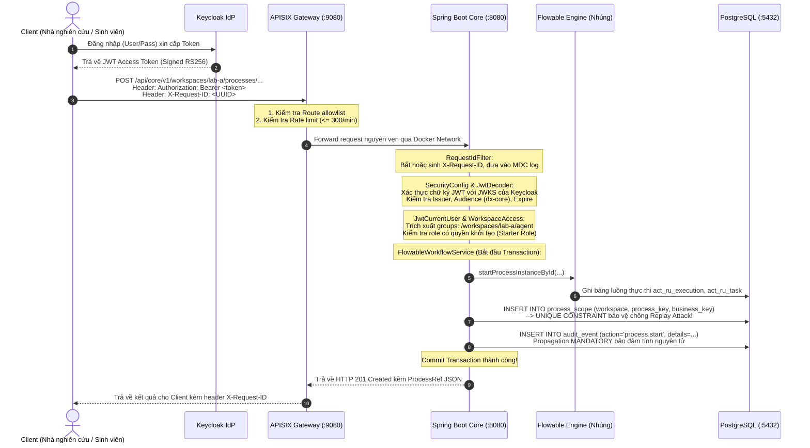
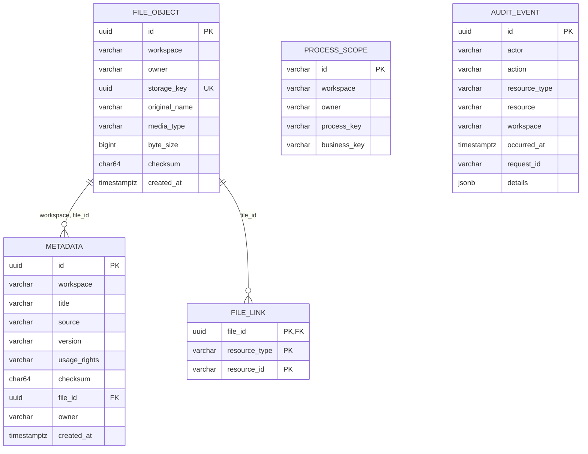
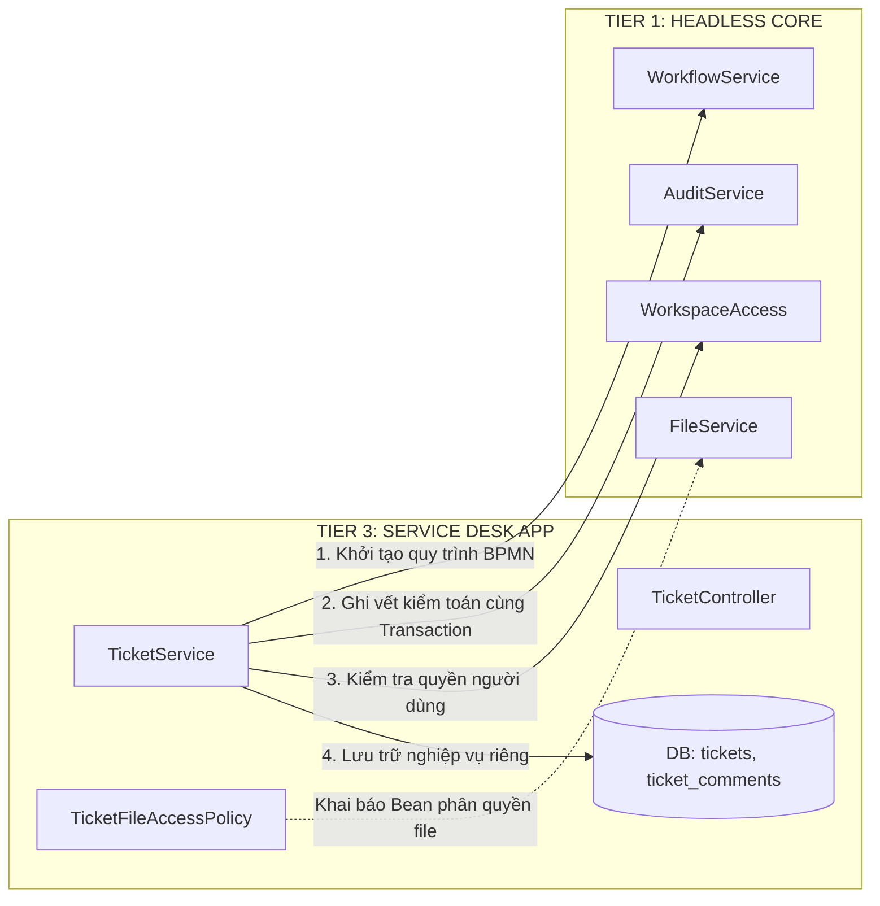

# TÀI LIỆU MASTER: KIẾN TRÚC & HƯỚNG DẪN PHÁT TRIỂN HỆ THỐNG SMART SERVICE DESK (DX-CORE)
> **Dành cho:** Developer, Kỹ sư phần mềm mới gia nhập dự án, Sinh viên CNTT nghiên cứu hệ thống thực tế.  
> **Phiên bản tài liệu:** 1.0.0 (Tương ứng với Core v0.1.0)  
> **Cập nhật ngày:** 15/10/2026  
> **Vị trí tài liệu trong dự án:** `docs/PROJECT_FROM_ZERO_TO_CONTRIBUTOR.md`

---

## 📑 MỤC LỤC TỔNG QUAN

1. [Chương 1: Bức tranh toàn cảnh & Mục đích dự án](#chương-1-bức-tranh-toàn-cảnh--mục-đích-dự-án)
   - 1.1 Bối cảnh ra đời của DX-Lab và DX-OS Open-Core
   - 1.2 Phân tầng kiến trúc: Tier 1, Tier 2, Tier 3
   - 1.3 Tại sao lại tách riêng tầng Headless Core?
   - 1.4 Ranh giới hiện thực (Thực tế hiện có vs Kế hoạch tương lai)
2. [Chương 2: Kiến thức nền tảng bắt buộc (Giải thích từ Zero)](#chương-2-kiến-thức-nền-tảng-bắt-buộc-giải-thích-từ-zero)
   - 2.1 Định danh (Identity), Xác thực (Authentication) & Phân quyền (Authorization)
   - 2.2 OAuth 2.0, OpenID Connect (OIDC) & JSON Web Token (JWT)
   - 2.3 Cơ chế ký & giải mã JWT qua JWKS (Asymmetric Cryptography)
   - 2.4 Cổng kết nối API (API Gateway) & Reverse Proxy
   - 2.5 Chuẩn quy trình BPMN 2.0 & Động cơ quy trình (Workflow Engine)
   - 2.6 Kiểm toán giao dịch (Transactional Audit) & Tính toàn vẹn ACID
   - 2.7 Lưu trữ tệp tin riêng tư (Private File Storage) vs Siêu dữ liệu (Metadata)
3. [Chương 3: Phân tích Stack công nghệ thực tế](#chương-3-phân-tích-stack-công-nghệ-thực-tế)
   - 3.1 Bảng phân tích các công nghệ trong dự án
   - 3.2 Tại sao chọn công nghệ này mà không chọn giải pháp khác? (Design Trade-offs)
4. [Chương 4: Kiến trúc hệ thống & Sơ đồ tương tác](#chương-4-kiến-trúc-hệ-thống--sơ-đồ-tương-tác)
   - 4.1 Sơ đồ kiến trúc tổng thể (Architecture Topology)
   - 4.2 Vòng đời của một HTTP Request (Request Lifecycle)
   - 4.3 Ranh giới bảo mật & Cơ chế phòng thủ đa lớp (Defense in Depth)
5. [Chương 5: Bản đồ Source Code & Điểm bắt đầu](#chương-5-bản-đồ-source-code--điểm-bắt-đầu)
   - 5.1 Cấu trúc cây thư mục toàn bộ dự án
   - 5.2 Điểm khởi động ứng dụng & Thẩm định tính nhất quán lúc khởi động
   - 5.3 Lộ trình đọc mã nguồn đề xuất cho lập trình viên mới
6. [Chương 6: Bóc tách chi tiết 4 Module cốt lõi của Core](#chương-6-bóc-tách-chi-tiết-4-module-cốt-lõi-của-core)
   - 6.1 Module Identity & Workspace RBAC (`vn.haui.dx.core.identity`)
   - 6.2 Module Workflow & BPMN Engine (`vn.haui.dx.core.workflow`)
   - 6.3 Module Metadata & File Storage (`vn.haui.dx.core.data`)
   - 6.4 Module Transactional Audit & Common (`vn.haui.dx.core.audit`, `vn.haui.dx.core.common`)
7. [Chương 7: Cơ sở dữ liệu & Data Flow](#chương-7-cơ-sở-dữ-liệu--data-flow)
   - 7.1 Lược đồ cơ sở dữ liệu (Database Schema Flyway V1 - V4)
   - 7.2 Các bảng Flowable Engine (`act_*`)
   - 7.3 Kiểm soát tương tranh & Cơ chế khóa (Concurrency Control & Row Locking)
8. [Chương 8: Cơ chế Bảo mật, Đóng gói & Triển khai](#chương-8-cơ-chế-bảo-mật-đóng-gói--triển-khai)
   - 8.1 Ma trận phân quyền RBAC (Role-Based Access Control)
   - 8.2 Đóng gói container Docker an toàn (Multi-stage & Non-root UID)
   - 8.3 Cấu hình Gateway APISIX (Rate limiting & Route allowlist)
9. [Chương 9: Kiểm thử & Đảm bảo chất lượng (Verification & Evidence)](#chương-9-kiểm-thử--đảm-bảo-chất-lượng-verification--evidence)
   - 9.1 Hệ thống kiểm thử Unit Test & Integration Test
   - 9.2 Kịch bản kiểm thử khói tự động (`scripts/smoke.ps1`)
   - 9.3 Kiểm thử hợp đồng API với OpenAPI Spec (`check-core-contract.py`)
10. [Chương 10: Hướng dẫn thực chiến: Tự phát triển một tính năng mới](#chương-10-hướng-dẫn-thực-chiến-tự-phát-triển-một-tính-năng-mới)
    - 10.1 Bài toán mẫu: Bổ sung quy trình hỗ trợ IT (`it-support-ticket`)
    - 10.2 Các bước triển khai chi tiết kèm code mẫu
11. [Chương 11: Hướng dẫn xây dựng tầng ứng dụng (Service Desk App) phía trên Core](#chương-11-hướng-dẫn-xây-dựng-tầng-ứng-dụng-service-desk-app-phía-trên-core)
    - 11.1 Ranh giới kiến trúc và các nguyên tắc bất biến (Invariants)
    - 11.2 Mẫu thiết kế tích hợp (Integration Patterns)
12. [Chương 12: Cẩm nang Debugging & Troubleshooting](#chương-12-cẩm-nang-debugging--troubleshooting)
    - 12.1 Danh mục mã lỗi và nguyên nhân gốc rễ
    - 12.2 Kỹ thuật truy vết theo `X-Request-ID` xuyên suốt hệ thống
13. [Chương 13: Bộ câu hỏi phỏng vấn / Trình bày & Phản biện kỹ thuật](#chương-13-bộ-câu-hỏi-phỏng-vấn--trình-bày--phản-biện-kỹ-thuật)
    - 13.1 Các câu hỏi kiến trúc chuyên sâu và câu trả lời chuẩn mực
14. [Chương 14: Bài tập thực hành có tiêu chí nghiệm thu (Hands-on Labs)](#chương-14-bài-tập-thực-hành-có-tiêu-chí-nghiệm-thu-hands-on-labs)
    - 14.1 Lab 1: Khởi động và kiểm tra sức khỏe hệ thống
    - 14.2 Lab 2: Tương tác với quy trình nghiệp vụ BPMN
    - 14.3 Lab 3: Thao tác tải lên tệp tin và tạo siêu dữ liệu
    - 14.4 Bảng tiêu chí PASS/FAIL tự đánh giá

---

## CHƯƠNG 1: BỨC TRANH TOÀN CẢNH & MỤC ĐÍCH DỰ ÁN

### 1.1 Bối cảnh ra đời của DX-Lab và DX-OS Open-Core
Trong quá trình chuyển đổi số của các tổ chức, trường đại học hoặc doanh nghiệp, hệ thống **Service Desk (Bàn trợ giúp / Tiếp nhận và xử lý yêu cầu dịch vụ)** là huyết mạch tiếp nhận thắc mắc, sự cố máy móc, mượn thiết bị phòng lab, duyệt tài liệu, phê duyệt kinh phí và hỗ trợ kỹ thuật.

Tuy nhiên, phần lớn các giải pháp phần mềm truyền thống đều gặp phải hai điểm nghẽn lớn:
1. **Kiến trúc nguyên khối (Monolith) chắp vá:** Logic xác thực người dùng, lưu file, phê duyệt workflow và nghiệp vụ ticket bị trộn lẫn vào nhau. Khi cần mở thêm quy trình mới (ví dụ từ mượn thiết bị sang duyệt đồ án), lập trình viên phải sửa đổi toàn bộ cơ sở dữ liệu và code cũ.
2. **Thiếu khả năng phân chia ranh giới và kiểm toán độc lập:** Không thể cô lập dữ liệu giữa các phòng ban/phòng thí nghiệm (multi-tenancy/multi-workspace) một cách an toàn, thiếu nhật ký kiểm toán không thể chối cãi (audit trail) khi có sự cố dữ liệu.

Dự án **DX-OS Open-Core** của DX-Lab HaUI ra đời nhằm giải quyết triệt để bài toán trên bằng cách xây dựng một kiến trúc mở, phân tầng chặt chẽ, nơi nền tảng lõi được chuẩn hóa hoàn toàn độc lập với các ứng dụng bên trên.

### 1.2 Phân tầng kiến trúc: Tier 1, Tier 2, Tier 3
Hệ thống tổng thể được thiết kế theo mô hình 3 tầng (3-Tier Separation):

```mermaid
flowchart TD
  subgraph Tier3 [TẦNG 3: APPLICATIONS - NGHIỆP VỤ]
    SDApp[Ứng dụng Service Desk / Quản lý vé yêu cầu]
    DocApp[Ứng dụng Duyệt tài liệu / Thiết bị phòng Lab]
    WebUI[Giao diện người dùng Web / Mobile SPA]
  end

  subgraph Tier2 [TẦNG 2: INTELLIGENCE - TRÍ TUỆ NHÂN TẠO]
    Triage[AI Triage: Phân loại & Gợi ý vé tự động]
    RAG[RAG & Knowledge Search: Tìm kiếm tri thức]
    Mining[Process Mining: Tối ưu quy trình nghiệp vụ]
  end

  subgraph Tier1 [TẦNG 1: HEADLESS CORE - NỀN TẢNG CỐT LÕI (REPO HIỆN TẠI)]
    Gateway[APISIX Gateway: Định tuyến & Giới hạn tần suất]
    IdP[Keycloak IAM: Định danh & Phân quyền Workspace]
    CoreEngine[Spring Boot Core: Identity, BPMN Workflow, File, Audit]
    DB[(PostgreSQL 16: Cơ sở dữ liệu nghiệp vụ & Lưu vết)]
    Storage[(Dedicated Volume: Kho tệp tin an toàn)]
  end

  Tier3 --> Tier2
  Tier3 --> Tier1
  Tier2 --> Tier1
```

- **Tier 1 (Tầng 1 - Headless Core):** Chính là repository `Smart-Service-Desk` mà bạn đang nghiên cứu. Tầng này cung cấp các dịch vụ hạ tầng nền tảng nhất: Định danh & phân quyền theo Workspace, Động cơ quy trình công việc BPMN 2.0 (Flowable), Quản lý siêu dữ liệu (Metadata) & lưu trữ tệp tin an toàn, và Ghi vết kiểm toán giao dịch (Transactional Audit).
- **Tier 2 (Tầng 2 - Intelligence):** Tầng dịch vụ thông minh (AI/ML), bao gồm các mô hình phân loại ticket tự động (Triage), tìm kiếm tri thức (Semantic Search/RAG) và khai phá quy trình (Process Mining). Tầng này giao tiếp với Tier 1 qua các hợp đồng dữ liệu chuẩn (`contracts/intelligence/`).
- **Tier 3 (Tầng 3 - Applications & UI):** Tầng ứng dụng nghiệp vụ cụ thể dành cho người dùng cuối (ví dụ màn hình tạo ticket, xử lý sự cố, giao diện nhân viên hỗ trợ, chatbot). Tầng này phụ thuộc vào Tier 1 và Tier 2, tuyệt đối không bao giờ được phép kéo phụ thuộc ngược lại.

### 1.3 Tại sao lại tách riêng tầng Headless Core?
"Headless" (Không đầu) có nghĩa là hệ thống **hoàn toàn không có giao diện người dùng (UI) gắn liền**. Toàn bộ chức năng được phơi bày (expose) thông qua các RESTful API và hợp đồng dữ liệu chuẩn xác.

Lý do kiến trúc:
1. **Tính tái sử dụng cao nhất (Extreme Reusability):** Một động cơ quy trình (`WorkflowService`) và hệ thống phân quyền workspace (`WorkspaceAccess`) có thể phục vụ đồng thời cho ứng dụng Quản lý sự cố CNTT (IT Service Desk), ứng dụng Đăng ký phòng máy, ứng dụng Mượn thiết bị đo lường, hay ứng dụng Trình ký văn bản nội bộ.
2. **Bảo toàn dữ liệu & Tính nhất quán (Data Invariants):** Khi tách tầng Core, các quy tắc bảo mật cốt lõi (như: "Ai có quyền claim task?", "Mọi thay đổi dữ liệu bắt buộc phải có audit log") được thực thi một cách nghiêm ngặt ở tầng sâu nhất, ngăn chặn lập trình viên ứng dụng vô tình hay cố ý bỏ qua bảo mật.
3. **Độc lập công nghệ giao diện:** Frontend có thể viết bằng React, Vue, Flutter trên điện thoại, hoặc các bot tự động mà không làm ảnh hưởng dù chỉ một dòng code ở backend Core.

### 1.4 Ranh giới hiện thực (Thực tế hiện có vs Kế hoạch tương lai)
Một sai lầm rất phổ biến của lập trình viên mới là đọc tài liệu tổng quan rồi ngộ nhận rằng trong code đã có sẵn màn hình đăng nhập hoặc bảng dữ liệu `Ticket`. Chúng ta cần làm rõ ranh giới minh bạch:

| Hạng mục | Trạng thái hiện tại trong Repo | Bằng chứng mã nguồn / Ghi chú |
| :--- | :--- | :--- |
| **Giao diện Web / UI** | ❌ **CHƯA CÓ** (Placeholder thư mục `frontend/README.md`) | Core là Headless API thuần túy |
| **Bảng dữ liệu Ticket / Service Desk** | ❌ **CHƯA CÓ** (Thuộc phạm vi Tier 3) | Sẽ do ứng dụng tầng trên định nghĩa |
| **Runtime AI / Model Chatbot** | ❌ **CHƯA CÓ** (Chỉ có tài liệu & hợp đồng hợp tác `intelligence/`) | AI chạy ở microservice riêng |
| **Xác thực JWT đa Workspace** | ✅ **ĐÃ CÓ & HOÀN THIỆN** | `vn.haui.dx.core.identity` |
| **Động cơ BPMN 2.0 nhúng** | ✅ **ĐÃ CÓ & HOÀN THIỆN** | `vn.haui.dx.core.workflow` (Flowable nhúng) |
| **Lưu trữ Metadata & File private** | ✅ **ĐÃ CÓ & HOÀN THIỆN** | `vn.haui.dx.core.data` (POSIX 0700, 5MB limit) |
| **Audit giao dịch bắt buộc** | ✅ **ĐÃ CÓ & HOÀN THIỆN** | `vn.haui.dx.core.audit` (`Propagation.MANDATORY`) |
| **API Gateway & Rate limit** | ✅ **ĐÃ CÓ & HOÀN THIỆN** | `infra/apisix/` (300 req/min) |

---

## CHƯƠNG 2: KIẾN THỨC NỀN TẢNG BẮT BUỘC (GIẢI THÍCH TỪ ZERO)

Nếu bạn là sinh viên mới hoặc chưa từng xây dựng hệ thống phần mềm phân tán, chương này được viết riêng cho bạn. Hãy đọc thật kỹ từng khái niệm dưới đây.

### 2.1 Định danh (Identity), Xác thực (Authentication) & Phân quyền (Authorization)
Hãy hình dung kịch bản đi máy bay:
1. **Identity (Danh tính):** Là thông tin xác định bạn là ai trong thế giới thực (Họ tên: Nguyễn Văn A, Số CCCD: 0123456789).
2. **Authentication - Authn (Xác thực):** Quá trình chứng minh bạn đúng là người mang danh tính đó. Tại quầy check-in, nhân viên nhìn mặt bạn và đối chiếu với ảnh trên CCCD. Trong phần mềm, bạn nhập Username + Mật khẩu (hoặc vân tay, OTP). Khi máy chủ xác nhận khớp, bạn đã được **Authenticate**. Câu hỏi trả lời là: *"Bạn là ai? Bạn có thật sự là người đó không?"*
3. **Authorization - Authz (Phân quyền):** Sau khi có vé máy bay, bạn đi vào phòng chờ hạng thương gia (Business Lounge). Nhân viên quét vé và nói: *"Xin lỗi, vé của bạn là vé phổ thông (Economy), bạn không có quyền vào phòng này"*. Bạn đã được xác thực danh tính, nhưng bạn **không có quyền** thực hiện hành động đó. Câu hỏi trả lời là: *"Với danh tính này, bạn ĐƯỢC PHÉP LÀM GÌ?"*

**Tại sao hệ thống chuyên nghiệp KHÔNG lưu mật khẩu và tự làm bảng `users` trong backend?**
- Lưu trữ mật khẩu an toàn đòi hỏi mã hóa muối (salt), băm đa vòng (bcrypt/argon2), chống tấn công từ điển, brute-force, quản lý quên mật khẩu, đổi mật khẩu, 2FA/MFA, khóa tài khoản khi nhập sai nhiều lần.
- Nếu tự viết trong backend, bạn đang phát minh lại cái bánh xe và đối mặt với rủi ro bảo mật khổng lồ.
- Giải pháp: Sử dụng một **Identity Provider (Nhà cung cấp danh tính tập trung - IdP)** độc lập như **Keycloak**. Backend Core hoàn toàn không lưu trữ mật khẩu của bất kỳ ai!

### 2.2 OAuth 2.0, OpenID Connect (OIDC) & JSON Web Token (JWT)
- **OAuth 2.0:** Là một chuẩn ủy quyền (Authorization Framework). Ví dụ: Ứng dụng in ảnh xin quyền truy cập vào album ảnh Google Photos của bạn mà bạn không cần phải đưa mật khẩu Google cho ứng dụng in ảnh đó.
- **OpenID Connect (OIDC):** Là tầng định danh (Identity Layer) được xây dựng đè lên nền tảng OAuth 2.0. OAuth 2.0 chỉ cấp quyền (Access Token), còn OIDC bổ sung thêm thông tin định danh người dùng (ID Token, `sub`, email, họ tên).
- **JSON Web Token (JWT):** Là một chuỗi ký tự được mã hóa URL-safe đại diện cho thông tin được chuyển giao an toàn giữa các bên. Một JWT luôn gồm 3 phần ngăn cách bởi dấu chấm `.`:
  $$\text{JWT} = \text{Header} . \text{Payload} . \text{Signature}$$
  - **Header:** Chứa thuật toán mã hóa (ví dụ `RS256` - mã hóa bất đối xứng RSA với hàm băm SHA-256).
  - **Payload:** Chứa các thông điệp tuyên bố (Claims). Ví dụ trong Core:
    ```json
    {
      "sub": "38a5b28a-86a3-4a11-82df-6b83f08a95d1",
      "preferred_username": "user2",
      "iss": "http://localhost:8081/realms/dx-lab",
      "aud": "dx-core",
      "exp": 1729000000,
      "groups": [
        "/workspaces/lab-a/agent"
      ]
    }
    ```
  - **Signature:** Chữ ký điện tử được tạo ra bằng Khóa bí mật (Private Key) của Keycloak để bảo đảm rằng nội dung Header và Payload không bị bất kỳ ai can thiệp sửa đổi trên đường truyền.

### 2.3 Cơ chế ký & giải mã JWT qua JWKS (Asymmetric Cryptography)
Hệ thống sử dụng mật mã học bất đối xứng:
1. Keycloak nắm giữ **Private Key (Khóa riêng tư)** và giữ bí mật tuyệt đối. Khi người dùng đăng nhập thành công, Keycloak dùng Private Key này để ký vào JWT.
2. Keycloak phơi bày **Public Key (Khóa công khai)** ra ngoài qua endpoint tiêu chuẩn JWKS (JSON Web Key Set): `http://keycloak:8080/realms/dx-lab/protocol/openid-connect/certs`.
3. Backend Core (Resource Server) khi nhận được token từ Client gửi lên trong header `Authorization: Bearer <token>`:
   - Backend Core **KHÔNG CẦN** gọi về Keycloak để hỏi "Token này có hợp lệ không?" cho từng request (tránh nghẽn mạng).
   - Backend Core chỉ tải Public Key từ JWKS của Keycloak một lần và cache lại.
   - Core dùng Public Key này để tự giải mã toán học và kiểm tra chữ ký. Nếu một hacker sửa `preferred_username` từ `user2` thành `admin`, chữ ký điện tử sẽ bị sai lệch ngay lập tức và Spring Security lập tức từ chối với mã lỗi `401 Unauthorized`.

### 2.4 Cổng kết nối API (API Gateway) & Reverse Proxy
- **Forward Proxy (Proxy xuôi):** Đứng trước các máy client trong công ty để kiểm soát việc nhân viên truy cập ra Internet.
- **Reverse Proxy (Proxy ngược):** Đứng trước các máy chủ backend để đón nhận request từ Internet chuyển tiếp vào bên trong.
- **API Gateway (Apache APISIX):** Là một Reverse Proxy thông minh chuyên dụng cho API, chịu trách nhiệm:
  - **Ẩn giấu topology mạng nội bộ:** Máy bên ngoài chỉ thấy cổng 9080 của Gateway, không hề biết backend Spring Boot (8080) hay database PostgreSQL (5432) nằm ở địa chỉ nào.
  - **Chặn đứng tấn công DoS / Brute-force:** Cấu hình plugin `limit-count` giới hạn tối đa 300 request/phút trên mỗi địa chỉ IP. Vượt quá sẽ trả về `429 Too Many Requests`.
  - **Bảo vệ cổng quản trị:** Ngăn chặn tuyệt đối việc để lộ Admin API của Gateway ra ngoài Internet (`enable_admin: false`).

### 2.5 Chuẩn quy trình BPMN 2.0 & Động cơ quy trình (Workflow Engine)
Trong các ứng dụng ngây thơ, người ta thường dùng một cột `status` trong database (`status VARCHAR(20)`) với các giá trị: `PENDING -> APPROVED -> REJECTED`.
Cách làm này nhanh chóng thất bại khi hệ thống mở rộng vì:
- Không kiểm soát được ai có quyền chuyển từ trạng thái A sang trạng thái B.
- Khi có 2 bước duyệt song song (ví dụ: Trưởng khoa duyệt đồng thời Kế toán duyệt) thì cột `status` đơn lẻ hoàn toàn bế tắc.
- Không thể tái hiện lại lịch sử ai đã duyệt lúc mấy giờ với kết quả ra sao.

**Giải pháp chuyên nghiệp:** Sử dụng chuẩn **BPMN 2.0 (Business Process Model and Notation)** và một động cơ quy trình chuyên dụng như **Flowable Engine**.
- Quy trình được vẽ và lưu dưới dạng file chuẩn XML (`.bpmn20.xml`).
- Động cơ Flowable tự động lưu trữ luồng thực thi (execution tokens), quản lý danh sách nhiệm vụ của con người (User Tasks), phân công nhóm ứng viên (Candidate Groups), và ghi nhận toàn bộ lịch sử (Audit & History).

### 2.6 Kiểm toán giao dịch (Transactional Audit) & Tính toàn vẹn ACID
Trong ngân hàng hoặc các hệ thống cốt lõi, khái niệm **Audit Trail (Nhật ký kiểm toán)** là sinh mệnh:
- Khi một hành động làm thay đổi dữ liệu xảy ra (tạo metadata, bắt đầu quy trình, hoàn thành duyệt đơn), hệ thống bắt buộc phải ghi lại: *Ai làm? Lúc mấy giờ? Làm trên đối tượng nào? Thông tin chi tiết là gì? Thuộc request nào?*
- **Quy tắc Transactional (`Propagation.MANDATORY`):** Việc ghi Audit **PHẢI** nằm trong cùng một cơ chế giao dịch ACID với thao tác nghiệp vụ.
  - Nếu thao tác tạo tài liệu thành công nhưng lệnh ghi audit bị lỗi cơ sở dữ liệu -> **Hệ thống bắt buộc phải ROLLBACK toàn bộ**, hủy bỏ việc tạo tài liệu.
  - Tuyệt đối không bao giờ cho phép tài liệu được tạo ra mà không có dấu vết kiểm toán!

### 2.7 Lưu trữ tệp tin riêng tư (Private File Storage) vs Siêu dữ liệu (Metadata)
- **File Object (Dữ liệu nhị phân - Binary):** Nội dung thực tế của file PDF, ảnh PNG dung lượng vài Megabyte. Lưu trực tiếp vào Database dưới dạng bytea/BLOB sẽ làm database phình to nhanh chóng, backup cực kỳ chậm và tốn RAM bộ đệm. Vì vậy, File Object được lưu trên hệ thống tệp (File System Volume) với tên file được mã hóa ngẫu nhiên bằng UUID (`storage_key`).
- **Metadata (Siêu dữ liệu):** Bản ghi mô tả thông tin của file trong Database: Tiêu đề, ai tải lên, thời gian, dung lượng, định dạng MIME (`application/pdf`), mã băm toàn vẹn SHA-256 (`checksum`), và thuộc không gian làm việc (`workspace`) nào.
- Sự tách rời này mang lại hiệu năng cao nhất nhưng vẫn đảm bảo tính toàn vẹn thông qua liên kết khóa ngoại.


## CHƯƠNG 3: PHÂN TÍCH STACK CÔNG NGHỆ THỰC TẾ

Dự án DX-Core lựa chọn các công nghệ tiêu chuẩn công nghiệp (Industry Standard) với độ ổn định cao, tuân thủ nguyên tắc: *"Boring code over clever code"* (Ưu tiên công nghệ tin cậy, phổ biến hơn là các framework thử nghiệm).

### 3.1 Bảng phân tích các công nghệ trong dự án

| Thành phần | Công nghệ & Phiên bản | Vai trò trong hệ thống | Bằng chứng cấu hình |
| :--- | :--- | :--- | :--- |
| **Ngôn ngữ & Nền tảng** | **Java 17 LTS** / **Temurin JRE** | Nền tảng thực thi chính, tính năng Record, Pattern Matching | `backend/pom.xml`, `backend/Dockerfile` |
| **Framework Backend** | **Spring Boot 3.3.4** | Framework lắp ráp (Assembly), Spring Security 6, MVC REST | `backend/pom.xml` |
| **Quản lý danh tính (IdP)**| **Keycloak 26.0.7** (Container) | Quản lý người dùng, cấp phát token JWT qua OpenID Connect | `compose.yaml` (quay.io/keycloak/keycloak) |
| **Cổng kết nối (Gateway)**| **Apache APISIX 3.11.0** | Lọc định tuyến (Route Allowlist), Giới hạn tần suất (Rate Limit) | `infra/apisix/`, `compose.yaml` |
| **Động cơ quy trình** | **Flowable 7.1.0 Process Engine** | Quản trị vòng đời quy trình nghiệp vụ chuẩn BPMN 2.0 nhúng | `backend/pom.xml` (flowable-spring-boot-starter) |
| **Cơ sở dữ liệu** | **PostgreSQL 16.6-bookworm** | Lưu trữ quan hệ ACID, hỗ trợ JSONB, chỉ mục btree/gin | `compose.yaml` (image postgres:16.6) |
| **Quản lý Migration DB** | **Flyway Core** | Tự động nâng cấp phiên bản schema database khi khởi động | `backend/src/main/resources/db/migration/` |
| **Môi trường điều phối** | **Docker Compose v2** | Đóng gói và chạy toàn bộ cụm dịch vụ với cờ `--wait` | `compose.yaml`, `scripts/start.ps1` |

### 3.2 Tại sao chọn công nghệ này mà không chọn giải pháp khác? (Design Trade-offs)

1. **Tại sao dùng Java 17 & Spring Boot 3.3 thay vì Node.js / Python FastApi?**
   - *Lý do:* Hệ thống Core cần quản lý các giao dịch phân tán, luồng nghiệp vụ phức tạp và tích hợp động cơ BPMN tiêu chuẩn doanh nghiệp. Flowable là thư viện số một thế giới về BPMN viết trên nền tảng Java Virtual Machine (JVM). Việc sử dụng Java 17 với cú pháp `record` bất biến (immutable data) giúp code ngắn gọn, an toàn kiểu dữ liệu (type-safe) và hiệu năng đa luồng vượt trội.
   - *Đánh đổi:* Thời gian khởi động (startup time) của JVM chậm hơn Node.js khoảng vài giây, tốn RAM cơ bản hơn (~300MB RAM), nhưng bù lại độ ổn định và độ tin cậy giao dịch khi vận hành tải cao là tuyệt đối.

2. **Tại sao dùng Flowable Engine nhúng (Embedded) thay vì tự code bảng trạng thái hoặc dùng Camunda riêng biệt?**
   - *Lý do:* Flowable nhúng chạy trực tiếp bên trong cùng tiến trình Spring Boot và **dùng chung DataSource kết nối PostgreSQL** với Core. Điều này cho phép áp dụng giao dịch nguyên tử (`@Transactional` ACID cục bộ). Nếu Flowable chạy thành service độc lập bên ngoài, bạn sẽ phải dùng giao dịch phân tán 2PC (Two-Phase Commit) hoặc Saga pattern cực kỳ phức tạp và dễ phát sinh lỗi không đồng bộ.

3. **Tại sao dùng Apache APISIX thay vì Nginx thuần hay Spring Cloud Gateway?**
   - *Lý do:* APISIX chạy trên nền tảng OpenResty (Nginx + LuaJIT), có hiệu năng xử lý hàng trăm nghìn request mỗi giây với độ trễ cực thấp. APISIX hỗ trợ cấu hình động qua định dạng YAML độc lập (`role_data_plane: yaml`), tách rời hoàn toàn khỏi mã nguồn Java của backend.

4. **Tại sao dùng JdbcTemplate và SQL thuần thay vì Hibernate / Spring Data JPA?**
   - *Lý do kiến trúc:* Đây là quyết định có chủ đích của Principal Architect. Hibernate mang theo chi phí trìu trượng hóa rất lớn (N+1 query, dirty checking, lazy loading exceptions, session cache phức tạp). Trong khi đó, Core cần kiểm soát tuyệt đối các câu lệnh khóa hàng `SELECT ... FOR UPDATE`, cơ chế phân trang tối ưu, và chèn dữ liệu JSONB native. Sử dụng `JdbcTemplate` giúp code trong sáng, dễ debug, truy vấn SQL minh bạch 100%.

---

## CHƯƠNG 4: KIẾN TRÚC HỆ THỐNG & SƠ ĐỒ TƯƠNG TÁC

### 4.1 Sơ đồ kiến trúc tổng thể (Architecture Topology)

Hệ thống được thiết kế với sự phân tách mạng chặt chẽ nhằm bảo đảm nguyên tắc bảo mật tối thượng: **Chỉ mở cổng tối thiểu ra bên ngoài host.**

```mermaid
graph TB
  subgraph Host_Environment [MÔI TRƯỜNG MÁY CHỦ / TRÌNH DUYỆT (127.0.0.1)]
    Client[Browser / Script Automation / Postman]
  end

  subgraph Docker_Network [MẠNG DOCKER CÔ LẬP (dx-core_default)]
    subgraph Gateway_Boundary [Ranh giới Cổng vào]
      APISIX[Apache APISIX Gateway<br/>Port 9080 mở loopback<br/>Plugin: Rate Limit 300 req/m]
    end

    subgraph Identity_Boundary [Ranh giới Định danh]
      KC[Keycloak IAM 26<br/>Port 8081 mở loopback<br/>Realm: dx-lab]
    end

    subgraph Application_Boundary [Ranh giới Ứng dụng - KHÔNG MỞ PORT HOST]
      CoreApp[DX-Core Spring Boot 3.3<br/>Port 8080 nội bộ<br/>Stateless REST Resource Server]
      StorageVolume[(Filesystem Volume: /var/lib/dx/files<br/>POSIX Mode 0700 - UID 10001)]
    end

    subgraph Database_Boundary [Ranh giới Cơ sở dữ liệu - KHÔNG MỞ PORT HOST]
      PG[(PostgreSQL 16 Server<br/>Port 5432 nội bộ<br/>DB: core & DB: keycloak)]
    end
  end

  Client -->|1. Lấy Token: POST /protocol/openid-connect/token| KC
  Client -->|2. Gọi API kèm Bearer JWT: http://localhost:9080| APISIX
  APISIX -->|3. Proxy chuyển tiếp sau khi lọc Rate Limit| CoreApp
  CoreApp -->|4. Tải Public Keys định kỳ kiểm tra chữ ký| KC
  CoreApp -->|5. SQL Queries & ACID Transactions| PG
  CoreApp -->|6. Ghi đọc File nhị phân an toàn| StorageVolume
  KC -->|Lưu trữ Identity & Realm| PG
```

### 4.2 Vòng đời của một HTTP Request (Request Lifecycle)

Hãy cùng theo dõi hành trình của một request tạo quy trình công việc: `POST http://localhost:9080/api/core/v1/workspaces/lab-a/processes/equipment-approval/instances`:



### 4.3 Ranh giới bảo mật & Cơ chế phòng thủ đa lớp (Defense in Depth)

Hệ thống Core được thiết kế theo tư duy bảo mật Zero-Trust và phòng vệ đa tầng:
1. **Tầng 1 - Ranh giới Mạng (Network Perimeter):**
   - Database PostgreSQL và Backend Spring Boot **không ánh xạ bất kỳ cổng nào ra máy chủ host**. Chỉ có APISIX (9080) và Keycloak (8081) lắng nghe trên giao diện loopback `127.0.0.1`. Kẻ tấn công trên mạng LAN hoàn toàn không thể chạm tới cơ sở dữ liệu.
2. **Tầng 2 - Ranh giới Gateway (Traffic Shaping & Routing):**
   - Chỉ các route được định nghĩa tường minh trong `apisix.yaml` (`/api/core/v1/*` và `/health`) mới được chuyển tiếp. Mọi truy vấn thăm dò đường dẫn khác bị chặn ngay tại rìa.
   - Cổng quản trị Admin API của APISIX bị tắt bỏ (`enable_admin: false`) để triệt tiêu nguy cơ chiếm quyền điều khiển gateway.
3. **Tầng 3 - Ranh giới Xác thực Token (Token Integrity):**
   - Spring Security xác thực nghiêm ngặt 4 yếu tố của JWT: Chữ ký hợp lệ, Chưa hết hạn (`exp`), Đúng máy chủ phát hành (`iss`), và đúng mục đích sử dụng (`aud: dx-core`).
4. **Tầng 4 - Ranh giới Phân quyền Workspace (Workspace Isolation):**
   - Workspace luôn được lấy trực tiếp từ đường dẫn URL (Path Variable) và đối chiếu chéo với danh sách thành viên trong JWT. Kẻ tấn công không thể gửi header giả mạo để truy cập dữ liệu của phòng thí nghiệm khác.

---

## CHƯƠNG 5: BẢN ĐỒ SOURCE CODE & ĐIỂM BẮT ĐẦU

### 5.1 Cấu trúc cây thư mục toàn bộ dự án

```text
D:\Smart-Service-Desk\
├── backend/                              # [BACKEND CORE] Mã nguồn chính Java & Spring Boot
│   ├── Dockerfile                        # Đóng gói Multi-stage build chạy user UID 10001
│   ├── pom.xml                           # Quản lý thư viện Maven (Spring Boot 3.3.4, Flowable 7.1.0)
│   └── src/
│       ├── main/
│       │   ├── java/vn/haui/dx/
│       │   │   ├── CoreApplication.java  # Lớp Main khởi động ứng dụng Core
│       │   │   ├── apps/                 # [TIER 3] Placeholder kiến trúc cho ứng dụng tương lai
│       │   │   └── core/                 # [TIER 1] Bốn module nền tảng cốt lõi
│       │   │       ├── Errors.java       # Global RestControllerAdvice chuẩn hóa lỗi RFC 7807
│       │   │       ├── audit/            # Module Ghi vết kiểm toán giao dịch
│       │   │       │   ├── api/          # Public Interfaces: AuditService, AuditEntry, AuditQuery
│       │   │       │   ├── internal/     # Implementation: JdbcAuditService (MANDATORY Tx)
│       │   │       │   └── web/          # REST Controller: AuditController
│       │   │       ├── common/           # Các lớp tiện ích chung: ErrorCode, Problems, RequestIdFilter
│       │   │       ├── data/             # Module Siêu dữ liệu (Metadata) & Lưu trữ File
│       │   │       │   ├── FileApi.java  # Controller upload/download tệp tin
│       │   │       │   ├── MetadataApi.java # Controller quản lý siêu dữ liệu
│       │   │       │   ├── api/          # Public Interfaces: FileService, MetadataService, FileAccessPolicy
│       │   │       │   └── internal/     # Implementation: JdbcMetadataService, LocalFileService
│       │   │       ├── identity/         # Module Định danh & Phân quyền Workspace
│       │   │       │   ├── api/          # Public Interfaces: CurrentUser, WorkspaceAccess, WorkspaceRole
│       │   │       │   ├── internal/     # Implementation: SecurityConfig, JwtCurrentUser, WorkspaceAccessImpl
│       │   │       │   └── web/          # REST Controller: MeController (/api/core/v1/me)
│       │   │       └── workflow/         # Module Động cơ quy trình công việc (Flowable BPMN)
│       │   │           ├── WorkflowApi.java # REST Controller thao tác quy trình (start, inbox, claim, complete)
│       │   │           ├── api/          # Public Interfaces: WorkflowService, ProcessPolicy, TaskView
│       │   │           └── internal/     # Implementation: FlowableWorkflowService, ProcessRegistry
│       │   └── resources/
│       │       ├── application.yml       # Cấu hình Spring Boot, JWT JWKS, File limits, Logging
│       │       ├── db/migration/         # Các script Flyway nâng cấp Database (V1 -> V4)
│       │       └── processes/            # Định nghĩa quy trình BPMN chuẩn (.bpmn20.xml)
│       └── test/                         # Bộ kiểm thử Unit & Integration tự động
├── contracts/                            # [CONTRACTS] Hợp đồng giao tiếp hệ thống
│   ├── openapi/core.yaml                 # Đặc tả OpenAPI 3.0 chuẩn mực của tầng Core
│   └── intelligence/                     # Đặc tả hợp đồng giao tiếp giữa Core và tầng AI
├── fixtures/                             # Dữ liệu thử nghiệm mẫu (Synthetic Fixtures)
├── infra/                                # [HẠ TẦNG] Cấu hình Docker & Dịch vụ phụ trợ
│   ├── apisix/                           # Cấu hình Gateway APISIX (config.yaml, apisix.yaml)
│   ├── keycloak/realm-template.json      # Bản mẫu Realm định danh mẫu
│   └── postgres/init.sql                 # Khởi tạo database keycloak ban đầu
├── scripts/                              # [KỊCH BẢN VẬN HÀNH & KIỂM THỬ]
│   ├── setup.ps1                         # Sinh mật khẩu ngẫu nhiên trong .env và tạo realm
│   ├── start.ps1                         # Khởi chạy một chạm toàn bộ hệ thống
│   ├── smoke.ps1                         # Kịch bản kiểm thử khói 80+ bước tự động
│   └── check-core-contract.py            # Kiểm thử tuân thủ hợp đồng OpenAPI
├── compose.yaml                          # File cấu hình hợp nhất Docker Compose
└── README.md                             # Tài liệu tổng quan dự án chuẩn quốc tế
```

### 5.2 Điểm khởi động ứng dụng & Thẩm định tính nhất quán lúc khởi động

Hãy mở file `backend/src/main/java/vn/haui/dx/CoreApplication.java`:

```java
package vn.haui.dx;

import org.springframework.boot.SpringApplication;
import org.springframework.boot.autoconfigure.SpringBootApplication;

@SpringBootApplication
public class CoreApplication {
    public static void main(String[] args) { 
        SpringApplication.run(CoreApplication.class, args); 
    }

    @org.springframework.context.event.EventListener(org.springframework.boot.context.event.ApplicationReadyEvent.class)
    public void validateProcesses(org.springframework.boot.context.event.ApplicationReadyEvent event) {
        event.getApplicationContext().getBean(vn.haui.dx.core.workflow.internal.ProcessRegistry.class).policies();
    }
}
```

**Phân tích kỹ thuật của Senior Architect:**
- Ứng dụng lắng nghe sự kiện `ApplicationReadyEvent`. Đây là thời điểm toàn bộ Spring context đã được khởi tạo xong và Flowable Engine đã tự động nạp các file BPMN từ thư mục `resources/processes/`.
- Lúc này, hàm `validateProcesses` gọi tới `ProcessRegistry.policies()` để thực hiện **Startup Invariant Validation (Thẩm định tính toàn vẹn khi khởi động)**:
  - Kiểm tra xem mọi file BPMN nạp trong Flowable có được đăng ký trong Java code hay không.
  - Kiểm tra xem các User Task trong XML có đúng định dạng Candidate Groups (`${workspace}:<role>`) hay không.
  - Ngăn chặn triệt để việc dev vô tình deploy một file BPMN bị lỗi hoặc chưa đăng ký policy. Nếu sai lệch, ứng dụng **sẽ sập ngay lập tức (Fail-Fast)** thay vì chạy ngầm và sinh lỗi runtime khó hiểu!

### 5.3 Lộ trình đọc mã nguồn đề xuất cho lập trình viên mới

Để không bị choáng ngợp trước codebase lớn, bạn nên đọc mã nguồn theo thứ tự 5 chặng sau:
1. **Chặng 1 (Nền tảng lỗi & Dữ liệu chung):** Đọc `ErrorCode.java`, `CoreException.java`, `Problems.java` và `RequestIdFilter.java`. Bạn sẽ hiểu cách hệ thống bắt lỗi và gán mã định danh tracing.
2. **Chặng 2 (Bảo mật & Định danh):** Đọc `SecurityConfig.java`, `JwtCurrentUser.java` và `WorkspaceAccessImpl.java`. Bạn sẽ nắm rõ cách token được phân giải thành workspace và role.
3. **Chặng 3 (Kiểm toán giao dịch):** Đọc `AuditService.java` và `JdbcAuditService.java`. Nắm được nguyên tắc `Propagation.MANDATORY`.
4. **Chặng 4 (Xử lý quy trình BPMN):** Đọc file BPMN `document-review.bpmn20.xml`, sau đó đọc `ProcessRegistry.java` và `FlowableWorkflowService.java`.
5. **Chặng 5 (Dữ liệu & Tệp tin):** Đọc `MetadataRepository.java`, `JdbcMetadataService.java`, và `LocalFileService.java`.

---

## CHƯƠNG 6: BÓC TÁCH CHI TIẾT 4 MODULE CỐT LÕI CỦA CORE

### 6.1 Module Identity & Workspace RBAC (`vn.haui.dx.core.identity`)

Module này chịu trách nhiệm duy nhất: Chuyển đổi một JWT thô từ Keycloak thành đối tượng nghiệp vụ `CurrentUser` có cấu trúc, đồng thời cung cấp cơ chế chặn quyền theo workspace.

#### Phân tích mã nguồn `SecurityConfig.java` (`backend/src/main/java/vn/haui/dx/core/identity/internal/SecurityConfig.java`)
```java
@Configuration
class SecurityConfig {
    @Bean
    SecurityFilterChain filterChain(HttpSecurity http, ObjectMapper json) throws Exception {
        BearerTokenAuthenticationEntryPoint bearer = new BearerTokenAuthenticationEntryPoint();
        
        // Xử lý lỗi 401: Khi client không gửi token hoặc token không hợp lệ
        AuthenticationEntryPoint unauthenticated = (request, response, error) -> {
            bearer.commence(request, response, error);
            write(json, request, response, ErrorCode.UNAUTHENTICATED, "Authentication required");
        };
        
        // Xử lý lỗi 403: Khi client có token nhưng không đủ thẩm quyền
        AccessDeniedHandler forbidden = (request, response, error) ->
            write(json, request, response, ErrorCode.FORBIDDEN, "Access denied");

        return http
            .csrf(csrf -> csrf.disable()) // Stateless REST API không dùng cookie nên an toàn tắt CSRF
            .sessionManagement(session -> session.sessionCreationPolicy(SessionCreationPolicy.STATELESS))
            .authorizeHttpRequests(auth -> auth
                .requestMatchers("/actuator/health").permitAll() // Healthcheck mở công khai
                .anyRequest().authenticated()                    // Mọi API khác đều bắt buộc đăng nhập
            )
            .oauth2ResourceServer(resource -> resource.jwt(Customizer.withDefaults())
                .authenticationEntryPoint(unauthenticated)
                .accessDeniedHandler(forbidden))
            .exceptionHandling(handling -> handling
                .authenticationEntryPoint(unauthenticated)
                .accessDeniedHandler(forbidden))
            .build();
    }
}
```

#### Phân tích phân giải Group trong `JwtCurrentUser.java`
Keycloak hỗ trợ cấu trúc nhóm phân cấp (Hierarchical Groups). Khi admin Keycloak gán user vào nhóm `/workspaces/lab-a/agent`, Keycloak sẽ đưa chuỗi này vào mảng `groups` của JWT payload.

Trong file `JwtCurrentUser.java`:
```java
static final Pattern GROUP = Pattern.compile("^/workspaces/([a-z0-9-]{1,50})/([a-z0-9-]{1,30})$");
```
Biểu thức chính quy (Regex) này thực hiện các nhiệm vụ an toàn sống còn:
1. **Chống Path Traversal & Ký tự lạ:** Chỉ chấp nhận chữ cái thường, số và dấu gạch ngang (`a-z0-9-`). Mọi nỗ lực tiêm chuỗi độc hại như `/workspaces/lab-a/../admin` sẽ lập tức bị regex loại bỏ hoàn toàn!
2. **Tách Workspace và Role:** Nhóm 1 (`group(1)`) là tên workspace (ví dụ: `lab-a`). Nhóm 2 (`group(2)`) là tên vai trò (ví dụ: `agent`).
3. **Phân tách Platform Admin:** Kiểm tra `realm_access.roles` chứa `platform-admin`. Chú ý: `platform-admin` là quyền quản trị toàn hệ thống, nhưng **không mặc nhiên** có quyền đọc dữ liệu nhạy cảm bên trong từng workspace nếu không tham gia vào workspace đó!

#### Cách sử dụng trong Service qua `WorkspaceAccess.java`
Khi một Service cần kiểm tra quyền, dev chỉ cần gọi:
```java
access.requireRole(workspace, WorkspaceRole.COORDINATOR);
```
Nếu người dùng hiện tại không có role `coordinator` trong workspace truyền vào, hàm sẽ ném `CoreException.forbidden("Workspace role required")`, làm dừng ngay lập tức thao tác và trả về mã HTTP 403 Problem Detail cho client.

---

### 6.2 Module Workflow & BPMN Engine (`vn.haui.dx.core.workflow`)

Module này là trái tim xử lý tiến trình công việc của Core. Nó bao bọc lấy động cơ Flowable và bổ sung thêm các ràng buộc an toàn tuyệt đối.

#### Hai quy trình mẫu có sẵn trong hệ thống:
1. `document-review` (`resources/processes/document-review.bpmn20.xml`):
   - Luồng: Khởi tạo -> Task `review` (phân công cho nhóm `${workspace}:coordinator`) -> Rẽ nhánh Exclusive Gateway -> Nếu `outcome_review == 'approved'` thì kết thúc thành công; nếu `rejected` thì kết thúc từ chối.
2. `equipment-approval` (`resources/processes/equipment-approval.bpmn20.xml`):
   - Luồng 2 bước: Khởi tạo -> Task `approve` (`${workspace}:coordinator`) -> Nếu duyệt -> Chuyển sang Task `handover` (Bàn giao thiết bị, phân công cho nhóm `${workspace}:agent`) -> Hoàn thành.

#### Cơ chế khóa và kiểm soát tương tranh trong `FlowableWorkflowService.java`
Đây là phần code tinh hoa nhất giải quyết bài toán chạy đua (Race Condition) trong hệ thống phân tán:

```java
private Task lockedTask(String workspace, String taskId) {
    text(taskId, 100, "taskId");
    var historic = engine.getHistoryService().createHistoricTaskInstanceQuery()
        .taskId(taskId).singleResult();
    if (historic == null) throw CoreException.notFound("Task not found");
    
    // KHÓA BI QUAN (PESSIMISTIC LOCK): Khóa dòng trong bảng process_scope
    var rows = jdbc.queryForList(
        "select id from process_scope where id=? and workspace=? for update", 
        historic.getProcessInstanceId(), workspace);
    if (rows.isEmpty()) throw CoreException.notFound("Task not found");
    
    var task = engine.getTaskService().createTaskQuery().taskId(taskId).singleResult();
    if (task == null) throw CoreException.conflict("Task already completed");
    
    return task;
}
```

**Tại sao phải có dòng `select id from process_scope ... for update`?**
- Hãy tưởng tượng 2 điều phối viên A và B cùng mở màn hình duyệt một yêu cầu và cùng bấm nút "Phê duyệt" vào cùng một mili-giây.
- Nếu không có dòng khóa này, cả 2 request sẽ cùng kiểm tra thấy Task vẫn đang mở và cùng gọi Flowable hoàn thành task -> Dẫn tới lỗi không nhất quán dữ liệu hoặc quy trình bị chạy vượt cấp.
- Với `FOR UPDATE`: Request của A đến trước, PostgreSQL sẽ khóa dòng `process_scope` tương ứng lại. Request của B đến sau buộc phải xếp hàng chờ A hoàn tất giao dịch. Khi A commit xong, task đã đóng lại; lúc này khóa được giải phóng, request của B tiếp tục chạy, kiểm tra thấy `task == null` và lập tức trả về mã lỗi **409 Conflict ("Task already completed")**. Tuyệt đối không bao giờ xảy ra lỗi xung đột!


### 6.3 Module Metadata & File Storage (`vn.haui.dx.core.data`)

Module Data xử lý bài toán lưu trữ tệp tin an toàn (Private File Storage) và quản lý siêu dữ liệu (Metadata) với các tiêu chuẩn an ninh nghiêm ngặt nhất.

#### Kiểm tra an toàn tệp tin trong `LocalFileService.java`
Khi một tệp tin được upload qua API, nó phải vượt qua một chuỗi hàng rào kiểm tra khắt khe trước khi được ghi vào ổ đĩa:

```java
private static void validateContent(String name, String type, byte[] bytes) {
    int dot = name.lastIndexOf('.');
    String extension = dot > 0 ? name.substring(dot + 1).toLowerCase(Locale.ROOT) : "";
    boolean valid = switch (type) {
        // Kiểm tra PDF: Đúng đuôi .pdf, bắt đầu bằng %PDF-, kết thúc bằng %%EOF
        case "application/pdf" -> extension.equals("pdf") 
            && starts(bytes, "%PDF-".getBytes(StandardCharsets.US_ASCII))
            && new String(bytes, Math.max(0, bytes.length - 1024), Math.min(bytes.length, 1024), StandardCharsets.ISO_8859_1)
                .stripTrailing().endsWith("%%EOF");
        // Kiểm tra PNG: Đúng đuôi .png, đúng Magic Bytes đầu (89504E47) và đuôi (IEND)
        case "image/png" -> extension.equals("png") 
            && starts(bytes, HexFormat.of().parseHex("89504e470d0a1a0a"))
            && ends(bytes, HexFormat.of().parseHex("0000000049454e44ae426082"));
        // Kiểm tra JPEG: Đúng đuôi .jpg/.jpeg, đúng Magic Bytes FFD8FF ... FFD9
        case "image/jpeg" -> Set.of("jpg", "jpeg").contains(extension) 
            && starts(bytes, HexFormat.of().parseHex("ffd8ff"))
            && ends(bytes, HexFormat.of().parseHex("ffd9"));
        // Kiểm tra Text/Markdown: Phải giải mã được UTF-8 và không chứa mã điều khiển độc hại
        case "text/plain" -> extension.equals("txt") && utf8Text(bytes);
        case "text/markdown" -> Set.of("md", "markdown").contains(extension) && utf8Text(bytes);
        default -> false;
    };
    if (!valid) throw unsupported();
}
```

**Tại sao phải kiểm tra Magic Bytes (File Signatures)?**
- Hacker có thể đổi tên một file thực thi virus độc hại `malware.exe` thành `document.pdf` và gửi lên server.
- Nếu server chỉ kiểm tra đuôi file `.pdf` hoặc tin tưởng header `Content-Type` do trình duyệt gửi lên, server sẽ bị lừa.
- `LocalFileService` đọc trực tiếp các byte đầu tiên (Magic bytes) và byte kết thúc trong nội dung thực tế của file để bảo đảm file đúng định dạng 100%.

#### Cơ chế lưu trữ đĩa và phân quyền POSIX:
1. **Lưu trữ qua UUID:** File trên đĩa không dùng tên gốc của người dùng (tránh lỗi font, trùng tên và Path Traversal). File được lưu bằng `storage_key` ngẫu nhiên (ví dụ: `e819b12e-128a-40a2-...`).
2. **Quyền riêng tư tuyệt đối:** Thư mục chứa file `/var/lib/dx/files` được phân quyền POSIX `rwx------` (0700), chỉ duy nhất tiến trình backend chạy user UID 10001 được phép đọc ghi, ngăn chặn hoàn toàn việc người dùng khác trên hệ điều hành đọc trộm file.
3. **Cơ chế bồi hoàn Transaction (Compensation):** Nếu việc ghi file vào ổ đĩa thành công nhưng câu lệnh `INSERT INTO file_object` trong database bị lỗi, `LocalFileService` sẽ kích hoạt khối bồi hoàn xóa ngay lập tức file vừa ghi trên đĩa, không để lại file mồ côi (orphan files).

#### Khái niệm `FileAccessPolicy` (Cầu nối phân quyền cho App tầng trên):
File tải lên ban đầu là file chưa liên kết (unlinked). Khi được liên kết vào một đối tượng nghiệp vụ (ví dụ: một ticket báo hỏng), Core cung cấp interface `FileAccessPolicy`:
```java
public interface FileAccessPolicy {
    String resourceType();
    boolean canRead(CurrentUser user, String workspace, String resourceId);
    default boolean canLink(CurrentUser user, String workspace, String resourceId) { return false; }
}
```
Khi ứng dụng Service Desk tầng 3 được phát triển, dev chỉ cần viết một Bean cài đặt interface này cho loại tài nguyên `servicedesk.ticket`. Khi người dùng muốn tải file đính kèm, Core sẽ tự động gọi hàm `canRead` của App để kiểm tra người đó có được xem ticket đó hay không!

---

### 6.4 Module Transactional Audit & Common (`vn.haui.dx.core.audit`, `vn.haui.dx.core.common`)

#### Nguyên tắc giao dịch bắt buộc (`Propagation.MANDATORY`)
Xem mã nguồn trong `backend/src/main/java/vn/haui/dx/core/audit/internal/JdbcAuditService.java`:
```java
@Override
@Transactional(propagation = Propagation.MANDATORY)
public void record(String action, String resourceType, String resourceId, String workspace, Map<String, Object> details) {
    if (action == null || action.length() > 100 || !ACTION.matcher(action).matches())
        throw new IllegalArgumentException("Invalid audit action: " + action);
    require(resourceType, 100, "resourceType");
    require(resourceId, 200, "resourceId");
    require(workspace, 100, "workspace");
    
    String requestId = RequestContext.requestId().orElseGet(() -> UUID.randomUUID().toString());
    jdbc.update("insert into audit_event(id,actor,action,resource_type,resource,workspace,request_id,details) "
            + "values (?,?,?,?,?,?,?,cast(? as jsonb))",
        UUID.randomUUID(), access.current().sub(), action, resourceType, resourceId, workspace, requestId, write(details));
}
```

**Tại sao là `Propagation.MANDATORY`?**
- `Propagation.MANDATORY` quy định: Phương thức này **BẮT BUỘC** phải được gọi từ bên trong một giao dịch (`@Transactional`) đã có sẵn của nghiệp vụ gọi nó.
- Nếu một developer vô tình gọi `audit.record()` mà quên mở Transaction ở Service của mình, Spring sẽ lập tức ném ngoại lệ `IllegalTransactionStateException`.
- Điều này bảo đảm tính toàn vẹn tuyệt đối: Nghiệp vụ và Audit Log luôn luôn "cùng sống cùng chết", cùng Commit hoặc cùng Rollback trong một Transaction đơn lẻ!

#### Truy vết xuyên suốt với `RequestIdFilter.java`
- Mỗi khi có HTTP Request đi vào, filter này kiểm tra header `X-Request-ID`.
- Nếu client (hoặc Gateway) đã gửi một chuỗi chuẩn UUID, Core sẽ giữ nguyên. Nếu không có hoặc gửi sai chuẩn, Core tự động sinh một UUID mới (`UUID.randomUUID()`).
- UUID này được:
  1. Gán vào `MDC (Mapped Diagnostic Context)` của thư viện log SLF4J -> Mọi dòng log in ra console đều có gắn kèm `[requestId]`.
  2. Gán vào trường `request_id` của bảng `audit_event`.
  3. Trả ngược về cho Client trong response header `X-Request-ID`.
- Khi người dùng báo lỗi, họ chỉ cần đọc mã `X-Request-ID` trên màn hình. Kỹ sư vận hành chỉ cần gõ mã đó vào công cụ tìm log là thấy toàn bộ hành trình của request từ lúc vào Gateway đến khi ghi xuống Database!

#### Chuẩn hóa thông báo lỗi theo chuẩn RFC 7807 (Problem Details)
Mọi lỗi trong hệ thống đều được `vn.haui.dx.core.Errors` bắt và chuyển đổi thành cấu trúc JSON chuẩn:
```json
{
  "type": "about:blank",
  "title": "Conflict",
  "status": 409,
  "detail": "Business key already exists",
  "instance": "/api/core/v1/workspaces/lab-a/processes/equipment-approval/instances",
  "code": "CONFLICT",
  "requestId": "7e3bbce9-9520-410a-81a1-b851b4cfae9d"
}
```
Không bao giờ làm lộ SQL Exception, Class name, hay Stack trace nhạy cảm ra ngoài cho client.

---

## CHƯƠNG 7: CƠ SỞ DỮ LIỆU & DATA FLOW

### 7.1 Lược đồ cơ sở dữ liệu (Database Schema Flyway V1 - V4)

Cơ sở dữ liệu của Core được quản lý thông qua các file di chuyển schema (Flyway Migrations) tại `backend/src/main/resources/db/migration/`:



#### Phân tích chi tiết từng bảng:

1. **Bảng `metadata`:**
   - Quản lý thông tin tài liệu, giáo trình, hồ sơ thiết bị.
   - Trường `file_id`: Khóa ngoại tham chiếu tới `(workspace, file_object.id)`. Ràng buộc đa cột này ngăn chặn việc metadata của `lab-a` liên kết nhầm với file thuộc sở hữu của `lab-b`.
   - Index: `metadata_workspace_created_id (workspace, created_at DESC, id DESC)` phục vụ phân trang tìm kiếm siêu nhanh.

2. **Bảng `process_scope`:**
   - Quản lý phạm vi của từng tiến trình BPMN đang chạy.
   - Ràng buộc: `UNIQUE(workspace, process_key, business_key)`:
     - Đảm bảo trong cùng một workspace, với cùng một loại quy trình, mã nghiệp vụ `business_key` (ví dụ mã đơn mượn máy: `EQ-2026-001`) chỉ được khởi tạo đúng một lần duy nhất.
     - Nếu có ai đó cố tình submit form 2 lần, database sẽ kích hoạt vi phạm Unique Constraint và ứng dụng trả về mã lỗi 409 Conflict.

3. **Bảng `file_object` & `file_link`:**
   - `file_object.byte_size`: Có ràng buộc CHECK `byte_size BETWEEN 0 AND 5242880` (5 Megabytes). Database là chốt chặn cuối cùng ngăn chặn file quá kích thước.
   - `file_link`: Bảng nối đa hình (Polymorphic linking). Cho phép một file có thể gắn vào nhiều loại tài nguyên khác nhau (`resource_type = 'servicedesk.ticket'`, `resource_type = 'metadata'`).

4. **Bảng `audit_event`:**
   - Bảng nhật ký kiểm toán bất biến (Append-Only).
   - Cột `details` có kiểu dữ liệu `jsonb` trong PostgreSQL cho phép lưu trữ cấu trúc linh hoạt theo từng sự kiện và hỗ trợ đánh chỉ mục GIN khi cần tra cứu sâu.

### 7.2 Các bảng Flowable Engine (`act_*`)
Khi khởi động với cấu hình `flowable.database-schema-update: true`, Flowable tự động tạo ra một hệ thống bảng tiền tố `act_` trong cùng database `core`:
- `act_re_*` (Repository): Lưu trữ định nghĩa quy trình (`act_re_procdef`) và các bản triển khai deployment.
- `act_ru_*` (Runtime): Lưu trữ các tiến trình và nhiệm vụ đang chạy trực tiếp (`act_ru_execution`, `act_ru_task`, `act_ru_variable`). Khi một nhiệm vụ hoàn thành, dữ liệu sẽ được chuyển khỏi bảng này để giữ bảng luôn nhỏ và chạy nhanh.
- `act_hi_*` (History): Lưu trữ toàn bộ lịch sử vĩnh viễn (`act_hi_procinst`, `act_hi_taskinst`, `act_hi_varinst`).

### 7.3 Kiểm soát tương tranh & Cơ chế khóa (Concurrency Control & Row Locking)
- **Tấn công lặp lại (Replay Attack) khi Start Process:** Ràng buộc UNIQUE trên `process_scope` kích hoạt `DuplicateKeyException` trong Spring, bắt và chuyển thành lỗi `409 Conflict`.
- **Tranh chấp hoàn thành nhiệm vụ (Race condition on Complete):** Khóa bi quan `SELECT ... FOR UPDATE` trên bảng `process_scope` tuần tự hóa các yêu cầu cạnh tranh. Request thứ nhất thành công (204 No Content), request thứ hai bị từ chối an toàn (409 Conflict).

---

## CHƯƠNG 8: CƠ CHẾ BẢO MẬT, ĐÓNG GÓI & TRIỂN KHAI

### 8.1 Ma trận phân quyền RBAC (Role-Based Access Control)

| Tài nguyên & Hành động | Endpoint HTTP | Vai trò tối thiểu yêu cầu |
| :--- | :--- | :--- |
| **Xem danh tính cá nhân** | `GET /api/core/v1/me` | Bất kỳ ai có JWT hợp lệ |
| **Khởi tạo quy trình** | `POST /api/core/v1/workspaces/{ws}/processes/{key}/instances` | Thành viên có quyền starter (`requester`, `agent`, `coordinator`) |
| **Xem Inbox nhiệm vụ** | `GET /api/core/v1/workspaces/{ws}/tasks` | Thành viên trong workspace (`scope=assigned` hoặc `candidate`) |
| **Nhận nhiệm vụ (Claim)** | `POST /.../tasks/{taskId}/claim` | Ứng viên thuộc Candidate Group của task đó |
| **Hoàn thành nhiệm vụ** | `POST /.../tasks/{taskId}/complete` | Người đang giữ task (Assignee) + đúng `expectedTaskKey` |
| **Xem lịch sử quy trình** | `GET /.../instances/{id}/history` | Người tạo quy trình, người đã tham gia duyệt, hoặc `coordinator` |
| **Tạo siêu dữ liệu** | `POST /api/core/v1/workspaces/{ws}/metadata` | `agent` hoặc `coordinator` trong workspace |
| **Đọc siêu dữ liệu** | `GET /api/core/v1/workspaces/{ws}/metadata/{id}` | Bất kỳ thành viên nào của workspace |
| **Tải lên tệp tin** | `POST /api/core/v1/workspaces/{ws}/files` | Thành viên workspace (Cần bật cấu hình allow-unscanned) |
| **Tải về tệp tin** | `GET /api/core/v1/workspaces/{ws}/files/{fileId}/content` | Thành viên workspace + Thỏa mãn `FileAccessPolicy` |
| **Tra cứu Nhật ký Audit** | `GET /api/core/v1/workspaces/{ws}/audit` | `coordinator` của workspace hoặc `platform-admin` |

### 8.2 Đóng gói container Docker an toàn (Multi-stage & Non-root UID)

File `backend/Dockerfile` minh họa chuẩn đóng gói container bảo mật cho môi trường sản xuất:
```dockerfile
# Giai đoạn 1: Build mã nguồn bằng Maven
FROM maven:3.9.9-eclipse-temurin-17 AS build
WORKDIR /build
COPY pom.xml .
RUN mvn -B dependency:go-offline
COPY src src
RUN mvn -B verify

# Giai đoạn 2: Runtime tối giản, bảo mật
FROM eclipse-temurin:17.0.12_7-jre-jammy
WORKDIR /app
COPY --from=build /build/target/dx-core-0.1.0-SNAPSHOT.jar app.jar
# Tạo thư mục storage và gán quyền sở hữu cho User không có đặc quyền root (Non-root user)
RUN mkdir -p /var/lib/dx/files && chown 10001:10001 /var/lib/dx/files && chmod 700 /var/lib/dx/files
USER 10001:10001
ENTRYPOINT ["java", "-jar", "app.jar"]
```

**Tại sao phải dùng Non-Root User (UID 10001)?**
- Nếu container chạy bằng quyền `root` (mặc định), nếu kẻ tấn công tìm được lỗ hổng Remote Code Execution (RCE) trong ứng dụng, chúng sẽ có quyền root trên host server nếu container bị thoát quyền (escape).
- Chạy bằng UID 10001 cô lập triệt để tiến trình bên trong container.

### 8.3 Cấu hình Gateway APISIX (Rate limiting & Route allowlist)
Trong `infra/apisix/apisix.yaml`:
```yaml
routes:
  - id: core
    uri: /api/core/v1/*
    plugins:
      limit-count:
        count: 300
        time_window: 60
        rejected_code: 429
        key: remote_addr
        policy: local
    upstream:
      type: roundrobin
      nodes:
        'core:8080': 1
```
Gateway tự động đếm số lượng request từ mỗi IP trong cửa sổ trượt 60 giây. Nếu vượt quá 300 requests, lập tức từ chối với mã 429 mà không để request lọt vào làm quá tải Spring Boot.

---

## CHƯƠNG 9: KIỂM THỬ & ĐẢM BẢO CHẤT LƯỢNG (VERIFICATION & EVIDENCE)

Chất lượng của một hệ thống tài chính / doanh nghiệp không thể đo bằng lời nói, mà đo bằng **bằng chứng thực thi tự động (Executable Evidence)**.

### 9.1 Hệ thống kiểm thử Unit Test & Integration Test
Codebase có sẵn bộ test tự động tại `backend/src/test/`:
- `WorkflowApprovalTest.java`: Kiểm thử động cơ Flowable, kiểm thử độc lập quyền duyệt, kiểm thử tranh chấp chạy đua (Race Condition Test) sử dụng `CountDownLatch` mô phỏng 2 luồng đồng thời gọi complete.
- `LocalFileServiceTest.java`: Kiểm thử phát hiện file giả mạo đuôi, kiểm thử giới hạn 5MB, kiểm thử bồi hoàn xóa file khi transaction bị rollback.
- `JwtCurrentUserTest.java`: Kiểm thử biểu thức chính quy tách Group và loại trừ các chuỗi độc hại.
- `JdbcAuditServiceTest.java`: Kiểm thử tính bắt buộc của Transaction (`Propagation.MANDATORY`).
- `CoreRuntimeIntegrationTest.java`: Khởi động toàn bộ Spring Context với JWT Decoder thật để thẩm định toàn bộ luồng.

### 9.2 Kịch bản kiểm thử khói tự động (`scripts/smoke.ps1`)
Kịch bản PowerShell `scripts/smoke.ps1` thực thi hơn 80 bước kiểm tra thực tế xuyên qua toàn bộ hạ tầng:
1. Đăng nhập Keycloak lấy Token thật cho `user1` đến `user7`.
2. Kiểm tra direct backend port (chứng minh backend từ chối truy cập không token với 401).
3. Tải lên file PDF thật qua Gateway 9080.
4. Thử tải file vượt quá 5MB và kiểm tra mã lỗi trả về đúng `413 Payload Too Large`.
5. Bắt đầu quy trình `equipment-approval` với `user1` (`requester`).
6. `user2` (`agent`) xem inbox kiểm tra nhiệm vụ.
7. `user3` (`coordinator`) thực hiện claim và duyệt đơn.
8. Thử nghiệm Race condition: Gửi đồng thời 2 request duyệt cùng lúc, xác minh đúng một request nhận `204 No Content` và một request nhận `409 Conflict`.
9. Kiểm tra bảng `audit_event` bảo đảm đầy đủ các hành động tương ứng.

### 9.3 Kiểm thử hợp đồng API với OpenAPI Spec (`check-core-contract.py`)
Kịch bản Python `scripts/check-core-contract.py` ghi nhận lại toàn bộ các phản hồi HTTP JSON trong quá trình chạy smoke test và đối chiếu từng trường với file định nghĩa `contracts/openapi/core.yaml`. Nếu có bất kỳ trường nào sai lệch kiểu dữ liệu hoặc thiếu trường bắt buộc, script sẽ báo lỗi ngay lập tức.


## CHƯƠNG 10: HƯỚNG DẪN THỰC CHIẾN: TỰ PHÁT TRIỂN MỘT TÍNH NĂNG MỚI TRÊN CORE

Trong chương này, chúng ta sẽ cùng nhau thực hiện một bài toán thực tế: **Bổ sung một quy trình nghiệp vụ mới mang tên `it-support-ticket` (Xử lý sự cố máy tính phòng Lab) vào tầng Core**.

### 10.1 Bài toán mẫu: Quy trình `it-support-ticket`
- **Mô tả nghiệp vụ:**
  1. Người dùng (`requester`, `agent`, `coordinator`) phát hiện máy tính phòng thực hành bị hỏng màn hình, tạo yêu cầu hỗ trợ.
  2. Yêu cầu chuyển đến Hộp thư của Kỹ thuật viên (`${workspace}:agent`) để đánh giá (Task: `triage`).
     - Nếu không phải sự cố (ví dụ chưa cắm điện): Kỹ thuật viên chọn `rejected` -> Kết thúc.
     - Nếu đúng là sự cố: Kỹ thuật viên chọn `accepted` -> Chuyển sang bước Xử lý (Task: `resolve`).
  3. Kỹ thuật viên sau khi sửa xong màn hình chọn `completed` -> Quy trình kết thúc.

### 10.2 Các bước triển khai chi tiết kèm code mẫu

#### Bước 1: Tạo file định nghĩa BPMN XML chuẩn
Tạo file mới tại: `backend/src/main/resources/processes/it-support-ticket.bpmn20.xml`

```xml
<?xml version="1.0" encoding="UTF-8"?>
<definitions xmlns="http://www.omg.org/spec/BPMN/20100524/MODEL"
             xmlns:xsi="http://www.w3.org/2001/XMLSchema-instance"
             xmlns:flowable="http://flowable.org/bpmn"
             targetNamespace="https://haui.vn/dx/core">
  <process id="it-support-ticket" name="IT Support Ticket Workflow" isExecutable="true">
    <startEvent id="start"/>
    <sequenceFlow id="f1" sourceRef="start" targetRef="triage"/>
    
    <!-- Bước 1: Phân loại sự cố do Agent thực hiện -->
    <userTask id="triage" name="Triage Ticket" flowable:candidateGroups="${workspace}:agent"/>
    
    <sequenceFlow id="f2" sourceRef="triage" targetRef="decisionGateway"/>
    <exclusiveGateway id="decisionGateway"/>
    
    <!-- Nhánh bị từ chối -->
    <sequenceFlow id="fRejected" sourceRef="decisionGateway" targetRef="rejectedEnd">
      <conditionExpression xsi:type="tFormalExpression"><![CDATA[${outcome_triage == 'rejected'}]]></conditionExpression>
    </sequenceFlow>
    <endEvent id="rejectedEnd"/>
    
    <!-- Nhánh được tiếp nhận -->
    <sequenceFlow id="fAccepted" sourceRef="decisionGateway" targetRef="resolve">
      <conditionExpression xsi:type="tFormalExpression"><![CDATA[${outcome_triage == 'accepted'}]]></conditionExpression>
    </sequenceFlow>
    
    <!-- Bước 2: Sửa chữa sự cố do Agent thực hiện -->
    <userTask id="resolve" name="Resolve Hardware Issue" flowable:candidateGroups="${workspace}:agent"/>
    <sequenceFlow id="f3" sourceRef="resolve" targetRef="resolvedEnd"/>
    <endEvent id="resolvedEnd"/>
  </process>
</definitions>
```

#### Bước 2: Đăng ký chính sách quy trình trong Java
Mở file `backend/src/main/java/vn/haui/dx/core/workflow/internal/ApprovalProcesses.java` và bổ sung thêm `ProcessPolicy` mới vào danh sách trả về:

```java
package vn.haui.dx.core.workflow.internal;

import java.util.List;
import java.util.Map;
import java.util.Set;
import org.springframework.stereotype.Component;
import vn.haui.dx.core.workflow.api.ProcessPolicy;
import vn.haui.dx.core.workflow.api.ProcessRegistration;
import static vn.haui.dx.core.identity.api.WorkspaceRole.*;

@Component
public final class ApprovalProcesses implements ProcessRegistration {
    @Override
    public List<ProcessPolicy> policies() {
        return List.of(
            new ProcessPolicy("document-review", Set.of(REQUESTER, AGENT, COORDINATOR), Set.of("title"),
                Map.of("review", Set.of("approved", "rejected"))),
            new ProcessPolicy("equipment-approval", Set.of(REQUESTER, AGENT, COORDINATOR), Set.of("title"),
                Map.of("approve", Set.of("approved", "rejected"), "handover", Set.of("delivered"))),
            
            // QUY TRÌNH MỚI BỔ SUNG:
            new ProcessPolicy(
                "it-support-ticket",                                // processKey
                Set.of(REQUESTER, AGENT, COORDINATOR),             // Ai được phép khởi tạo
                Set.of("title", "roomNumber"),                     // Biến đầu vào được phép
                Map.of(
                    "triage", Set.of("accepted", "rejected"),       // Outcomes cho bước triage
                    "resolve", Set.of("completed")                  // Outcomes cho bước resolve
                )
            )
        );
    }
}
```

#### Bước 3: Kiểm chứng cơ chế Fail-Fast của hệ thống
Thử gõ sai tên task (ví dụ gõ `"triage_sai"` thay vì `"triage"` trong Java code) và khởi động ứng dụng:
- Ngay lập tức, `ProcessRegistry` trong `ApplicationReadyEvent` sẽ ném ngoại lệ:
  `IllegalArgumentException: Task policies and BPMN user tasks differ`
- Ứng dụng từ chối khởi động. Điều này bảo vệ hệ thống tuyệt đối khỏi các lỗi gõ sai chính tả giữa XML và Java!

#### Bước 4: Kiểm thử qua API (PowerShell / cURL)
Sau khi sửa đúng và khởi động lại container backend, thực thi:
```powershell
# 1. Khởi tạo một quy trình mới
$body = @{
    businessKey = "IT-2026-LAB-001"
    variables = @{
        title = "Hỏng màn hình máy số 5"
        roomNumber = "P302-A1"
    }
} | ConvertTo-Json

Invoke-RestMethod -Method Post `
  -Uri "http://localhost:9080/api/core/v1/workspaces/lab-a/processes/it-support-ticket/instances" `
  -Headers @{ Authorization = "Bearer $agentToken" } `
  -ContentType "application/json" `
  -Body $body
```

---

## CHƯƠNG 11: HƯỚNG DẪN XÂY DỰNG TẦNG ỨNG DỤNG (SERVICE DESK APP) PHÍA TRÊN CORE

Khi bạn cần xây dựng ứng dụng nghiệp vụ hoàn chỉnh (Tier 3: Service Desk Application), hãy tuân thủ các nguyên tắc thiết kế sau.

### 11.1 Ranh giới kiến trúc và các nguyên tắc bất biến (Invariants)



#### 4 NGUYÊN TẮC BẤT DI BẤT DỊCH:
1. **Không can thiệp vào bảng Flowable và Keycloak:** App không bao giờ được viết câu lệnh `UPDATE` hoặc `DELETE` vào các bảng `act_*` hoặc bảng người dùng Keycloak. Mọi tương tác phải qua `WorkflowService` và OIDC Token.
2. **Sở hữu cơ sở dữ liệu riêng:** App tạo các bảng nghiệp vụ của riêng mình (ví dụ `sd_ticket`, `sd_comment`). Không sửa đổi các bảng lõi `process_scope`, `metadata`, `audit_event`.
3. **Liên kết lỏng qua `businessKey`:** App dùng mã vé (ví dụ UUID của ticket hoặc chuỗi `TK-2026-0001`) làm `businessKey` khi gọi `workflow.start()`. Nhờ đó, App có thể dễ dàng tra cứu lịch sử luồng qua `workflow.history(workspace, processInstanceId)`.
4. **Tích hợp Transactional Audit:** Trong phương thức `@Transactional` của `TicketService`, sau khi lưu vé, hãy gọi:
   ```java
   audit.record("servicedesk.ticket.create", "servicedesk.ticket", ticket.getId().toString(), workspace, Map.of("title", ticket.getTitle()));
   ```

### 11.2 Triển khai `FileAccessPolicy` để bảo vệ tệp đính kèm vé
Khi người dùng tải một file ảnh chụp màn hình lỗi và đính kèm vào vé `TK-101`:
1. App gọi `fileService.link(workspace, fileId, "servicedesk.ticket", ticketId);`
2. App khai báo một Spring Component cài đặt `FileAccessPolicy`:
   ```java
   @Component
   public class TicketFileAccessPolicy implements FileAccessPolicy {
       private final TicketRepository ticketRepo;

       public TicketFileAccessPolicy(TicketRepository ticketRepo) {
           this.ticketRepo = ticketRepo;
       }

       @Override
       public String resourceType() {
           return "servicedesk.ticket";
       }

       @Override
       public boolean canRead(CurrentUser user, String workspace, String resourceId) {
           var ticket = ticketRepo.findByWorkspaceAndId(workspace, UUID.fromString(resourceId));
           if (ticket == null) return false;
           // Người tạo vé, kỹ thuật viên gán vé, hoặc điều phối viên mới được xem file đính kèm
           return user.sub().equals(ticket.getReporter()) 
               || user.sub().equals(ticket.getAssignee()) 
               || user.hasRole(workspace, WorkspaceRole.COORDINATOR);
       }
   }
   ```
Nhờ cơ chế này, Core tự động bảo vệ tệp tin mà không cần biết cấu trúc chi tiết của bảng Ticket!

---

## CHƯƠNG 12: CẨM NANG DEBUGGING & TROUBLESHOOTING

Khi gặp lỗi trong quá trình phát triển hoặc kiểm thử, hãy tra cứu bảng triệu chứng và cách xử lý dưới đây.

### 12.1 Danh mục mã lỗi và nguyên nhân gốc rễ

| Mã lỗi HTTP | Tên lỗi chuẩn RFC 7807 | Nguyên nhân gốc rễ thường gặp | Cách khắc phục |
| :--- | :--- | :--- | :--- |
| **401** | `UNAUTHENTICATED` | 1. Quên truyền header `Authorization: Bearer <token>`.<br/>2. Token đã hết hạn (Access Token mặc định sống 5 phút).<br/>3. Token sai Audience (yêu cầu `aud: dx-core`).<br/>4. Spring Boot không kết nối được tới JWKS của Keycloak. | Kiểm tra biến môi trường `JWT_JWKS`. Đăng nhập lấy token mới từ Keycloak. Decode JWT trên `jwt.io` để kiểm tra trường `exp` và `aud`. |
| **403** | `FORBIDDEN` | 1. Token hợp lệ nhưng user không thuộc workspace trên URL.<br/>2. User không có vai trò phù hợp (ví dụ `requester` cố tạo metadata).<br/>3. User cố tình claim một task mà mình không nằm trong Candidate Group. | Kiểm tra gán nhóm trong Keycloak Admin: nhóm phải đúng định dạng `/workspaces/{workspace}/{role}`. |
| **404** | `NOT_FOUND` | 1. Đường dẫn URL sai.<br/>2. Resource ID không tồn tại.<br/>3. **Bảo mật tránh Enumeration:** Resource thuộc về workspace khác hoặc người khác, Core cố tình trả về 404 để kẻ tấn công không biết tài nguyên đó có tồn tại hay không. | Kiểm tra đúng workspace và ID trong cơ sở dữ liệu. |
| **409** | `CONFLICT` | 1. Khởi tạo quy trình với `businessKey` đã tồn tại.<br/>2. Nhiệm vụ (Task) đã được người khác hoàn thành trước đó (Race condition).<br/>3. Cố hoàn thành task của phiên bản BPMN cũ chưa được migrate. | Sinh `businessKey` mới ngẫu nhiên. Lấy lại danh sách task mới nhất từ Inbox trước khi complete. |
| **413** | `PAYLOAD_TOO_LARGE` | Dung lượng file upload vượt quá 5 Megabytes (`5242880 bytes`). | Nén file hoặc chọn file có dung lượng nhỏ hơn 5MB. |
| **415** | `UNSUPPORTED_MEDIA_TYPE` | 1. Định dạng không nằm trong danh sách cho phép (PDF, PNG, JPEG, TXT, MD).<br/>2. **Giả mạo đuôi file:** Đổi tên file exe thành pdf nhưng nội dung không chứa Magic Bytes hợp lệ. | Sử dụng file gốc chuẩn định dạng và kiểm tra nội dung tệp. |

### 12.2 Kỹ thuật truy vết theo `X-Request-ID` xuyên suốt hệ thống

Khi xảy ra lỗi trên môi trường tích hợp:
1. **Lấy mã `requestId`:** Xem trong response JSON của client hoặc response header `X-Request-ID`.
   *(Ví dụ: `c18f2732-b7e8-466d-b83b-e0186975239a`)*
2. **Tìm trong Console Log:**
   ```powershell
   docker compose logs core | Select-String "c18f2732-b7e8-466d-b83b-e0186975239a"
   ```
   Do hệ thống đã cấu hình logging pattern `%5p [%X{requestId:-}]`, bạn sẽ thấy toàn bộ các dòng log liên quan chính xác tới request đó.
3. **Tìm trong Audit Trail:**
   Mở terminal PostgreSQL và truy vấn:
   ```sql
   SELECT * FROM audit_event WHERE request_id = 'c18f2732-b7e8-466d-b83b-e0186975239a';
   ```
   Bạn sẽ biết chính xác ai là người thực hiện, thời gian ghi nhận và trạng thái chi tiết của giao dịch.

---

## CHƯƠNG 13: BỘ CÂU HỎI PHỎNG VẤN / TRÌNH BÀY & PHẢN BIỆN KỸ THUẬT

Dưới đây là tập hợp các câu hỏi chuyên sâu mà hội đồng phản biện hoặc Lead Architect thường hỏi khi nghiệm thu dự án.

#### Câu 1: Tại sao hệ thống lại sử dụng Spring Boot Resource Server kết hợp với Keycloak thay vì tự code bảng User và JWT filter thủ công?
> **Trả lời:** Tách biệt Identity Provider (Keycloak) tuân thủ nguyên tắc Single Responsibility và Separation of Concerns. Keycloak đảm nhiệm toàn bộ các tính năng bảo mật phức tạp như băm mật khẩu chuẩn công nghiệp, chính sách xoay vòng khóa (key rotation), hỗ trợ chuẩn OAuth2/OIDC, quản lý phiên và MFA. Backend Core chỉ đóng vai trò là Resource Server thuần túy (Stateless), giải mã token qua Public Key (JWKS) mà không cần truy vấn database người dùng, giúp Core nhẹ, an toàn và mở rộng quy mô (scale-out) không giới hạn.

#### Câu 2: Làm thế nào hệ thống đảm bảo một nhiệm vụ (Task) không bị 2 nhân viên cùng phê duyệt một lúc (Race Condition)?
> **Trả lời:** Hệ thống áp dụng cơ chế khóa bi quan (Pessimistic Locking) ở tầng cơ sở dữ liệu. Khi nhận request complete task, hàm `lockedTask()` thực hiện truy vấn `SELECT id FROM process_scope WHERE id=? AND workspace=? FOR UPDATE`. Câu lệnh này đặt khóa độc quyền trên dòng của tiến trình đó trong PostgreSQL. Request thứ hai đến sau buộc phải chờ request thứ nhất hoàn thành. Khi request thứ nhất commit, task đã đóng lại. Lúc này request thứ hai vào kiểm tra thấy task đã biến mất (`task == null`) và bị từ chối ngay với mã lỗi `409 Conflict`.

#### Câu 3: Tại sao phương thức `AuditService.record()` lại bắt buộc cấu hình `Propagation.MANDATORY`?
> **Trả lời:** `Propagation.MANDATORY` yêu cầu bắt buộc phải có một Transaction đang hoạt động khi gọi hàm ghi audit. Thiết kế này ngăn chặn hai rủi ro toàn vẹn: (1) Tránh việc một thao tác nghiệp vụ (như tạo đơn, sửa dữ liệu) được commit thành công mà không để lại vết kiểm toán; (2) Tránh việc nghiệp vụ thất bại và rollback nhưng audit log lại bị commit lơ lửng nếu cấu hình `REQUIRES_NEW`. Với `MANDATORY`, nghiệp vụ và kiểm toán cùng commit hoặc cùng rollback nguyên tử (Atomic).

#### Câu 4: Làm thế nào hệ thống ngăn chặn việc tải lên các tệp tin chứa mã độc trá hình (File Spoofing)?
> **Trả lời:** `LocalFileService` không tin tưởng vào phần mở rộng tệp (file extension) hay header `Content-Type` do client gửi lên. Thay vào đó, hàm `validateContent()` kiểm tra trực tiếp các byte nhận dạng đầu và cuối (Magic Bytes) của tệp tin nhị phân. Ví dụ với file PNG bắt buộc phải bắt đầu bằng chuỗi byte `89 50 4E 47` và kết thúc bằng `IEND chunk`. Với file văn bản, hệ thống giải mã toàn bộ luồng byte theo UTF-8 và loại bỏ các ký tự điều khiển (Control Characters) độc hại.

#### Câu 5: Hệ thống kiểm soát tính toàn vẹn giữa định nghĩa BPMN XML và mã nguồn Java như thế nào?
> **Trả lời:** Thông qua lớp `ProcessRegistry` và sự kiện `ApplicationReadyEvent`. Khi ứng dụng vừa khởi động xong, `ProcessRegistry` duyệt qua toàn bộ các process definition đã deploy trong Flowable và đối chiếu với danh sách `ProcessPolicy` được khai báo trong Java. Nếu có sự sai lệch về tên process, tên user task, định dạng candidate group (`${workspace}:<role>`), hoặc thiếu các giá trị outcome hợp lệ, ứng dụng sẽ Fail-Fast và dừng chạy ngay lập tức.

---

## CHƯƠNG 14: BÀI TẬP THỰC HÀNH CÓ TIÊU CHÍ NGHIỆM THU (HANDS-ON LABS)

Để làm chủ hoàn toàn hệ thống, bạn hãy hoàn thành 4 bài thực hành dưới đây trên máy tính cá nhân.

### 14.1 Lab 1: Khởi động và kiểm tra sức khỏe hệ thống
- **Nhiệm vụ:**
  1. Chạy file `scripts/setup.ps1` để tự sinh mật khẩu bí mật trong `.env`.
  2. Khởi động toàn bộ cụm dịch vụ qua `scripts/start.ps1`.
  3. Kiểm tra lệnh `docker compose ps` và xác nhận 4 container đều ở trạng thái `healthy`.
  4. Gửi request kiểm tra Gateway Health: `curl -i http://localhost:9080/health`.
- **Tiêu chí PASS:** Gateway trả về `HTTP/1.1 200 OK` với body `{"status":"UP"}`.

### 14.2 Lab 2: Tương tác với quy trình nghiệp vụ BPMN
- **Nhiệm vụ:**
  1. Lấy JWT Token của `user1` (vai trò `requester` trong `lab-a`).
  2. Khởi tạo một tiến trình `document-review` với `businessKey = "DOC-TEST-001"`.
  3. Lấy token của `user3` (vai trò `coordinator` trong `lab-a`).
  4. Gọi API `/workspaces/lab-a/tasks?scope=candidate` để tìm task vừa tạo.
  5. Dùng token `user3` để claim task và hoàn thành task với `outcome = "approved"`.
  6. Kiểm tra API lịch sử `/workspaces/lab-a/instances/{id}/history` để thấy `ended = true`.
- **Tiêu chí PASS:** Lịch sử trả về bước duyệt có actor chính là `user3` và thời gian kết thúc không null.

### 14.3 Lab 3: Thao tác tải lên tệp tin và tạo siêu dữ liệu
- **Nhiệm vụ:**
  1. Dùng token của `user2` (`agent`) tải lên một file ảnh `sample.png` dung lượng < 1MB qua endpoint `/api/core/v1/workspaces/lab-a/files`.
  2. Lấy `id` của file vừa tải lên.
  3. Gọi `POST /api/core/v1/workspaces/lab-a/metadata` để tạo một bản ghi metadata liên kết với `file_id` đó.
  4. Gọi `GET /api/core/v1/workspaces/lab-a/files/{fileId}/content` để tải lại file về và kiểm tra tính toàn vẹn dung lượng.
- **Tiêu chí PASS:** File tải về mở lên bình thường, bảng metadata chứa đúng `file_id` và `checksum` SHA-256 tương ứng.

### 14.4 Bảng tiêu chí PASS/FAIL tự đánh giá

| Bài thực hành | Tiêu chí đạt (PASS) | Tiêu chí không đạt (FAIL) |
| :--- | :--- | :--- |
| **Lab 1: Khởi động** | 4 container healthy, Gateway trả 200 tại `/health` | Container crash, Gateway báo 502 Bad Gateway |
| **Lab 2: Workflow** | Instance chuyển trạng thái kết thúc, audit log ghi nhận | Bị lỗi 403 Forbidden hoặc 409 Conflict |
| **Lab 3: File & Meta**| Tải lên và tải về nguyên vẹn byte | Lỗi 415 Unsupported Media Type |
| **Lab 4: Smoke Test** | Chạy `scripts/smoke.ps1` đạt **PASS toàn bộ** | Có bất kỳ bước nào throw exception |

---
> **Lời kết từ Lead Architect:**  
> Hệ thống DX-Core được thiết kế với tư duy kỹ thuật nghiêm cẩn, tối giản và hướng tới sự trường tồn (Longevity). Khi bạn đã hiểu rõ 14 chương trong tài liệu này, bạn không chỉ làm chủ dự án hiện tại mà đã nắm vững tư duy thiết kế hệ thống phần mềm doanh nghiệp tiêu chuẩn quốc tế. Chúc bạn phát triển thành công các tính năng tiếp theo!
