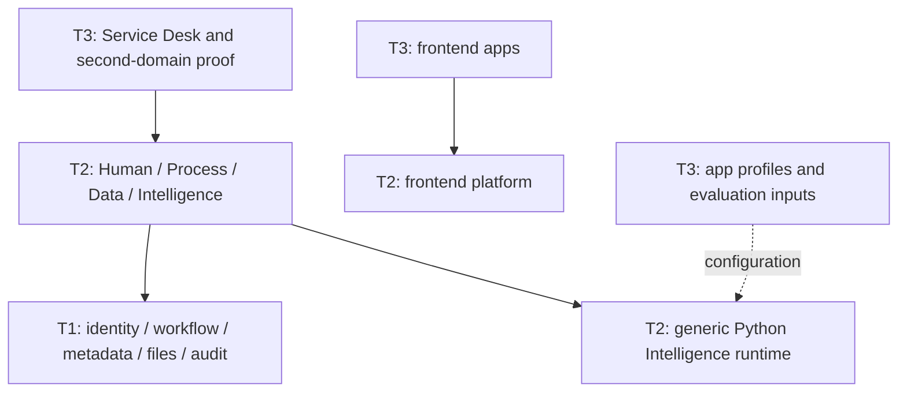

# DX-OS boundary map

The normative dependency definition is [ADR-005](ADR-005-dxos-three-tier-boundary.md).

| Area | Baseline ownership | Target ownership |
| --- | --- | --- |
| `backend/.../core/{identity,workflow,data,audit,common}` | T1 | T1; public API only across tiers |
| `backend/.../apps/servicedesk` | T3 with direct T1 dependencies | T3 -> hpdi public APIs |
| `backend/.../hpdi` | absent | T2 capabilities and adapters |
| `resources/processes/service-desk*` | shared resource directory | apps/servicedesk/process |
| approval probe policies/BPMN | Core | sample T3 contributions |
| `resources/db/migration/V1..V5` | historical global stream | immutable historical stream |
| `intelligence/src/hdpi` | Generic Python runtime | T2, no imports of `apps` or app policy |
| `intelligence/src/apps` | App profiles and authoring policy | T3, excluded from generic wheel and image context |
| historical `intelligence/profiles` | app policy bundled with runtime | intelligence/src/apps/servicedesk/intelligence/profiles |
| `fixtures/intelligence/service-desk` | authored app evaluation | T3-owned exact-byte fixtures; stable paths |
| `frontend` | reserved, no framework | strict TypeScript platform/apps, standalone build and import guard |
| `contracts/openapi/core.yaml` | T1 wire API | stable path, T1 ownership |
| `contracts/openapi/servicedesk.yaml` | T3 wire API | stable path, T3 ownership |
| `contracts/intelligence/v1` | generic AI wire API | stable path, T2 ownership |

BND-00 through BND-07 are complete on the recovery branch. The frontend
TypeScript scaffold and source layout from the reference branch are also restored.
Current runtime, bootstrap and contract behavior remain based on develop; see
[validation](REFACTOR_VALIDATION.md) and [operations](STRICT_BOUNDARY_OPERATIONS.md).
