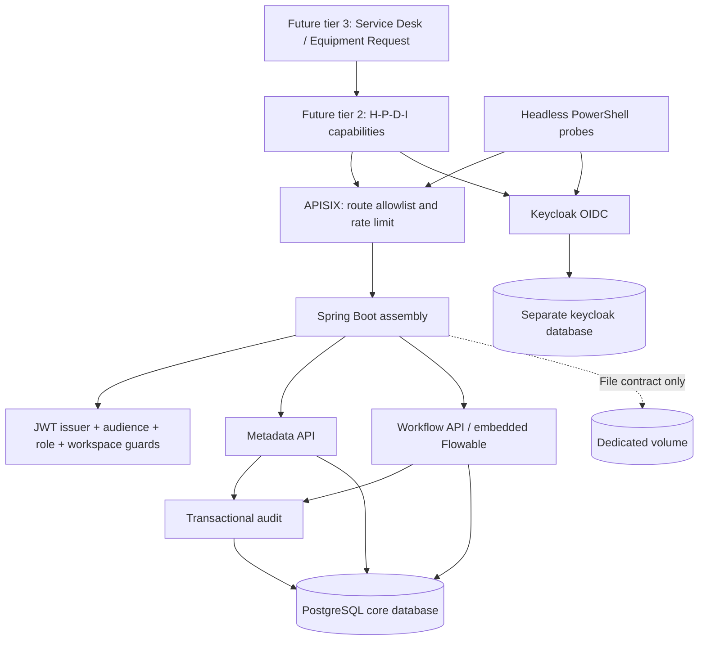

# Core architecture / ADR-001

Integration update (2026-10-15): [current runtime and authorization](core-integration.md)
supersede the probe-only implementation descriptions below. Core Acceptance remains pending.

Status: local baseline, not the full competition product. Date: 2026-10-06.

## Boundaries and ownership

- One Maven artifact under `backend/`, package modules `vn.haui.dx.core.identity`, `data`, `workflow`, `audit`; `vn.haui.dx.CoreApplication` assembles them. The `apps/`, root `frontend/` and `intelligence/` boundaries have README placeholders only, not initialized frameworks or additional Maven modules.
- Identity owns users, credentials, memberships and realm roles. Only IdP admin configuration may grant these. Core never writes IdP tables.
- APISIX standalone owns routing/rate limiting. JWT authentication and authorization are enforced by the backend, including requests bypassing the gateway inside the Docker network. Only gateway and IdP bind host loopback ports; DB/backend have no published ports.
- Metadata owns source, usage rights, version, checksum, creator and workspace. Baseline metadata is workspace-shared, immutable after creation. A checksum is a caller-declared provenance field, not proof of uploaded content.
- Workflow owns definitions, execution, task transitions and engine history. The adapter uses engine APIs only. `process_scope` belongs to Core, not to Flowable. No code imports a ticket entity, DTO or service.
- Apps will own their business tables, link `businessKey` and process ID, and call Core APIs. They must not mutate engine or IdP internals. Baseline contains no TicketService, UI, RAG or model training.
- Audit is append-only at the application API level and shares the business transaction. DB owner can still modify audit: tamper-evident storage is backlog.

## Authorization contract

Keycloak signs `sub`, `groups` and `realm_access.roles`; Spring verifies signature, expiry, issuer and `dx-core` audience. Workspace and role come from group paths `/workspaces/{workspace}/{role}` (other group strings are ignored), not from an arbitrary client header. `requester`, `agent` and `coordinator` are defaults; new roles are new Keycloak groups. `platform-admin` is a realm role without implicit workspace access. Group changes become effective on token refresh/expiry (five-minute access tokens). Immediate revocation is backlog.

| Operation | Required authorization |
| --- | --- |
| `/me` | Valid JWT |
| Metadata create | `agent` or `coordinator` in the workspace |
| Metadata read | Any role in the workspace |
| Start process | Any role in the workspace (interim until per-process starter roles) |
| Tasks/history | Any role in the workspace + process creator |
| Complete task | Task assignee (checked before the task key) + expected task key + allowed outcome; candidate steps also require a candidate group and forbid the initiator; `${initiator}` steps only the initiator |

Missing/invalid JWT: 401. Missing role/workspace: 403. Resource absent or process owned by another user: 404. Duplicate start or invalid/replayed transition: 409. Invalid body: 400. No admin bypass. Workspace and role are checked together; names such as `appId`, `resourceId`, `owner` or `initiator` cannot grant rights. Unknown JSON fields are rejected.

## Workflow and transactions

Two registered definitions are intentionally small: `document-review` has one coordinator review; `equipment-approval` has coordinator approval then agent handover. Both are probes, NOT finished business workflows. User tasks either go to workspace candidate groups `${workspace}:<role>` (claimed by someone other than the initiator) or are assigned to `${initiator}` for steps such as "requester confirms". Completion comments are stored as Flowable comments and returned in history. Delegate/cancel and a deployment API are backlog.

Input variables are deliberately bounded: `title` is caller input; `initiator` and `workspace` are server-derived. No arbitrary engine variables or client-supplied expressions. Adding definitions requires code/config review and task permission tests. The adapter remains independent of business-domain types.

`@Transactional` spans engine API calls, `process_scope`, metadata and audit on the same datasource. Unique `(workspace, process_key, business_key)` rejects duplicate starts, rolling back the second engine instance. Completion locks the Core scope row so concurrent calls serialize; the second call sees no live task and returns 409. Engine owns actual state/history, never a handwritten status enum.

Headless proof: smoke runs with no frontend at all. Reuse proof: different process keys and task counts use the same identity, gateway, workflow and audit implementation.

## File and Audit contracts

Implemented: `file_object`, `file_link` schema and dedicated Compose volume. No upload/download endpoint is registered. Planned File operations: create <=5 MiB object, link to `(resourceType,resourceId)`, read/download by UUID; server generates storage key, verifies checksum and media type, rejects traversal, and checks BOTH file access and linked-resource access. App adapters must prove linked resource authorization; raw resource IDs are not authorization. Volume permissions, atomic writes/DB compensation, content scanning and cross-workspace link prevention must be implemented before enabling these endpoints.

Implemented audit fields: UUID, actor/sub, action, resource type, resource, workspace, UTC timestamp, request ID (from `X-Request-ID` when it is a UUID, otherwise generated) and JSON `details`. Callers use `AuditService.record`, which takes actor and request ID from the current request and must run inside the caller's transaction (`Propagation.MANDATORY`). Writes occur for metadata creation, process start and task completion. `GET /workspaces/{workspace}/audit` (newest first, filters `from`/`to`/`action`/`actor`, max page size 100) is limited to the workspace's coordinators and `platform-admin`. Export, retention, failed-access logging and immutable external sink are backlog. Do not publish placeholder endpoints returning fake success.

## Deployment limits

Local HTTP only; Keycloak start-dev and probe password grant are confined to loopback. Future browser clients must use Authorization Code + PKCE, not the probe client. Production needs TLS, separate DB roles, fixed image digests, vulnerability remediation, backup/restore tests and a controlled Flowable schema-upgrade procedure. Baseline uses Flyway for owned tables and Flowable's native auto-schema initialization for engine tables.

Component versions deliberately follow Flowable 7.1.0's upstream Boot 3.3.4 baseline. This verifies compatibility, NOT security currency or support in October 2026. Upgrade and vulnerability review are a release gate, not permission to expose this baseline publicly.
