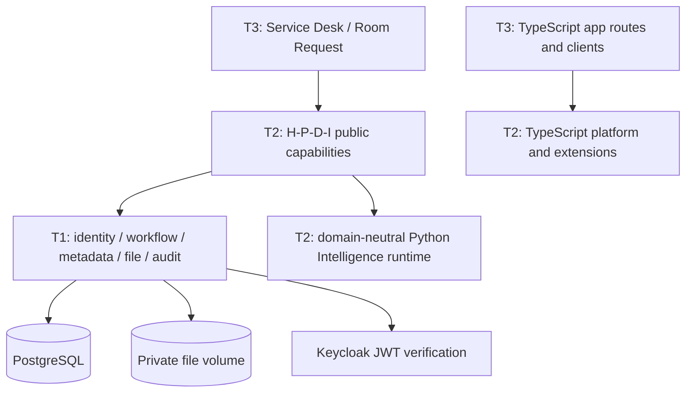

# DX-OS runtime architecture

Current boundary definition: [ADR-005](architecture/ADR-005-dxos-three-tier-boundary.md).
This page supersedes the initial ADR-001 probe-only topology. The backend remains
one modular Spring Boot artifact; extraction does not require microservices.

| Tier | Production ownership | Public boundary |
| --- | --- | --- |
| T1 | `core.identity/workflow/data/audit/common` | technical `api` contracts and approved common primitives |
| T2 | `hpdi.human` | HumanContext, Actor, ActivityJournal |
| T2 | `hpdi.process` | ProcessCapability, WorkInbox, ProcessTimeline, ProcessObservations, ProcessContribution |
| T2 | `hpdi.data` | KnowledgeCatalog and AuthorizedKnowledge |
| T2 | `hpdi.intelligence` / `hdpi_intelligence` | trusted triage, authorized search/citation services, private adapter |
| T3 | `apps.servicedesk`, `apps.roomrequest`, `apps.samples` | business APIs, rules, entities, app SQL, BPMN and profiles |

Core has no upper-tier dependencies. H-P-D-I depends only on Core public APIs
and approved common technical primitives. Apps depend only on public H-P-D-I
contracts. ArchUnit and cross-language source guards enforce these rules without
waivers. Only Core workflow internals import Flowable. Test fixtures may inspect
internal state to prove transactions, isolation and migration compatibility.

## Authorization and transaction behavior

Keycloak signs subject and workspace memberships; Core verifies issuer, audience,
signature and expiry. HumanContext derives a trusted workspace Actor from that
verified identity. Domain code never decodes JWTs. Realm platform-admin grants
no implicit workspace access. A path/header/body cannot grant workspace rights.

Service Desk keeps its requester/agent/coordinator visibility policy. Its create
transaction spans ProcessCapability start, app-owned ticket persistence and
ActivityJournal recording on the same datasource. Core audit still requires an
active transaction and supplies actor/request correlation. The journal additionally
validates event names and safe reference-only details. No ticket content is logged.
Duplicate submission, workflow failure or audit failure rolls back all writes.

Statistics read app-owned process links in bounded keyset batches and request
authorized technical snapshots through H-P-D-I. One REPEATABLE_READ transaction
preserves the population and state snapshot. Only the Core adapter reads engine
tables. Ticket state classification remains application policy; missing, cancelled,
suspended or mismatched state stays unclassified. No stored duplicate ticket status.

KnowledgeCatalog composes Human membership, metadata/file authorization, workspace
binding and exact-byte checksum checks. Python authorized search retains its
auth-before-scoring, immutable state validation and Core citation re-resolution.

## Resources and compatibility

Apps own `resources/apps/<app>/process/*.bpmn20.xml`. ProcessContribution maps
reviewed app policy into the technical engine registration. Core owns no domain
process keys. Content-aware deployment compares exact deployed resource bytes,
so ownership-path changes preserve definition IDs and running instances. Changed
definitions retain the explicit version/migration checks; no instance is rewritten.

Historical Flyway V1-V5 remain byte-identical in the global stream. New V6 lives
under `db/migration/apps/roomrequest`; the default recursive scan preserves one
deterministic version order. Apps have no foreign keys to engine internals. The
`core-only` and `second-domain` Maven profiles select resources for fresh disposable
proof databases; they are not upgrade profiles for an existing shared database.

Existing Core and Service Desk REST routes remain available. Core routes serve
technical clients and acceptance probes. Application/HPDI code does not bypass
its Java capability boundaries. Tier-2 projections are at `/api/hpdi/v1`, with
[their own shared contract](../contracts/hpdi/openapi.yaml). Service Desk retains
its established specification path and now references H-P-D-I schemas.

## Intelligence and frontend

The generic wheel contains runtime code and shared schemas, without app profiles.
Registries require an explicit root/provider configuration; there is no app fallback.
Service Desk and Room Request own distinct profiles. Evaluators receive fixture
locations, runtime pins and evaluation gates as configuration. Historical authored
fixtures retain their exact bytes and provenance; they are not runtime citations.

The optional [private Java/Python adapter](../intelligence/docs/architecture/private-adapter.md)
derives context before invoking AI, uses a separate service credential, bounds
requests and applies timeout/fallback policy. Operational unavailability is explicit
DEGRADED; authentication, contract and workspace ambiguity fail closed. The private
endpoint is not published to a host port. Core runs without that optional service.

Frontend source and tests use strict TypeScript. Platform owns shared clients and
an extension registry; apps own routes, API clients and rendering slots. Routes,
menus, dashboard sources, renderers and process business-key resolvers register at
the composition root. ESLint and source guards block reverse imports. This is a
structural scaffold; rendered UI remains outside ARC-07.

## Executable evidence

Run `scripts/test-file.ps1` for full PostgreSQL regression, `-MavenProfile core-only`
for standalone Core and the command in [Room Request](../apps/roomrequest/README.md)
for H-P-D-I reuse without Service Desk. The proof jar excludes the disabled tiers.
See [validation record](architecture/REFACTOR_VALIDATION.md) for actual results and
the distinction between local execution and remote CI/review gates.
